## What the engine does


Dashed boxes are planned and not yet supported.

The graph query engine is a multi-pass compiler. It turns a JSON Query DSL or
GQL query into one parameterized SQL statement over the ontology's node and
edge tables. Every statement it emits is bounded, carries a traversal-path
predicate on every namespaced read, and resolves each row to its latest
version. ClickHouse is the production backend. The same passes target DuckDB
for the local graph schema and the code-graph test suites.

The engine compiles four query types. Each row shows a GQL query and the core
of the SQL that it produces.

> [!note]
> These SQL fragments show only the core of each query.
> The full SQL also has authorization filters, page limits, and query settings.

<!-- markdownlint-disable MD044 -->

| Query type | Example (GQL) | Meaning | SQL output fragment |
| --- | --- | --- | --- |
| **Traversal** | <pre><code class="language-cypher">MATCH (u:User)-[:AUTHORED]-&gt;(mr:MergeRequest {state: 'merged'})&#10;RETURN u.username, mr.title</code></pre> | Merged merge requests and the users who wrote them | <pre><code class="language-sql">FROM gl_edge AS e JOIN gl_merge_request AS mr ON mr.id = e.target_id&#10;WHERE e.relationship_kind = ? AND mr.state = ?</code></pre> |
| **Aggregation** | <pre><code class="language-cypher">MATCH (mr:MergeRequest)-[:IN_PROJECT]-&gt;(p:Project {id: 278964})&#10;RETURN mr.state, count(mr) AS mrs</code></pre> | How many merge requests one project has in each state | <pre><code class="language-sql">SELECT mr.state, COUNT(mr.id) AS mrs ... GROUP BY mr.state</code></pre> |
| **Path finding** | <pre><code class="language-cypher">MATCH path = ANY SHORTEST&#10;  (g:Group {id: 9970})-[:CONTAINS*1..2]-&gt;(p:Project {id: 278964})&#10;RETURN path</code></pre> | The shortest path from a group to a project | <pre><code class="language-sql">WITH forward AS (...), backward AS (...)&#10;SELECT ... FROM forward JOIN backward ON ...</code></pre> |
| **Neighbors** | <pre><code class="language-cypher">MATCH (mr:MergeRequest {id: 42})--(n)&#10;RETURN n</code></pre> | Everything directly connected to one merge request, in either direction | <pre><code class="language-sql">SELECT ... FROM gl_edge WHERE source_id = ?&#10;UNION ALL&#10;SELECT ... FROM gl_edge WHERE target_id = ?</code></pre> |

<!-- markdownlint-enable MD044 -->

## How it works

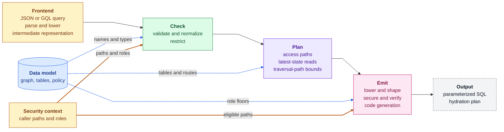

The engine compiles in passes, and each pass has one job. A pass declares the
state it reads and the state it writes. That state is the IR, the query plan,
the SQL AST, the result context, or the hydration plan. A macro turns those
declarations into a typed context for each pipeline, so a pass sees only the
state it declared. A pass that needs state an earlier pass hasn't produced
fails with an invariant error, never on partial input.

A pipeline is an ordered list of passes for one frontend and one backend. The
JSON and GQL pipelines for ClickHouse share every pass after their frontend.
The hydration pipeline reuses the remote passes, minus parsing, pagination,
and hydration planning. The DuckDB pipelines reuse the frontends,
normalization, lowering, pagination, and the result contract. They swap in a
DuckDB planner and code generator, and drop restriction, bounds, and security,
because a local graph has a single user.

Every pass reads one immutable data model for the active schema version. The
model is the only source of table names, columns, edge routes, and
authorization rules. No identifier from the query reaches SQL unless the model
resolves it. Each request compiles against the schema snapshot that was active
when it started, so a schema switch never changes a query mid-compilation.

The output is one SQL statement with bound parameters, plus a plan for the
hydration statement.

Every statement that the engine emits has these guarantees:

| Guarantee | Meaning |
| --- | --- |
| **Parameterized SQL** | Values are bound parameters, and names must match the ontology. |
| **Fail-closed authorization** | Every namespaced read has an authorization filter, or the query is rejected. |
| **Bounded queries** | Hard limits on query shape, result size, time, and memory. |
| **Current state** | Every read sees the latest version of each row. |
| **Stable results** | The plan changes how data is read, never what is returned. |
| **Read-only access** | The webserver can only run `SELECT`. |

## Walkthrough: GQL query to secure SQL

The steps below follow one GQL query through the remote ClickHouse pipeline,
from the data model it compiles against to the statement that ClickHouse runs.

Each step's diagram traces this query through that step, and the italic text
in each box shows what happens to it. The colors mean the same thing in every
step. Green is a compiler pass, and purple is the query as it moves between
passes. Amber comes from the caller, blue is the data model, and gray is
outside the compiled statement.

```gql orbit-query
MATCH (u:User)-[:AUTHORED]->(mr:MergeRequest {state: 'merged'})
RETURN u.username, mr.title
```

### 1. The query data model

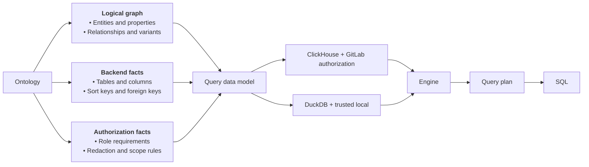

The server builds one data model each time it loads a schema version. The
model combines three parts. The graph catalog holds entities, properties,
relationships, and relationship variants under typed IDs. The layout pairs the
physical schema with a mapping from graph identities to tables, columns, sort
keys, foreign keys, variant routes, and sorted copies. The policy holds role
floors, redaction metadata, and admin-only and hidden fields. Passes only read
the model. Schema management derives the same physical schema for DDL,
migrations, and cleanup, so the queries and the stored data cannot drift
apart.

### 2. Intermediate representation

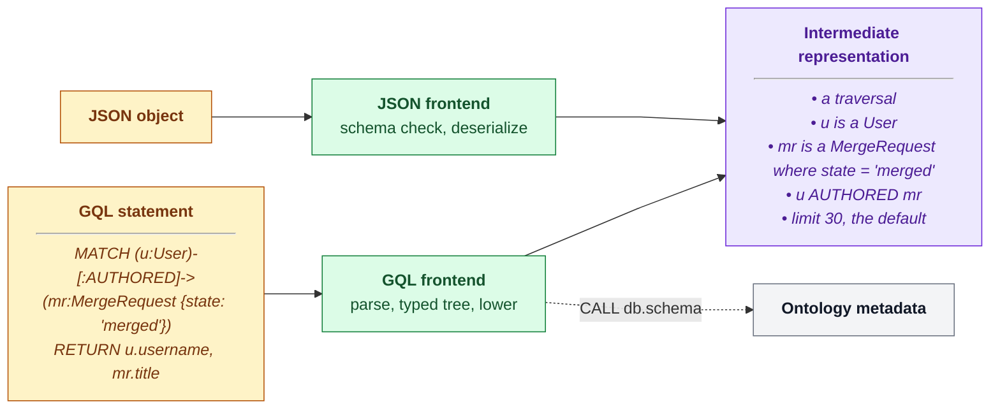

Every pass after the frontend works on one intermediate representation (IR):
the language-neutral compiler input. It holds node selectors, relationship
selectors, filters, aggregations, ordering, and limits. Each query language
has one frontend that produces the IR, and that frontend is the first pass of
its pipelines. The JSON frontend validates the payload against the base and
ontology-derived JSON schemas, then deserializes it. The GQL frontend parses
against an openCypher 9 grammar and builds a typed syntax tree. Lowering then
applies statement-wide checks: one connected pattern, unique variables, and an
inferred query type. Both produce the same IR, so no later pass knows which
language the query came from.

The GQL frontend also answers schema calls. The server parses a statement once
and routes on the result. A `MATCH` statement continues into the compiler, and
`CALL db.schema()` returns ontology metadata without running any further pass.
The [query languages](query-languages.md) page covers both frontends in
detail.

### 3. Validation and normalization

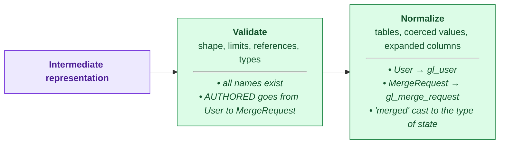

Validation checks the input's shape and bounds, resolves every reference
against the data model, and checks that filter values fit their property
types. Normalization resolves entities to tables, coerces filter values, and
expands wildcard projections. It also puts predicates in a canonical order, so
equal queries produce byte-identical SQL and parameters.

### 4. Restriction


Restriction is the first pass that reads the security context. It rejects
queries on entities whose role floor the caller meets on no authorized path.
It strips admin-only columns, and rejects filters, sorts, and aggregates on
admin-only fields. It checks explicit traversal-path filters against the
authorized set. It also rejects aggregations in which no traversal-path-scoped
node is reachable, because aggregates bypass row-level redaction.

### 5. Planning and latest-state reads

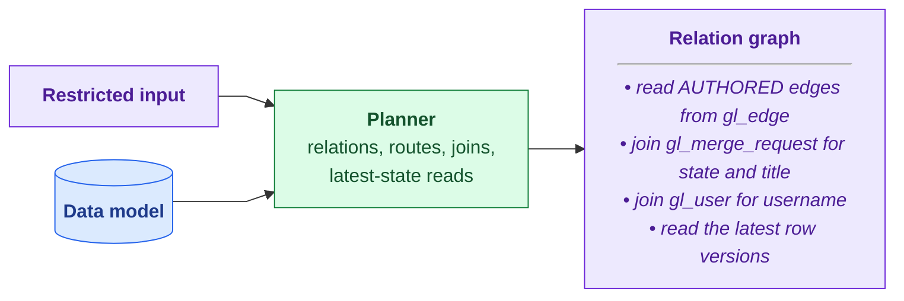

The planner builds a relation graph, with one relation per relationship
occurrence, joined through shared node bindings. Reads are edge-first. A node
table is joined only for node data that the query consumes: a filter, a
projection, a group key, or a sort key. Variant routing picks the edge table
for each relationship kind and endpoint pair. A relationship that spans
several tables becomes a `UNION ALL` with a uniform column set. Selective
chains pass distinct-endpoint frontiers from hop to hop, and path finding runs
a bidirectional frontier search. Foreign-key relationships join node to node
with no edge read. A relation that is referenced more than once becomes a CTE,
unless it is a point lookup. Planning changes access paths, never results.

Node and edge tables are `ReplacingMergeTree(_version, _deleted)`, so a read
must resolve each key to its latest version. The default is `FINAL`, a
streaming merge with bounded memory. For exact IDs, narrow ranges, frontiers,
and filters that the ontology marks as selective, the planner uses a two-step
read instead. It finds candidate keys without `FINAL`, then reads every
version of only those keys, and keeps the latest with `LIMIT 1 BY` on the
replacement key. Filters on sort-key and immutable columns run before the
pick, because tombstones carry those columns. Filters on mutable columns, and
`_deleted = false`, run after it.

### 6. Traversal-path bounds

A traversal-path bound limits a read to one namespace when the query names
that namespace. It is an extra `startsWith` filter on top of the authorization
filter, and it lets ClickHouse skip most of the table.

The example query names no project or group, so it gets no bound, and it reads
every namespace that the caller can see. Here is the same query pinned to one
project:

```gql orbit-query
MATCH (u:User)-[:AUTHORED]->(mr:MergeRequest {state: 'merged'})-[:IN_PROJECT]->(p:Project {id: 278964})
RETURN u.username, mr.title
```

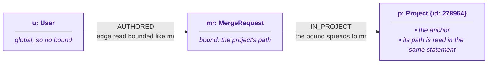

The project has a known ID, so it is the anchor. The engine reads the
project's current path in a subquery of the same statement, so a moved project
is bounded by its new path. `IN_PROJECT` keeps a merge request in its
project's namespace, so the bound spreads to `mr`. `AUTHORED` edges are stored
with their merge request, so the edge read gets the same bound. `User` is
global and has no path, so `u` gets no bound.

Some relationships, like `CLOSES`, can cross namespaces. A bound never spreads
across them, and never from a child namespace up to its parent. A bound only
narrows a read, and the authorization filter still applies.

### 7. Lowering and result shaping

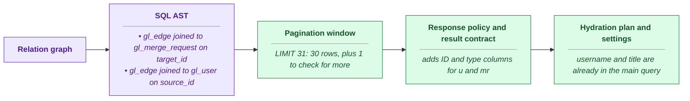

Lowering turns the plan into a SQL AST with physical result bindings, and
attaches the bounds to the reads they own. Pagination sets a limit of the page
size plus one probe row, lowers `SKIP` to an `OFFSET`, and adds tie-breakers
so that windows are stable. The response policy caps large text projections so
that a page fits within the Workhorse gRPC message limit. The result contract
adds redaction ID and type columns for every returned node and edge, and
records the result context that redaction and formatting read. The pass also
builds the hydration plan and resolves the ClickHouse settings for the query
type.

### 8. Security, verification, and code generation

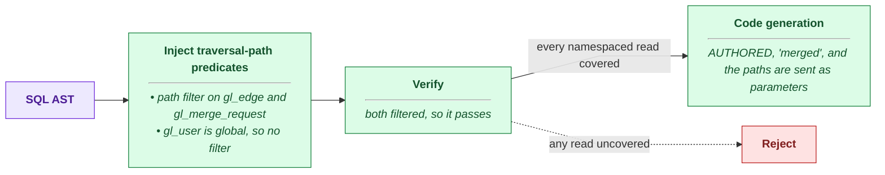

Security runs on the finished AST, after every pass that can add a read. It
adds `startsWith(traversal_path, ?)` to every namespaced node and edge alias,
using only the paths where the caller meets the entity's role floor. With no
eligible path, the predicate is a constant false. Verification then walks the
final AST, and rejects the statement if any namespaced alias lacks a
role-eligible predicate or a fail-closed false. Code generation renders the
AST in the backend's dialect with bound parameters. The AST has a closed
function vocabulary, and a backend rejects any operation it can't express.

## When things go wrong

- **An unresolved reference.** Validation rejects the query before planning.
- **A namespaced read without a predicate.** Verification rejects the
  statement. It never reaches ClickHouse.
- **An anchor that isn't indexed or is deleted.** The bound subquery returns a
  sentinel path, and the read falls back to the authorization predicate alone.
- **Too many anchors.** Past eight anchors on one node, the node keeps only
  its authorization predicate.
- **An operation the backend can't express,** such as token search on DuckDB.
  Code generation rejects it, and never substitutes an approximation.
- **An invariant violation between passes.** The pipeline returns an internal
  error, not degraded SQL.

## Why we built it this way

Declaring each pass's state makes ordering explicit, and stops one pass from
reading state that another hasn't produced yet. Pipelines can then reuse runs
of passes. Hydration and local compilation share the remote passes instead of
copying them, and running security last guarantees that verification sees the
final AST.

`FINAL` stays the default for latest-state reads. An `argMax` aggregation over
IDs can be faster on small results, but its memory grows with result
cardinality, which is unknown at compile time. On settled parts, `FINAL` was
as fast or faster in every measured case, with bounded memory. A slow `FINAL`
points to part fragmentation, and the fix belongs in storage.

Bounds resolve the anchor path inside the statement, not in a lookup before
it. That avoids a cache and its staleness window, and production `EXPLAIN`
output shows the same granule pruning as a literal prefix.

## Decisions

- [ADR 000: ClickHouse as graph storage](../adr/000_clickhouse_graph_storage.md)
- [ADR 016: Column statistics for join ordering](../adr/016_column_statistics_for_join_ordering.md)

## Appendix

### Phase map

Each step in the walkthrough maps to one or more engine phases.

| Theme | Component | What it does | Query Engine Phases |
| --- | --- | --- | --- |
| Data | [Query data model](#query-data-model) | The engine's read-only view of one schema version: the graph, the ClickHouse tables that store it, and its authorization rules | None |
| Data | [Storage model](#storage-model) | Node tables, edge tables, and row versions in ClickHouse, inside the query data model | None |
| Structure | [Pipelines](#pipelines) | Ordered lists of phases, built from reusable segments, one per frontend and backend | All |
| Querying | [Frontends](query-languages.md) | Parse GQL or JSON into the shared input, in their own doc | `gql_parse`, `json_dsl_parse` |
| Querying | [Validation](#phases) | Rejects bad queries early, then normalizes names and types | `validate`, `validate_relationships`, `normalize` |
| Querying | [Restriction](#phases) | Applies the caller's field access, and rejects queries that would skip redaction | `restrict` |
| Querying | [Planning](#phases) | Picks how to read each node and relationship | `plan` |
| Querying | [Current-state reads](#phases) | Makes sure every read sees the latest version of each row | `plan` |
| Querying | [Scope bounds](#phases) | Narrows each read to the namespaces that the query's anchors live in | `tp_bounds` |
| Querying | [Lowering](#phases) | Turns the plan into a SQL syntax tree | `lower` |
| Querying | [Pagination](#phases) | Pages through results without keeping state between requests | `paginate` |
| Querying | [Result shape](#phases) | Caps large values, and adds the columns that redaction needs | `response_policy`, `result_contract` |
| Querying | [Hydration](#phases) | Plans a second, small query for the properties the main query didn't fetch | `hydrate_plan` |
| Querying | [Settings](#phases) | Picks time and memory limits for each query type | `settings` |
| Querying | [Authorization](#phases) | Adds authorization filters, then proves that every read has one | `security`, `security_check` |
| Querying | [Code generation](#phases) | Renders the SQL tree as SQL for one backend | `codegen`, `duckdb_codegen` |

---

### System diagram

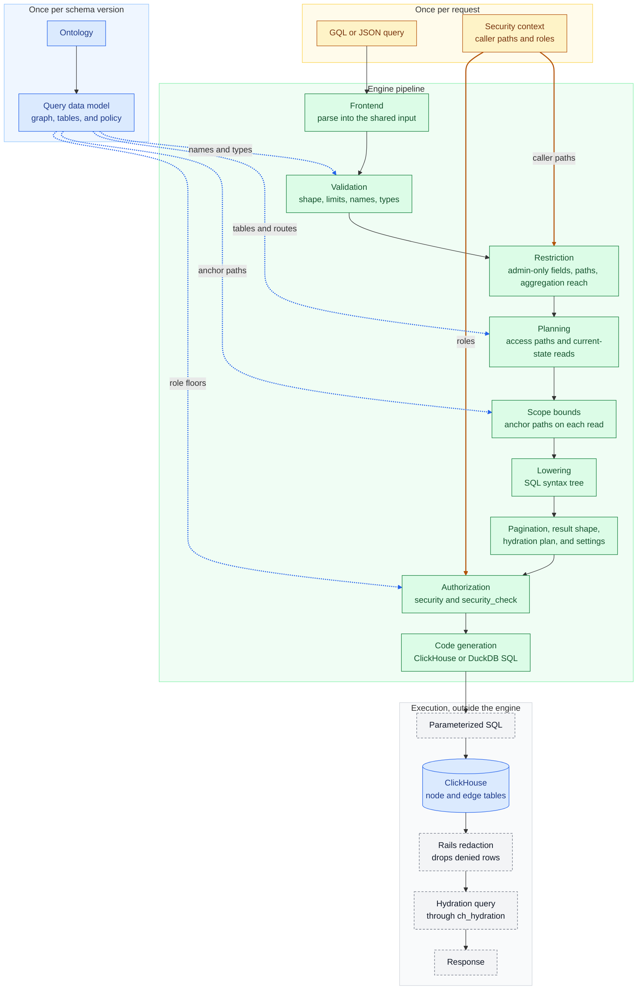

### Query data model

The query engine never reads the ontology directly.
Instead, each schema version of Orbit derives one immutable query data model from its ontology, and every engine phase reads from that model.

The model splits the ontology into three kinds of facts:

- The **logical graph**: entities, properties, relationships, and relationship variants.
  A variant is one relationship between one pair of entity types, like `(User)-[:AUTHORED]->(MergeRequest)`.
- The **backend facts**: the ClickHouse tables, columns, sort keys, and foreign keys, and which edge table each relationship variant lives in.
- The **authorization facts**: role requirements, redaction rules, and scope rules.

The [first walkthrough step](#1-the-query-data-model) shows how these facts combine into one model per backend.

<details>
<summary><b>How a model is put together</b>: the graph catalog, the layout, and the policy</summary>

Every model has the same three parts, and each part can be swapped on its own:

- The **graph catalog** describes the logical graph.
  It is shared by every backend.
- The **layout** pairs a physical schema with a mapping.
  The schema describes the tables a backend actually has.
  The mapping connects each graph identity, like an entity or a property, to the table and column that stores it.
- The **policy** decides what a caller may see.

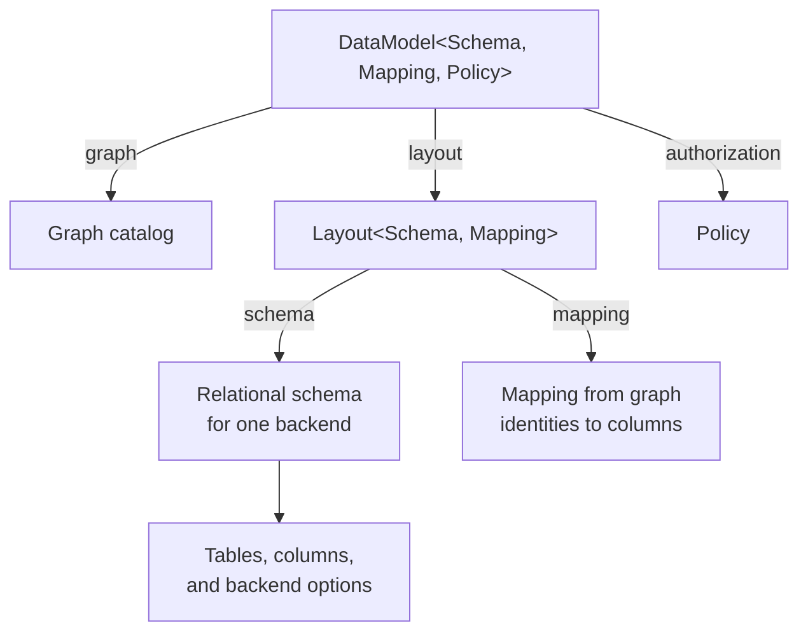

The model builds its mapping from the graph and the schema it is given, so a mapping can never be paired with the wrong schema.
A missing property in the mapping means that the backend cannot supply it.

Orbit has two models:

| Model | Schema | Policy | Used by |
| --- | --- | --- | --- |
| `ClickHouseDataModel` | ClickHouse tables, engines, indexes, and views | GitLab authorization | Orbit Remote |
| `DuckDbDataModel` | The local DuckDB tables | Trusted local, since a local graph has one user | The local graph schema and the code-graph test suites |

A new backend, like a document store, supplies its own schema and mapping.
It does not have to look relational, and the graph catalog stays the same.

</details>

<details>
<summary><b>Data model consumers</b>: the query server, the engine phases, and schema management</summary>

The query server builds one ClickHouse data model when it loads a schema version.
It keeps the model next to the ontology and the named queries for that version.
The compilation and hydration stages pass it to the engine, and every phase reads it as read-only input.

Each phase asks the model different questions:

| Phase | Asks the data model |
| --- | --- |
| `validate`, `normalize` | Does this entity, property, or relationship exist? Is the property filterable or text-indexed? Which foreign key links these nodes? |
| `restrict` | Is this property admin-only? Does this entity have a traversal path? |
| `plan` | Which table stores this entity, and which edge tables does this relationship route to? Is there a foreign key, a sort key, or a sorted copy? Is the property mutable or selective? |
| `tp_bounds` | Which table and column hold an anchor's traversal path? Which foreign keys point at an anchor? Does this relationship variant stay in one namespace? |
| `lower` | Is this column in the table's sort key? |
| `result_contract` | Which column identifies each entity for redaction, and which authorization rules apply to it? |
| `security`, `security_check` | Which columns hold a traversal path, and what role floor does each table need? |
| `hydrate_plan` | Which table stores each entity, and which properties are virtual, hidden, or admin-only? |

Schema management doesn't need the mapping or the policy.
It derives only the physical ClickHouse schema from the same ontology.
DDL, view lifecycle, migration scope, and the indexer's table cleanup all read that schema, so they can't drift from what the engine queries.

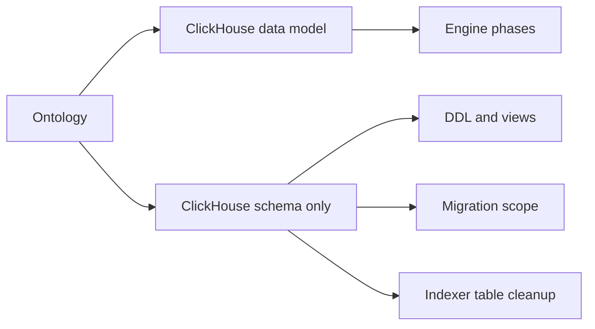

The DuckDB data model follows the same path for local compilation and the code-graph test suites.

</details>

The code lives in `crates/query-data-model/`.

#### Storage model

The storage model is the physical schema inside the data model's layout.
The ontology defines every table, sort key, and index in it.

- Each entity has its own node table.
  Namespaced tables lead their sort key with the traversal path, so authorization filters prune the primary index.
- Relationships share edge tables.
  The ontology routes each relationship to a table, with `gl_edge` as the default.
  Edge tables sort by traversal path, relationship kind, and source, so one-hop lookups read a narrow range.
- Every row has a version and a deleted flag.
  The indexer appends new versions, and ClickHouse merges old ones away in the background.
- The ontology can declare a denormalized join: a pre-joined chain of tables that answers several hops in one scan.
  Every table in the chain keeps its own traversal path, and each one is filtered on its own.

This diagram shows how ClickHouse stores one relationship, `(User)-[:AUTHORED]->(MergeRequest)`.
`PK` marks the primary key columns.
`gl_ci_edge` and `gl_sec_edge` have the same columns.
`gl_code_edge` adds `project_id` and `branch` to its sort key, so code queries can pin one project and branch.

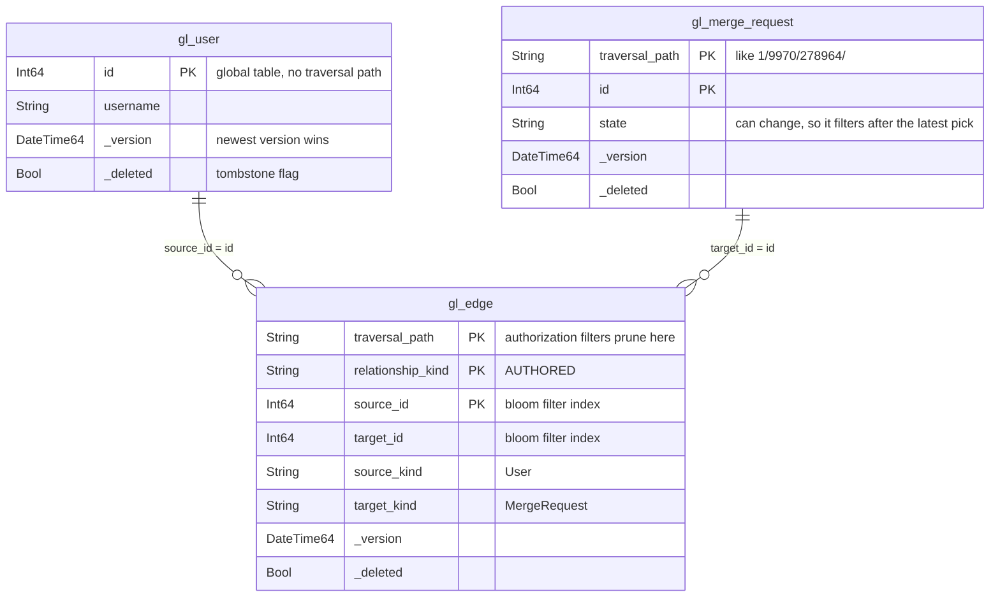

[Data model](data-model.md) describes the entities and relationships.
[Schema management](schema-evolution.md) describes how tables change between versions.

### Pipelines

A pipeline is a list of compiler phases that executes in order.
`crates/query-engine/compiler/src/config.rs` declares every phase, the state it reads and writes, and every pipeline that uses it.
Because each phase declares its inputs and outputs, the same run of phases can show up in several pipelines.

A segment is a run of phases that several pipelines share:

| Segment | Phases |
| --- | --- |
| GQL front | `gql_parse` → `validate` → `validate_relationships` → `normalize` |
| JSON front | `json_dsl_parse` → `validate` → `normalize` |
| Remote plan | `restrict` → `plan` → `tp_bounds` → `lower` |
| Result shape | `response_policy` → `result_contract` |
| Remote finish | `settings` → `security` → `security_check` → `codegen` |
| Local tail | `plan` → `lower` → `paginate` → `result_contract` → `duckdb_codegen` |

This diagram shows how each pipeline combines segments.
Boxes with the same color are the same segment:

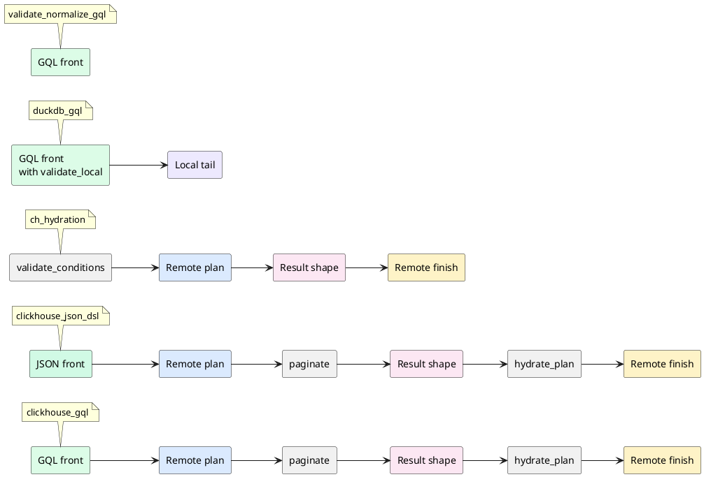

Segment reuse has these effects:

- **Both remote languages share everything after parsing.** `clickhouse_gql` and `clickhouse_json_dsl` differ only in their front segment.
- **Hydration reuses the remote segments.** It starts from an input the server builds, so it skips parsing, pagination, and hydration planning.
  It still runs the same restrict, plan, scope, and security phases, so hydration queries can't bypass authorization.
- **Security runs last.** Every phase that changes the SQL tree runs before `security` and `security_check`.
  The check sees the final tree, so no later phase can add an unfiltered read.
- **Local queries reuse the front.** The DuckDB pipelines parse and normalize the same way.
  Then they swap in a local tail with no restriction, scope, or security phases, because a local graph has a single user.
- **A front segment can run alone.** When a new schema version loads, the server runs every named query through `validate_normalize_gql` and `validate_normalize`, to prove each one still fits the new ontology.

| Pipeline | Frontend | Backend | Used by |
| --- | --- | --- | --- |
| `clickhouse_gql` | GQL | ClickHouse | Orbit Remote |
| `clickhouse_json_dsl` | JSON Query DSL | ClickHouse | Orbit Remote |
| `ch_hydration` | None | ClickHouse | Hydration queries |
| `duckdb_gql`, `duckdb_json_dsl` | Either | DuckDB | The local graph schema and the code-graph test suites |
| `validate_normalize_gql`, `validate_normalize` | Either | None | Named-query checks when a schema version loads |

### Phases

A query runs through these phases in order.
Expand a phase to see how it works.

<details>
<summary><b>Validation</b>: rejects invalid queries before planning starts</summary>

Validation is the first phase after parsing.
It rejects an invalid query before planning starts.
Each check rejects a different kind of mistake, and every rejection is a client-safe error.

```plantuml
@startuml
left to right direction
skinparam componentStyle rectangle
component "Query text" as text
component "Parse" as parse
component "Shape and\nlimits" as shape
component "Ontology names\nand types" as names
component "Relationship\ndirection" as direction
component "Normalize" as normalize
component "Shared input" as input
text --> parse
parse --> shape
shape --> names
names --> direction
direction --> normalize
normalize --> input

note bottom of parse
  MATCH (u:User RETURN u
  rejected: unexpected token,
  line 1, column 15
end note

note bottom of shape
  -[:CONTAINS*1..5]->
  rejected: hops cap at 3
end note

note bottom of names
  MATCH (mr:MergeRequest)
  RETURN mr.titel
  rejected: unknown property
end note

note bottom of direction
  (mr:MergeRequest)-[:AUTHORED]->(u:User)
  rejected: AUTHORED goes
  from User to MergeRequest
end note

note bottom of normalize
  MergeRequest becomes gl_merge_request,
  '42' becomes 42,
  columns * becomes a list
end note
@enduml
```

Validation checks these categories:

- **Syntax.** GQL must match the grammar.
  JSON must match the JSON schema.
  Syntax errors report the line and column, and never echo the query text.
- **Shape.** A query has one to five nodes.
  A traversal has exactly one fewer relationship than nodes.
  A GQL pattern must be one connected tree with unique variables and no cycles.
- **Limits.** Hops and path depth cap at 3.
  `LIMIT` caps at 1,000, and `SKIP` at 10,000.
  A query has at most 16 predicates, 500 node IDs per node, 100 values per `IN` list, and 10 relationship types.
  GQL text caps at 32 KiB and 32 levels of nesting.
- **Ontology names.** Every entity, relationship, and property must exist, and each property must belong to its entity.
- **Types.** Filter values must match the property type.
  `sum` and `avg` need numeric properties.
  Group keys must be stored, filterable properties, and date buckets need date properties.
- **Relationship direction.** In GQL, a typed relationship between two labeled nodes must match the ontology.
  A reversed arrow is rejected with a hint that names the right direction.
- **Normalization.** Once a query is valid, `normalize` resolves entity names to tables, coerces filter values to their property types, and expands wildcard columns.
  It also orders filters into stable predicate lists, so the same query always produces the same SQL.

The limits live as Rust constants, and a build script checks that the JSON schema states the same ones.
The [query language reference](../../../docs-gitlab-com/remote/queries/query-language.md#validation-limits) lists them all.

</details>

<details>
<summary><b>Restriction</b>: applies the caller's field access, and rejects queries that would skip redaction</summary>

Restriction is the first phase that reads the caller's security context: their organization, plus each traversal path they can read and their role on it.

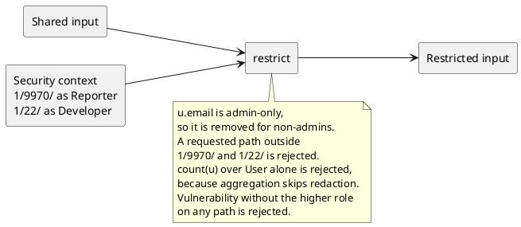

Restriction does four things:

- It rejects a query on an entity that needs a higher role, like vulnerabilities, when the caller holds that role on no path.
- It removes admin-only properties, like `User.email`, from the returned columns, unless the caller is an admin.
  A filter, a sort, or an aggregation on an admin-only property fails instead.
- It rejects any traversal path filter the caller asks for that isn't inside their authorized paths.
- It rejects an aggregation that no namespaced node can reach.
  Aggregations return counts, not rows, so Rails redaction can't check them.
  At least one node in the pattern must carry a traversal path, like a group, project, or note.

</details>

<details>
<summary><b>Planning</b>: picks how to read each node and relationship</summary>

The planner decides how to read each node and relationship.
It works from facts in the query data model, not from the shape of the query text.

The planner uses these strategies, among others.

**Read edges first, and join nodes only when needed.** Edge tables already hold both endpoint IDs, so a query that only needs IDs never touches a node table.

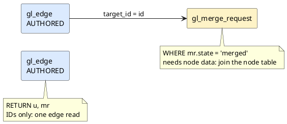

**Union the edge tables a relationship lives in.** The ontology can route each relationship variant to its own edge table.
When a query's relationship spans more than one table, every table becomes one arm of a `UNION ALL`, and every arm returns the same columns.

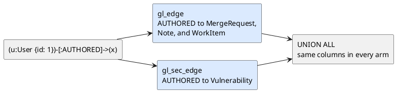

**Narrow a chain as it goes.** In a selective chain, the distinct endpoints of one hop bound the scan of the next hop.

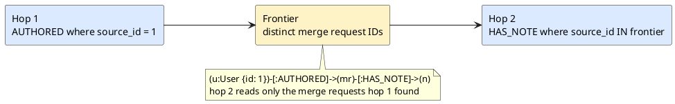

The full set of planning decisions:

- **Relations.** Each relationship in the query becomes one relation.
  Shared nodes connect the relations into a chain or a branch.
- **Node joins.** The planner joins a node table only for node data: a filter, a returned property, a group key, or a sort key.
- **Edge filters.** A node filter can run on the edge row itself when every selected relationship variant carries that property.
- **Routing.** Each relationship variant reads the edge table the ontology routes it to.
  A relationship that spans several tables becomes a union.
- **Foreign keys.** A relationship stored as a foreign key joins node to node on that column, with no edge table.
- **Direction.** A reverse hop filters on the target column, which has its own index.
  It can also read a sorted copy of the table when the ontology declares one.
- **Frontiers.** Selective chains narrow hop by hop, and path finding searches from both ends at once.
- **Reuse.** A relation used more than once becomes a CTE.
  A relation that is only a point lookup, like one ID, is cheaper to repeat inline.
- **Aggregations.** Filters run before grouping, and groups run on the smallest set of rows possible.
  A property group keeps its node table-backed, so security and current-row checks run before the aggregate.
- **Current state.** The planner picks `FINAL` or a selective current-row read for each relation.
  The current-state reads entry below explains the choice.
- **Hydration.** The planner decides which properties the main query returns, and which ones hydration fetches later.

The planner may change how a query reads data, but never what it returns.
Plan-shape fixtures pin these choices for the common query shapes.
A planner change that picks a different plan for one of them fails a test.

</details>

<details>
<summary><b>Current-state reads</b>: makes every read see the latest version of each row</summary>

Node and edge tables keep several versions of a row until ClickHouse merges them.
A correct query has to ask "does the current version match?", not "did any version ever match?".
Those two questions give different answers for any column that can change back.

```plantuml
@startuml
left to right direction
skinparam componentStyle rectangle
component "Job 1001, version 1\nstatus: failed" as v1
component "Job 1001, version 2\nstatus: success (latest)" as v2 #DCFCE7
v1 --> v2 : retried
note bottom of v1
  any version matches status = 'failed':
  wrongly counted as failed
end note
note bottom of v2
  current version checked:
  correctly not counted
end note
@enduml
```

The engine reads current state in one of two ways:

```plantuml
@startuml
left to right direction
skinparam componentStyle rectangle
component "FINAL\nstream-merge sorted parts" as final #DBEAFE
component "Latest version\nof every row" as final_rows
final --> final_rows
note bottom of final
  the default
  memory stays bounded
end note

component "1. Find candidate keys\nwithout FINAL" as candidates #FEF3C7
component "2. Read every version\nof those keys only" as versions #FEF3C7
component "3. Keep the latest,\nthen filter again" as latest #FEF3C7
candidates --> versions
versions --> latest
note bottom of candidates
  selective reads only:
  exact IDs, narrow ranges,
  frontiers, selective filters
end note
@enduml
```

Where a filter runs depends on whether its column can change:

- **Sort-key and unchanging columns** filter before the latest version is picked.
  Every tombstone carries these columns, so a tombstone passes the filter and hides the deleted row.
- **Changing columns**, like `state` or `status`, filter after the pick, so an old version can't match.
- **The deleted flag** always filters last.

Some more details:

- The selective read is safe for changing columns because finding candidates never decides the result.
  It only limits which keys the second read checks.
- Negated filters, `!=`, `IS NOT NULL`, wide ID ranges, and low-selectivity fields keep `FINAL`.
- Edge-only reads don't join node tables, so the indexer deletes a node's edges in the same batch as the node.
- Hydration reads a tiny, fixed set of IDs, so it picks the latest version without `FINAL` and keeps column pruning.
- Orbit doesn't use `argMax`-style aggregations to resolve the latest version.
  Their memory grows with the number of result rows, which is unknown when the query compiles.
- On settled ClickHouse parts, `FINAL` was faster or equal in every measured case, and stayed bounded.
  A slow `FINAL` aggregation is a sign of fragmented parts, and the fix belongs in storage, not in the query.

</details>

<details>
<summary><b>Scope bounds</b>: narrows each read to the namespaces that the query's anchors live in</summary>

A project-scoped query should read only that project's rows.
The `tp_bounds` phase runs after planning and finds those bounds.
Lowering then adds them to each node and edge read.

A bound starts at an anchor: a node with a known ID or path, like a project, group, merge request, or file.
The anchor's traversal path becomes a `startsWith` filter, which lets ClickHouse prune most of the primary index.

```plantuml
@startuml
left to right direction
skinparam componentStyle rectangle
component "Group 9970" as group
component "Project 278964\n(anchor)" as project #DBEAFE
component "MergeRequest" as mr #DBEAFE
component "User" as user
component "WorkItem" as work_item
group --> project : CONTAINS
mr --> project : IN_PROJECT
user --> mr : AUTHORED
mr --> work_item : CLOSES

note bottom of project
  bound: the project's own path,
  read in a subquery of the same statement
end note
note bottom of mr
  IN_PROJECT stays in one namespace,
  so the bound spreads here
end note
note bottom of user
  AUTHORED edges are stored with the
  merge request, so the edge read gets
  its bound, and the bound stops there
end note
note bottom of work_item
  CLOSES can cross namespaces,
  so the bound stops
end note
note top of group
  a bound never spreads
  from a child to its parent
end note
@enduml
```

The rules for bounds:

- Only traversal and aggregation queries get bounds.
- The anchor's current path is read in a subquery inside the same statement.
  There is no lookup before the query and no cache.
  A transferred project scopes to its new path as soon as its rows are indexed.
- ClickHouse evaluates that subquery before index analysis, so it prunes like a literal prefix.
- A bound spreads along relationships that the ontology marks as staying in one namespace, like `IN_PROJECT` and `CONTAINS`.
- It never spreads across relationships that can cross namespaces, like `CLOSES`, and never from a child namespace up to its parent.
- Some relationships store their edges with one endpoint, like `AUTHORED` with its target.
  The edge read gets that endpoint's bound, but the bound doesn't spread to the other endpoint.
- A node pinned only by its own ID or path gets no bound of its own, because the pin already narrows the read.
  It still gets one when another read in the query shares that bound.
- A node with several anchors gets one `startsWith` per anchor, combined with `OR`.
  Past eight anchors, the node keeps only the authorization filter.
- A missing or deleted anchor falls back to the authorization filter alone, so the query still returns the rows that are indexed.
- A bound only narrows a query.
  It never widens what the caller can read.

</details>

<details>
<summary><b>Lowering</b>: turns the plan into a SQL syntax tree</summary>

Lowering turns the plan into a SQL syntax tree, and adds the scope bounds to each read.
Every later phase works on that tree.

- Planning decides what to read.
  Lowering decides how to express it as SQL.
  Code generation decides the dialect.
- Every query value stays a bound parameter, all the way to the database driver.
- Date buckets keep their units until code generation picks the backend expression.

</details>

<details>
<summary><b>Pagination</b>: pages through results without keeping server state</summary>

The engine pages without keeping any state between requests.
Every page is a new, bounded query.

```plantuml
@startuml
left to right direction
skinparam componentStyle rectangle
component "SKIP 20 LIMIT 20" as request
component "SQL\nORDER BY mr.created_at DESC, mr.id\nLIMIT 21 OFFSET 20" as sql #DBEAFE
component "21 rows back\nkeep 20\nhas_more: true" as trim
component "Redaction drops 2\n18 rows\nhas_more: true" as redacted
request --> sql
sql --> trim
trim --> redacted
note bottom of sql
  one probe row past the page,
  plus tie-breakers for a stable order
end note
@enduml
```

- The engine asks for one row past the page.
  If that row exists, `has_more` is true.
- `SKIP` becomes an `OFFSET` over a stable order.
  Tie-breakers keep pages from overlapping or dropping rows: node IDs for traversals, group keys for aggregations, and path arrays for path finding.
- Redaction runs after SQL, so a page can hold fewer rows than its limit while `has_more` is still true.
  Callers stop when `has_more` is false.

</details>

<details>
<summary><b>Result shape</b>: caps large values, and adds the columns that redaction needs</summary>

Two phases shape what the query returns.
`response_policy` caps large values, and `result_contract` records what each row means.

- `response_policy` shortens large text projections, so a full page always fits in one response message.
- `result_contract` adds ID and type columns for each returned node and edge.
  Rails uses them to check rows that SQL can't decide on its own, like confidential items.
- It also records each entity's authorization rules, and builds the result context that redaction and formatting read.
- Local pipelines run `result_contract` too, so local and remote results have the same shape.

</details>

<details>
<summary><b>Hydration</b>: fetches the properties that the main query didn't return</summary>

The main query returns identities, plus the properties it already joined.
Hydration fetches the rest in one more small query.

```plantuml
@startuml
left to right direction
skinparam componentStyle rectangle
component "Main query\n(User 1)-[:MEMBER_OF]->(Group 22)\nIDs only" as main
component "Hydration plan\nUser: [1]\nGroup: [22]" as hydration_plan
component "Hydration query\ngl_user WHERE id IN (1)\nUNION ALL\ngl_group WHERE id IN (22)" as hydration_query #DBEAFE
component "Response\nnodes with properties" as response
main --> hydration_plan
hydration_plan --> hydration_query
hydration_query --> response
note bottom of hydration_query
  compiled through ch_hydration,
  so it carries the same
  authorization filters
end note
@enduml
```

- Path finding and neighbors find node types only at run time, so they usually return IDs alone and rely on hydration.
- Nodes that the main query already joined, for a sort or a group key, need no second query.
- The hydration query compiles through `ch_hydration`, so it runs the same restrict and security phases as the main query.
- The caller picks how many columns dynamic nodes return: the ontology defaults, or all columns.

</details>

<details>
<summary><b>Settings</b>: sets time and memory limits for each query type</summary>

The `settings` phase picks ClickHouse settings for each query type: time limits, memory limits, and caching.
Path finding has hard ceilings of 15 seconds and 15 GiB.
Server configuration can tighten these limits, but never raise them past the ceilings.

</details>

<details>
<summary><b>Authorization</b>: adds authorization filters, then proves that every read has one</summary>

Two phases protect every remote query, and they run last.
`security` adds the authorization filters, and `security_check` verifies that every read has one.

```plantuml
@startuml
left to right direction
skinparam componentStyle rectangle
component "SQL tree\nreads gl_edge, gl_merge_request,\ngl_vulnerability, gl_user" as tree
component "security" as security
component "security_check" as check
component "Safe SQL tree" as safe
tree --> security
security --> check
check --> safe

note bottom of security
  gl_merge_request: startsWith on
  1/9970/ and 1/22/ (Reporter floor)
  gl_vulnerability: only paths where
  the caller holds the higher role
  gl_user: global, no path filter
end note

note bottom of check
  every namespaced read has a filter?
  yes: pass
  no: reject the query
end note
@enduml
```

- Every namespaced node and edge read gets a `startsWith(traversal_path, ?)` filter at the role floor of its entity.
  Most entities need Reporter, and security entities like vulnerabilities need a higher role.
- When the caller holds no path at the right role, the read gets a filter that is always false.
  When the caller holds that role on no path at all, restriction already refused the query.
  In both cases, the caller gets no rows for that entity.
- Global tables, like `gl_user`, have no traversal path.
  Their rows rely on Rails redaction, and joins through namespaced relationships keep their path filters.
- `security_check` walks the final SQL tree.
  If any namespaced read lacks a valid filter, the engine rejects the query instead of running it.

The [Security](security.md) design document describes the full authorization model and the redaction layer.

</details>

<details>
<summary><b>Code generation</b>: renders the SQL tree as SQL for one backend</summary>

Code generation renders the safe SQL tree for one backend.
Built-in functions are a closed vocabulary in the tree, so each backend spells them its own way.

```plantuml
@startuml
left to right direction
skinparam componentStyle rectangle
component "SQL tree\nFilter(StartsWith(mr.traversal_path, p0))" as tree
component "ClickHouse\nstartsWith(mr.traversal_path, {p0:String})" as clickhouse #DBEAFE
component "DuckDB\nstarts_with(mr.traversal_path, ?)" as duckdb #FCE7F3
tree --> clickhouse
tree --> duckdb
@enduml
```

- Every query value is a bound parameter in the rendered SQL.
- When a backend can't support an operation, it rejects the query.
  DuckDB, for example, has no equivalent for ClickHouse's token search.

</details>

### Glossary

- An **anchor** is a node with a known ID or path, like a project, that a query's scope starts from.
- A **frontier** is the set of distinct endpoints that one hop hands to the next.
- A **phase** is one engine step, such as `validate` or `plan`.
- A **pipeline** is an ordered list of phases for one frontend and one backend.
- The **query data model** is the engine's view of one schema version: the logical graph, its physical layout for one backend, and its authorization policy.
- A **relation** is one read of a node or edge table in the plan.
- A **scope bound** is a narrow traversal path prefix that the engine derives from the query's anchors, such as the path of one project.
- A **segment** is a run of phases that several pipelines share.
- A **tombstone** is the row version that marks a row as deleted.

### Observability

Each query reports the time of each phase, the rows it returned, and the rows, bytes, and memory that ClickHouse used.
Authorized callers can see the compiled SQL and its parameters.

### Testing

Query scenarios check results in both languages.
Plan-shape fixtures check the plan the engine picks.
Fuzz targets check the frontends.
[Testing](../testing/README.md) describes each layer and its CI job.

### Related documents

- [Querying overview](querying.md)
- [Query languages](query-languages.md)
- [Security](security.md)
- [Data model](data-model.md)
- [Schema management](schema-evolution.md)
- [ADR 000: ClickHouse as graph storage](../adr/000_clickhouse_graph_storage.md)
