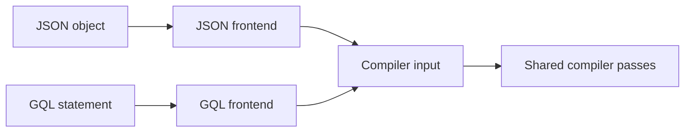
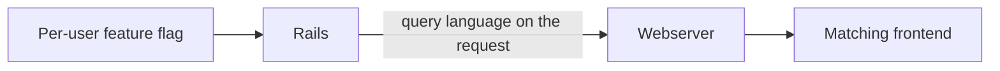
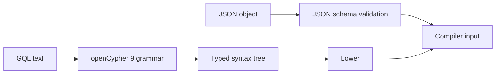
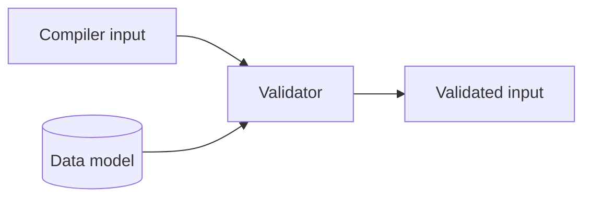
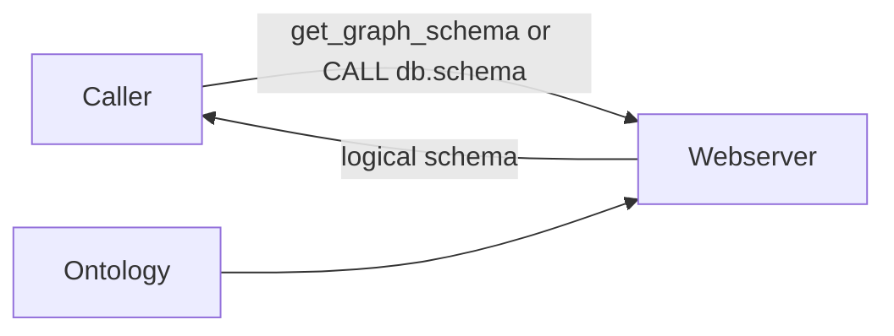
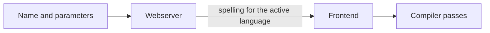

## What the query languages are

Orbit Remote accepts two query languages with the same expressive power over
the graph. The JSON Query DSL is a schema-defined JSON object, and it is the
default. GQL is a read-only subset of openCypher 9 with a small set of Orbit
extensions. Both frontends lower into the same compiler input, so validation,
authorization, planning, and results are shared.

The same query in each language:

```json orbit-query
{
  "query_type": "traversal",
  "nodes": [
    {"id": "u", "entity": "User"},
    {"id": "mr", "entity": "MergeRequest", "filters": {"state": "merged"}}
  ],
  "relationships": [
    {"type": "AUTHORED", "from": "u", "to": "mr"}
  ],
  "limit": 25,
  "order_by": "-mr.merged_at"
}
```

```gql orbit-query
MATCH (u:User)-[:AUTHORED]->(mr:MergeRequest {state: 'merged'})
RETURN u.username, mr.title
LIMIT 10
```

## How it works



The language is a property of the user, not of the payload. Rails selects it,
and the matching frontend parses and lowers the query. Every pass after
lowering is language-neutral.

### 1. Language selection



A default-off, per-user Rails feature flag selects the frontend. Rails sets
the language on the gRPC request, for ad hoc and named queries alike. With the
flag off, every surface accepts only JSON. With it on, the query endpoint,
named queries, and discovery switch to GQL, and JSON payloads are rejected.
The server does no content sniffing and has no fallback. Discovery responses
describe only the active language.

### 2. Parsing and lowering



The JSON frontend validates the payload against the base JSON schema and an
ontology-derived schema, then deserializes it into the compiler input. The GQL
frontend parses with a grammar adapted from the openCypher 9 M23 EBNF and
builds a typed syntax tree. Lexical rules apply at that point: identifiers,
string escapes, numeric ranges, and duplicate map keys. Lowering then applies
the statement-wide rules. The pattern must be one connected tree, variables
must be unique, and the query type is inferred from the pattern and
projections.

An unsupported construct fails with a positioned, client-safe error. A
frontend never drops part of a statement and runs the rest.

### 3. Shared validation



Both inputs pass through one native validator. It checks shape, limits,
ontology membership, and type compatibility. The limits are Rust constants,
and a build script asserts that the JSON schema declares the same bounds. JSON
is validated twice by design, so every JSON test also exercises the shared
validator. GQL pipelines also check each typed relationship against the
ontology's edge endpoints, and reject a reversed arrow with the valid
direction.

### 4. Schema discovery



Discovery returns the logical schema from the ontology, never the physical
tables. JSON callers use `get_graph_schema`, which lists domains and edges in
TOON and expands node types on request. GQL callers use `CALL db.schema()`, or
`CALL db.schema('MergeRequest')` for one type. The GQL frontend answers schema
calls from ontology metadata, with no SQL and no billing event.

### 5. Named queries



Named queries are server-defined queries that clients such as the Orbit
dashboard call by name. Each one carries a JSON spelling and a GQL spelling
with one shared parameter schema. The server renders the spelling for the
caller's active language and compiles it through that frontend. Compiler tests
require both spellings to produce identical SQL and parameters. Each schema
version also checks every named query against its ontology when it loads.

## When things go wrong

- **The payload doesn't match the active language.** The request is rejected.
  The other frontend is never tried.
- **An unsupported GQL construct,** such as `OPTIONAL MATCH`, `OR`, `WITH`, or
  any write. The error names the construct and its position.
- **An unknown identifier.** The error lists the valid candidates from the
  data model.
- **A bound is exceeded.** The error names the limit.
- **A named query no longer fits a new schema version.** That snapshot leaves
  it out, and the server logs a warning.

## Why we built it this way

The JSON Query DSL came first. LLMs generate output that conforms to a JSON
schema more reliably than free-form text. The schema also documents every
field and bound in one machine-readable file. GQL followed because agents
already know Cypher, and a pattern costs fewer tokens than the equivalent
JSON.

Both languages lower into one input, so each capability, check, and security
rule exists once. A language is one frontend module. Retiring the JSON Query
DSL removes that module and its schema, and nothing downstream changes.

## Decisions

- [ADR 011: Agent command surface](../adr/011_agent_command_surface.md)
- [ADR 019: GQL response format](../adr/019_gql_response_format.md)

## Appendix

### Language principles

- Both languages lower to one input.
  A capability that exists in the input works in every language that can express it.
- The same query returns the same result in both languages.
  Tests check both spellings against one expectation.
- Query values never become SQL text.
  The compiler binds every value as a parameter, and every name must match the ontology.
- A frontend rejects what it does not support.
  It never drops part of a query and runs the rest.
- Errors are safe to show the caller.
  They name the problem without echoing the query text.
- Callers discover the graph from the ontology, never from the ClickHouse schema.
- Rails picks the language for each user.
  The server never guesses the language from the payload.

### Terms

- A **frontend** is the part of the compiler that parses one query language.
- The **input** is the language-neutral form of a query: node selectors, relationship selectors, filters, aggregations, ordering, and limits.
- A **node selector** names an entity type and a variable, with optional IDs, filters, and returned properties.
- A **relationship selector** connects two node selectors, with a relationship type, a direction, and a hop range.
- A **pattern** is the GQL form of node and relationship selectors, such as `(u:User)-[:AUTHORED]->(mr)`.

### The languages side by side

| | JSON Query DSL | GQL |
| --- | --- | --- |
| Form | A JSON object | One text statement |
| Built for | LLMs that fill in a JSON schema, and services that build queries in code | Agents and people who know Cypher |
| Query type | Stated in `query_type` | Inferred from the statement |
| Checks | JSON schema, then the shared validator | Grammar, then the shared validator |
| Schema discovery | `get_graph_schema` | `CALL db.schema()` |
| Frontend code | `passes/frontend/json_dsl/` | `passes/frontend/gql/` |

Both frontends live under `crates/query-engine/compiler/src/passes/frontend/`.

### Query types

Every query is one of four types.
JSON names the type, and GQL infers it from the statement.

| Query type | Answers | GQL form |
| --- | --- | --- |
| Traversal | Which nodes match this pattern? A single node with no relationships is a lookup. | Any other supported pattern |
| Aggregation | How many, how much, grouped by what? | An aggregate in `RETURN` |
| Path finding | What is the shortest path between these nodes? | A named `ANY SHORTEST` pattern |
| Neighbors | What is connected to this node? | One relationship to an unlabeled, unfiltered endpoint |

The [query language reference](../../../docs-gitlab-com/remote/queries/query-language.md) documents every field, operator, and limit.

### JSON Query DSL details

JSON is the default language.
It is designed for LLMs and services:

- LLMs produce valid JSON against a schema more reliably than free-form query text.
- One machine-readable file, `config/schemas/graph_query.schema.json`, documents every field, type, and limit.
- Every value has its own field, so values never mix with query structure.
- Services can build queries in code without a parser.

A query names its type and its nodes.
The other fields depend on the type:

| Part | Purpose |
| --- | --- |
| `query_type` | One of `traversal`, `aggregation`, `path_finding`, or `neighbors` |
| `nodes` | The node selectors |
| `relationships` | The relationship selectors that connect the nodes |
| `aggregations` and `group_by` | The metrics and group keys of an aggregation |
| `path` and `neighbors` | The settings for path finding and neighbors |
| `limit` and ordering | The size and order of the result |
| `options` | Presentation settings that do not change what the query matches |


The DSL has a version: the `query_dsl` pin in `config/versions.yaml`.
Its major version is part of the schema `$id`.
`get_query_dsl` returns the current schema.

### GQL details

GQL is the text language.
It is designed for agents that know Cypher:

- A short pattern costs fewer tokens than the same query in JSON.
- A pattern has the same shape as the graph it matches.
- One statement form covers queries and schema discovery.

GQL in Orbit is a restricted subset of openCypher 9 with a few extensions.
It reads and never writes.
It accepts one statement per request and has no query parameters, so callers keep untrusted values out of the query text.
It is not a Neo4j-compatible driver.
The grammar adapts productions from the official openCypher 9 M23 EBNF grammar, and the grammar module carries the Apache-2.0 license and the upstream attribution.

A statement has this shape:

```plaintext
MATCH pattern [WHERE predicates]
[MATCH pattern [WHERE predicates] ...]
RETURN projections
[ORDER BY key [ASC | DESC]]
[SKIP rows]
[LIMIT rows]
[DEBUG]
```


The pattern must form one connected tree.
Several `MATCH` clauses join into one pattern, and their `WHERE` predicates combine with `AND`.
`RETURN` selects what the graph response includes.
It is not a general table of expressions.

The GQL frontend works in two steps:

1. Parsing checks syntax: identifiers, strings, numbers, and the order of clauses.
1. Lowering checks the whole statement: unique variables, a connected pattern, the query type, and the projections.

Orbit adds these extensions to openCypher 9:

- Shortest paths use the ISO GQL prefix `ANY SHORTEST`, because openCypher 9 has no shortest-path syntax.
- `date_trunc` buckets dates in aggregations.
- Token predicates search text-indexed properties.
- `OFFSET` is a synonym for `SKIP`.
- `DEBUG` returns the compiled SQL to authorized users.

The frontend rejects writes, `OPTIONAL MATCH`, `WITH`, `UNION`, `OR`, cycles, and other syntax outside this shape.

### Validation

Both languages end in the same shared validator.
It checks the limits, then checks every entity, relationship, and property against the ontology.
The limits are Rust constants, and a build script checks that the JSON schema states the same limits.

A JSON query is checked twice: first by the JSON schema, then by the shared validator.
Every JSON test therefore also tests the shared validator.

### Adding or retiring a language

Every language-specific step lives in its frontend, so each language is one module:

- A new language adds a frontend that lowers to the shared input, and a compiler pipeline that starts with its parse phase.
- Retiring the JSON Query DSL deletes its frontend, its parse phase, and its schema file.
  The shared phases do not change.
- A check that reads only the input works for every language.
  For example, the relationship-direction check runs on GQL today, and the JSON pipelines can add it without frontend changes.

### Testing

Query scenarios state each query once in each language, and both spellings must return the same result.
A grammar fuzz target generates statements from the GQL grammar, and other fuzz targets send arbitrary input through both frontends.
[Testing](../testing/README.md) describes these layers.
