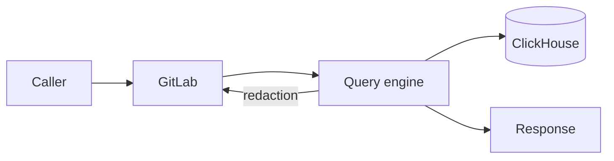
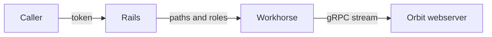
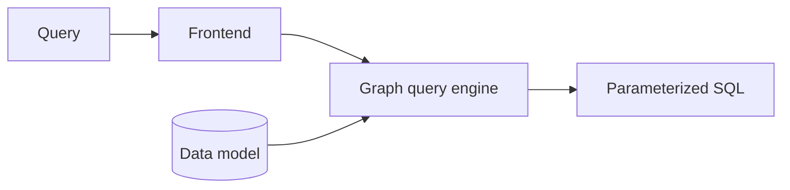
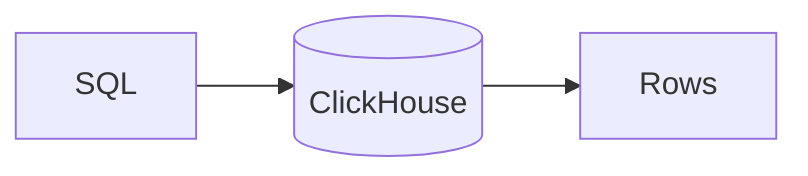
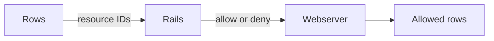
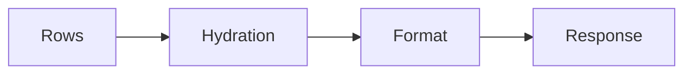

## What querying does

Querying answers questions about the graph: who wrote what, what connects to
what, how many of something there are, and how two things are related. Agents
and people ask these questions through MCP, the GitLab Orbit CLI, the REST
API, and GitLab Duo. Orbit answers each question with one ClickHouse query
that reads only what the caller is allowed to see.

There are four types of query:

| Type | Answers questions like |
| --- | --- |
| Traversal | Which merge requests did this user author? |
| Aggregation | Which authors merged the most work this month? |
| Path finding | What is the shortest path between these two projects? |
| Neighbors | What is connected to this work item? |

Callers write queries in the JSON Query DSL or in GQL. The
[query languages](query-languages.md) page covers both.

## How it works

Every query goes through GitLab first, so GitLab stays the only source of
truth for who can see what. Orbit then compiles the query into SQL, runs it on
ClickHouse, and asks GitLab about the rows that SQL alone can't decide. The
steps below follow one query along that path.

### 1. GitLab checks the caller

Rails authenticates the caller and works out which namespaces they can read,
and with which role. It hands the query, those namespaces, and a signed token
to Workhorse. Workhorse opens a gRPC stream to the Orbit webserver, so a long
query never ties up a Rails worker.
[ADR 008](../adr/008_workhorse_query_acceleration.md) explains that choice.

A per-user feature flag in Rails decides which query language the caller uses.
The server never guesses the language from the query itself.

### 2. The engine compiles the query

The engine turns the query into one parameterized SQL statement. It checks
every name against the ontology, plans how to read each node and relationship,
and adds authorization filters for the caller's namespaces. A final check
rejects the query if any read is missing its filter. The
[graph query engine](query-engine.md) page walks through each step.

### 3. ClickHouse runs it

The webserver connects to ClickHouse as a user that can only read. Each query
type has its own time and memory limits, so one expensive query can't starve
the others. The SQL reads the current version of each row, never a stale or
deleted one.

### 4. GitLab redacts what SQL can't decide

Some rules live only in GitLab, like who can see a confidential work item. For
those, the webserver sends the IDs of the returned resources back through the
stream. Rails checks each one with its normal permission rules, and the
webserver drops every row that Rails denies.

### 5. Hydration and the response

The main query returns IDs, plus the properties it already joined. A second,
small query fetches the rest for a fixed set of IDs, with the same
authorization filters. Then the webserver formats the result. Every query type
returns the same shape: nodes, edges, optional aggregation rows, and
pagination information. Callers pick raw JSON, compact text for LLMs, or a
GQL-style table.

Pages keep no state. The server asks for one row past the page to report
whether more rows exist, and each next page is a new query.

## When things go wrong

- **The caller can't see a namespace.** Its rows never match, because every
  read filters on the caller's namespaces.
- **The caller lacks the role for an entity.** The query is rejected, or that
  entity returns no rows.
- **The query is too big.** Validation rejects it before any SQL runs, and the
  error names the limit.
- **The query is too slow.** ClickHouse stops it at its time limit, and the
  caller gets an error.
- **GitLab can't answer a redaction check.** The query fails instead of
  returning rows that nobody checked.
- **The caller disconnects.** The webserver stops the query.
- **A new schema version is rolling out.** Queries keep using the active graph
  until the new graph is complete.

## Why we built it this way

We could have run a graph database next to GitLab. We didn't, because
ClickHouse already holds the replicated data, handles analytical queries well,
and is shared GitLab infrastructure.
[ADR 000](../adr/000_clickhouse_graph_storage.md) records the evaluation. The
engine adds graph semantics on top.

Authorization lives in two places. SQL filters on the caller's namespaces,
which is fast and covers almost every row. GitLab redaction covers the rules
that only GitLab knows. Some queries pay for an extra round trip, but no query
depends on filtering after the fact alone.

Callers never write SQL. A query language with a fixed shape lets the engine
validate, bound, and secure every query, and LLMs can write it safely.

## Decisions

- [ADR 000: ClickHouse as graph storage](../adr/000_clickhouse_graph_storage.md)
- [ADR 004: Unified response schema](../adr/004_unified_response_schema.md)
- [ADR 008: Workhorse query acceleration](../adr/008_workhorse_query_acceleration.md)
- [ADR 011: Agent command surface](../adr/011_agent_command_surface.md)
- [ADR 019: GQL response format](../adr/019_gql_response_format.md)
- [ADR 021: Entity context expansion](../adr/021_entity_context_expansion.md)

## Appendix

### Design principles

- One compiler serves every query language.
  Each language lowers to the same input, so validation, security, planning, and SQL generation exist once.
- The ontology is the schema.
  Entities, relationships, properties, storage tables, and redaction rules come from `config/ontology/`.
  A new entity needs no compiler change.
- Caller input never becomes SQL text.
  Values are bound parameters, and names must match the ontology.
- Security fails closed.
  A final check rejects any SQL that reads a namespaced table without an authorization filter.
- Every query is bounded.
  Hops, path depth, result size, predicates, memory, and execution time all have hard limits.
- The query tier is read-only.
  It connects to ClickHouse as a user that can only run `SELECT`.
- Queries see current state.
  A query never matches a stale version of a row or a deleted row.
- The webserver is stateless.
  Each request, including each page, is a new query.
- All query types share one response contract, so a caller can render a graph, a table, or a chart from one format.

### Terms

- The **JSON Query DSL** is the JSON query language.
  It is the default.
- **GQL** is Orbit's read-only text query language.
  It uses openCypher 9 syntax with Orbit restrictions and extensions.
  It is not a Neo4j-compatible driver.
- A **frontend** is the part of the compiler that parses one query language.
- The **input** is the language-neutral form of a query: node selectors, relationship selectors, filters, aggregations, ordering, and limits.
- The **ontology** declares the entities, relationships, and properties of the graph, and how each one is stored and authorized.
- The **traversal path** is the namespace hierarchy of a row, such as `1/9970/`.
  Authorization and scope filter on its prefix.
- **Redaction** is the Rails permission check on individual rows after SQL runs.
- **Hydration** is a second, smaller query that fetches properties for nodes the main query only identified.
- A **named query** is a server-defined query that a client calls by name.

### Request stages

| Stage | What it does |
| --- | --- |
| Routing | Selects the frontend for the request language. Answers schema calls without SQL. |
| Security | Builds the security context from the JWT: the organization and the caller's traversal paths with their roles. |
| Compilation | Turns the query into parameterized SQL and a hydration plan. |
| Execution | Runs the SQL on ClickHouse. |
| Authorization and redaction | Asks Rails about the resources that need a permission check, and drops the denied rows. |
| Hydration | Fetches the properties of discovered nodes, under the same authorization rules. |
| Output | Formats the result as raw JSON, as compact text for LLMs, or as a GQL table. |

The [Security](security.md) design document covers the authorization layers.
[ADR 008](../adr/008_workhorse_query_acceleration.md) explains why the gRPC stream runs in Workhorse.

### Capabilities

Queries can also:

- Filter on properties with comparisons, membership, string matching, null checks, and token search on text-indexed properties.
- Group aggregations by node or by property, and bucket dates by unit.
- Read virtual columns, such as file content and merge request diffs from Gitaly.
- Page through results with `SKIP` and `LIMIT`.
- Return the compiled SQL to authorized users for debugging.

The [query language reference](../../../docs-gitlab-com/remote/queries/query-language.md) lists every field, operator, and limit.

### Flexible by design

The engine separates what a query means from where the data lives and how the caller writes it.
Each part can change on its own.

- **Query languages.** A frontend parses one language into the shared input.
  Adding a language adds one frontend.
  Retiring the JSON Query DSL removes one frontend, and the other phases do not change.
  See [Query languages](query-languages.md).
- **Storage backends.** The compiler reads a query data model, not table names.
  ClickHouse serves Orbit Remote.
  DuckDB compiles the same queries against the local graph schema, and the code-graph test suites use it.
- **The graph.** A new entity, property, or relationship is an ontology change.
  Tables, validation, schema discovery, and redaction follow from it.
- **Storage layout.** The ontology routes each relationship to an edge table and can declare pre-joined tables.
  The planner picks the access path, so queries do not change when the layout does.
- **Compiler pipelines.** Each phase declares the state it reads and writes.
  A pipeline is an ordered list of phases, so hydration and local queries reuse the same phases in different combinations.
- **Response formats.** One formatter stage renders the result.
  A new format does not touch compilation or execution.

### Query surfaces

- **gRPC.** `ExecuteQuery` is the only path from a query to SQL.
  Rails and Workhorse are its callers.
- **REST and MCP.** Rails serves `/api/v4/orbit/*` and the Orbit MCP tools.
  The [API reference](../../../docs-gitlab-com/remote/access/api.md) lists the endpoints.
- **Agent commands.** Agents discover graph capabilities through a short command catalog instead of long tool descriptions.
  See [ADR 011](../adr/011_agent_command_surface.md).
- **Named queries.** `config/named_queries/` holds server-defined queries in both languages.
  Clients pass a name and parameters, and the server compiles the spelling for the active language.
  The Orbit dashboard and entity context expansion use them.
- **Schema discovery.** Callers read the ontology, not the ClickHouse schema.
  The JSON mode uses `get_graph_schema`, and GQL uses `CALL db.schema()`.

Each user has one active language, which a per-user flag in Rails selects.
[Query languages](query-languages.md#1-rails-picks-the-language) describes the rules.

### Responses

Every query type returns the same envelope: nodes, edges, optional aggregation columns and rows, and pagination metadata.
Nodes appear once, and edges connect node instances.
[ADR 004](../adr/004_unified_response_schema.md) defines the contract, and its version is the `raw_output_format` pin in `config/versions.yaml`.

The same result can render as raw JSON, as [TOON](https://github.com/toon-format/spec/blob/main/SPEC.md) text for LLMs, or as a cypher-shell style table for GQL callers ([ADR 019](../adr/019_gql_response_format.md)).

### Pages

| Document | Covers |
| --- | --- |
| [Query languages](query-languages.md) | The JSON Query DSL and GQL: why each exists, how each lowers to the shared input, and how Rails picks one |
| [Graph query engine](query-engine.md) | Data model and storage, compiler phases, planning, current-state reads, and guarantees |
