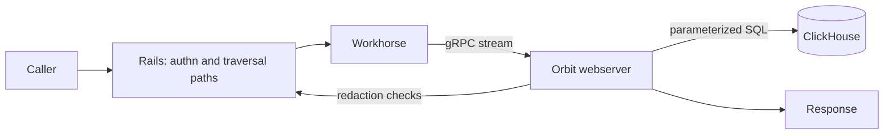
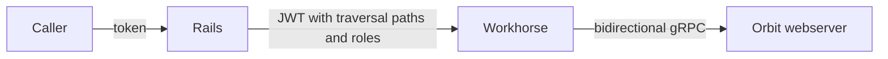
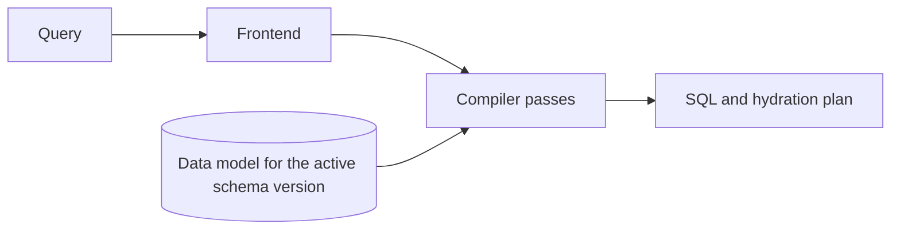
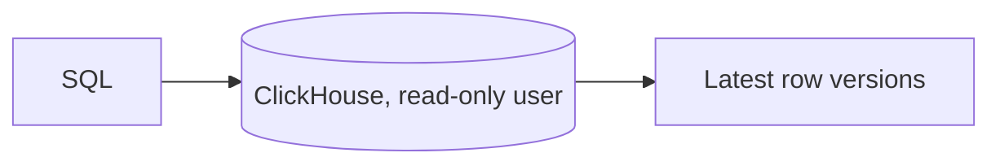
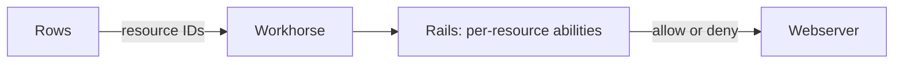
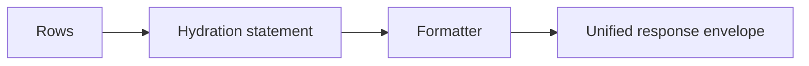

## What querying does

Orbit Remote serves read-only graph queries over the SDLC and code graphs.
Each query compiles to one parameterized ClickHouse statement. The statement
is scoped to the caller's authorized traversal paths and bounded in shape,
execution time, and memory. MCP, the GitLab Orbit CLI, the REST API, and
GitLab Duo all reach it through GitLab Rails.

| Query type | Shape | Example |
| --- | --- | --- |
| Traversal | A pattern of up to five node selectors joined by relationship selectors | Merge requests that a user authored |
| Aggregation | A traversal with group keys and metrics | Merged merge requests per author, per month |
| Path finding | The shortest path between two anchored nodes, up to three hops | The containment path from a group to a project |
| Neighbors | One hop from a single node, in either direction | Every entity linked to a work item |

Queries are written in GQL today. The [Orbit Query Engine](query-engine.md)
doesn't depend on the input language or the backend. A new language or backend
plugs in as one frontend or one code generator.

## How it works

Authorization is split between Orbit and GitLab. Orbit enforces namespace and
role scope inside the SQL. GitLab stays authoritative for identity and for
per-resource rules that the graph does not model. The request path below
follows that split.

### 1. Authentication and scope resolution

Rails authenticates the caller and resolves the traversal paths that the
caller can read, each tagged with an access level. It signs them into a JWT
and hands the request to Workhorse, which opens a bidirectional gRPC stream to
the Orbit webserver. Long-running queries never hold a Puma worker;
[ADR 008](../adr/008_workhorse_query_acceleration.md) records that decision.

### 2. Compilation

The webserver builds a security context from the JWT and compiles the query
against the data model of the active schema version. Compilation resolves
every identifier against the ontology and plans the reads. It then injects a
`startsWith(traversal_path, ?)` predicate at each entity's role floor, and
fails closed if any namespaced read lacks one. The output is one statement
with bound parameters, plus a plan for the hydration query. The
[Orbit Query Engine](query-engine.md) page covers each pass.

### 3. Execution

The statement runs as a read-only ClickHouse user, with execution-time and
memory limits chosen per query type. Every read resolves the latest version of
each row, so superseded and deleted versions never match a predicate.

### 4. Redaction

Some access rules exist only in Rails, such as confidential work items. For
entities that need them, the webserver streams the returned resource IDs back
to Workhorse, which calls the Rails redaction endpoint. Rails evaluates each
resource against its normal ability checks, and the webserver removes every
denied row before formatting. Aggregates can't be redacted row by row, so the
compiler rejects aggregation shapes that would depend on redaction.

### 5. Hydration and formatting

The base statement returns identities and the properties it joined inline. A
second statement fetches the remaining properties for that bounded ID set. It
compiles through the same restriction and security passes as the base
statement. The formatter then emits one envelope for every query type:
deduplicated nodes, instance-level edges, optional aggregation columns and
rows, and pagination metadata. It renders the envelope as JSON, as TOON for
LLM callers, or as a cypher-shell table
([ADR 004](../adr/004_unified_response_schema.md),
[ADR 019](../adr/019_gql_response_format.md)).

Pagination is stateless. Each statement fetches one row past the window to
compute `has_more`, and `SKIP` lowers to an `OFFSET` over a stable sort.

## When things go wrong

- **Unauthorized namespace.** The traversal-path predicate excludes its rows
  inside ClickHouse. They never reach the webserver.
- **Role floor not met.** If the caller meets an entity's role floor on no
  path, restriction rejects the query. Otherwise, reads of that entity compile
  to a constant-false predicate for the ineligible paths.
- **Shape or size limit exceeded.** Validation rejects the query before any
  SQL is generated, with a client-safe error that names the bound.
- **Time or memory limit exceeded.** ClickHouse aborts the statement, and the
  caller gets an error, never a partial result.
- **Redaction exchange fails.** The query fails. Rows that Rails didn't check
  are never returned.
- **Client disconnects.** Closing the stream cancels the pipeline.
- **Schema migration in progress.** The webserver serves the active snapshot
  until every table of the new version is complete.

## Why we built it this way

ClickHouse already holds the replicated GitLab data as shared Data Insights
Platform infrastructure, and its OLAP execution suits aggregation-heavy
questions. A dedicated graph database would add another store to operate and
replicate into. Orbit treats graph semantics as a compilation problem instead.
[ADR 000](../adr/000_clickhouse_graph_storage.md) records the evaluation.

Authorization uses two layers. Traversal-path predicates in SQL apply
namespace and role scope at index speed. Rails redaction covers the remaining
per-resource rules. Results that need redaction pay for one extra round trip,
and in return no query relies on post-filtering for tenant isolation.

Callers never send SQL. A constrained query language gives the compiler a
closed input shape, so validation, bounding, and predicate injection are
total. The same constraint makes the language reliable for LLMs to generate.

## Decisions

- [ADR 000: ClickHouse as graph storage](../adr/000_clickhouse_graph_storage.md)
- [ADR 004: Unified response schema](../adr/004_unified_response_schema.md)
- [ADR 008: Workhorse query acceleration](../adr/008_workhorse_query_acceleration.md)
- [ADR 011: Agent command surface](../adr/011_agent_command_surface.md)
- [ADR 019: GQL response format](../adr/019_gql_response_format.md)
- [ADR 021: Entity context expansion](../adr/021_entity_context_expansion.md)

## Appendix

### Design principles

- One compiler serves every query language.
  Each language lowers to the same input, so validation, security, planning, and SQL generation exist once.
- The ontology is the schema.
  Entities, relationships, properties, storage tables, and redaction rules come from `config/ontology/`.
  A new entity needs no compiler change.
- Caller input never becomes SQL text.
  Values are bound parameters, and names must match the ontology.
- Security fails closed.
  A final check rejects any SQL that reads a namespaced table without an authorization filter.
- Every query is bounded.
  Hops, path depth, result size, predicates, memory, and execution time all have hard limits.
- The query tier is read-only.
  It connects to ClickHouse as a user that can only run `SELECT`.
- Queries see current state.
  A query never matches a stale version of a row or a deleted row.
- The webserver is stateless.
  Each request, including each page, is a new query.
- All query types share one response contract, so a caller can render a graph, a table, or a chart from one format.

### Terms

- **GQL** is Orbit's read-only text query language.
  It uses openCypher 9 syntax with Orbit restrictions and extensions.
  It is not a Neo4j-compatible driver.
- A **frontend** is the part of the compiler that parses one query language.
- The **input** is the language-neutral form of a query: node selectors, relationship selectors, filters, aggregations, ordering, and limits.
- The **ontology** declares the entities, relationships, and properties of the graph, and how each one is stored and authorized.
- The **traversal path** is the namespace hierarchy of a row, such as `1/9970/`.
  Authorization and scope filter on its prefix.
- **Redaction** is the Rails permission check on individual rows after SQL runs.
- **Hydration** is a second, smaller query that fetches properties for nodes the main query only identified.
- A **named query** is a server-defined query that a client calls by name.

### Request stages

| Stage | What it does |
| --- | --- |
| Routing | Parses the query. Answers schema calls without SQL. |
| Security | Builds the security context from the JWT: the organization and the caller's traversal paths with their roles. |
| Compilation | Turns the query into parameterized SQL and a hydration plan. |
| Execution | Runs the SQL on ClickHouse. |
| Authorization and redaction | Asks Rails about the resources that need a permission check, and drops the denied rows. |
| Hydration | Fetches the properties of discovered nodes, under the same authorization rules. |
| Output | Formats the result as raw JSON, as compact text for LLMs, or as a GQL table. |

The [Security](security.md) design document covers the authorization layers.
[ADR 008](../adr/008_workhorse_query_acceleration.md) explains why the gRPC stream runs in Workhorse.

### Capabilities

Queries can also:

- Filter on properties with comparisons, membership, string matching, null checks, and token search on text-indexed properties.
- Group aggregations by node or by property, and bucket dates by unit.
- Read virtual columns, such as file content and merge request diffs from Gitaly.
- Page through results with `SKIP` and `LIMIT`.
- Return the compiled SQL to authorized users for debugging.

The [query language reference](../../../docs-gitlab-com/remote/queries/query-language.md) lists every field, operator, and limit.

### Flexible by design

The engine separates what a query means from where the data lives and how the caller writes it.
Each part can change on its own.

- **Query languages.** A frontend parses one language into the shared input.
  GQL is the only language today, and SQL or GLQL would each add one frontend.
- **Storage backends.** The compiler reads a query data model, not table names.
  ClickHouse and DuckDB are the backends today, and PostgreSQL would add one code generator.
- **The graph.** A new entity, property, or relationship is an ontology change.
  Tables, validation, schema discovery, and redaction follow from it.
- **Storage layout.** The ontology routes each relationship to an edge table and can declare pre-joined tables.
  The planner picks the access path, so queries do not change when the layout does.
- **Compiler pipelines.** Each phase declares the state it reads and writes.
  A pipeline is an ordered list of phases, so hydration and local queries reuse the same phases in different combinations.
- **Response formats.** One formatter stage renders the result.
  A new format does not touch compilation or execution.

### Query surfaces

- **gRPC.** `ExecuteQuery` is the only path from a query to SQL.
  Rails and Workhorse are its callers.
- **REST and MCP.** Rails serves `/api/v4/orbit/*` and the Orbit MCP tools.
  The [API reference](../../../docs-gitlab-com/remote/access/api.md) lists the endpoints.
- **Agent commands.** Agents discover graph capabilities through a short command catalog instead of long tool descriptions.
  See [ADR 011](../adr/011_agent_command_surface.md).
- **Named queries.** `config/named_queries/` holds server-defined queries.
  Clients pass a name and parameters, and the server compiles the query.
  The Orbit dashboard and entity context expansion use them.
- **Schema discovery.** Callers read the ontology, not the ClickHouse schema.
  Agents call `get_graph_schema`, and GQL callers run `CALL db.schema()`.

### Responses

Every query type returns the same envelope: nodes, edges, optional aggregation columns and rows, and pagination metadata.
Nodes appear once, and edges connect node instances.
[ADR 004](../adr/004_unified_response_schema.md) defines the contract, and its version is the `raw_output_format` pin in `config/versions.yaml`.

The same result can render as raw JSON, as [TOON](https://github.com/toon-format/spec/blob/main/SPEC.md) text for LLMs, or as a cypher-shell style table for GQL callers ([ADR 019](../adr/019_gql_response_format.md)).

### Pages

| Document | Covers |
| --- | --- |
| [Orbit Query Engine](query-engine.md) | Data model and storage, compiler phases, planning, current-state reads, and guarantees |
