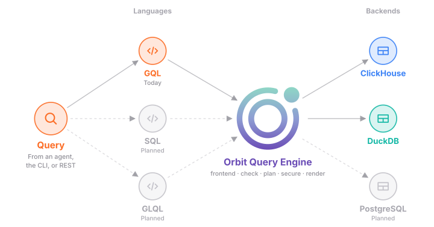
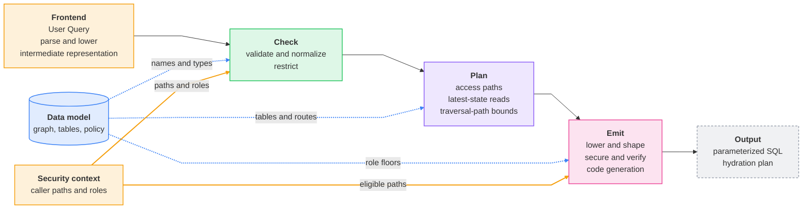
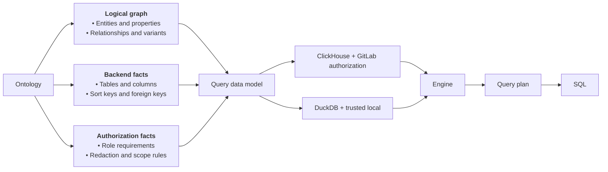
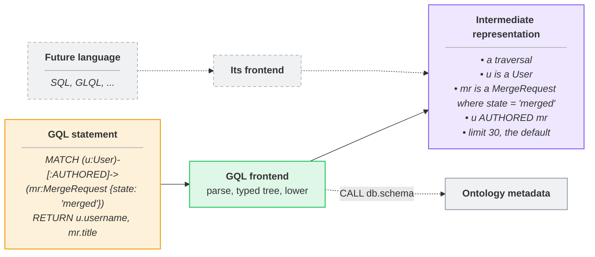
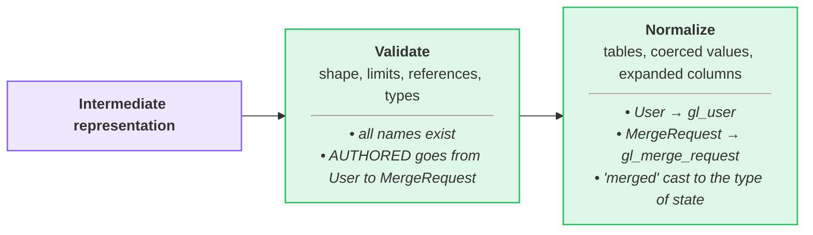
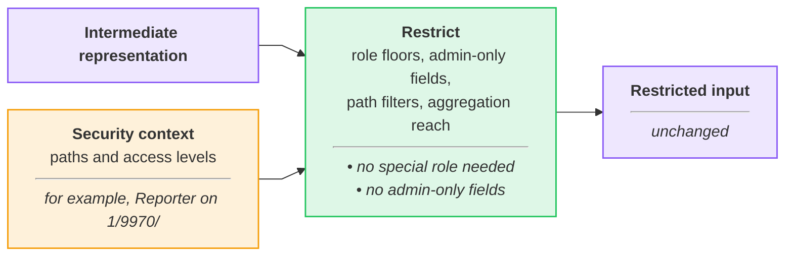
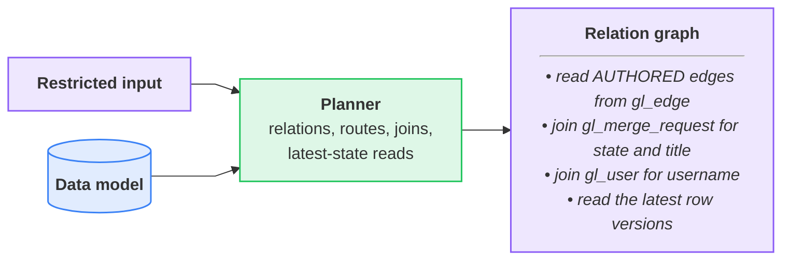
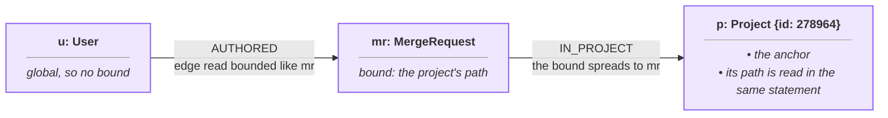
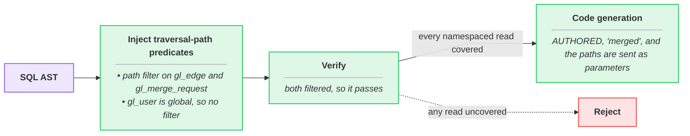

## What the engine does

The Orbit Query Engine compiles a graph query into one parameterized SQL
statement. We built it so that neither end is fixed. A frontend turns a query
language into one intermediate representation, and a code generator turns that
representation into SQL for one backend. Today GQL is the only language, and
ClickHouse and DuckDB are the backends.



The engine compiles four query types. Each row shows a GQL query and the core
of the SQL that it produces.

> [!note] > These SQL fragments show only the core of each query. > The full
SQL also has authorization filters, page limits, and query settings.

<!-- markdownlint-disable MD044 -->

| Query type | Example (GQL) | SQL output fragment |
| --- | --- | --- |
| **Traversal**<br>Merged merge requests and the users who wrote them | <pre><code class="language-cypher">MATCH (u:User)-[:AUTHORED]-&gt;&#10;      (mr:MergeRequest {state: 'merged'})&#10;RETURN u.username, mr.title</code></pre> | <pre><code class="language-sql">FROM gl_edge AS e JOIN gl_merge_request mr&#10;  ON mr.id = e.target_id&#10;WHERE e.relationship_kind = ?&#10;  AND mr.state = ?</code></pre> |
| **Aggregation**<br>How many merge requests one project has in each state | <pre><code class="language-cypher">MATCH (mr:MergeRequest)-[:IN_PROJECT]-&gt;&#10;      (p:Project {id: 278964})&#10;RETURN mr.state, count(mr) AS mrs</code></pre> | <pre><code class="language-sql">SELECT mr.state, COUNT(mr.id) AS mrs&#10;... GROUP BY mr.state</code></pre> |
| **Path finding**<br>The shortest path from a group to a project | <pre><code class="language-cypher">MATCH path = ANY SHORTEST&#10;  (g:Group {id: 9970})-[:CONTAINS*1..2]-&gt;&#10;  (p:Project {id: 278964})&#10;RETURN path</code></pre> | <pre><code class="language-sql">WITH forward AS (...),&#10;     backward AS (...)&#10;SELECT ... FROM forward&#10;JOIN backward ON ...</code></pre> |
| **Neighbors**<br>Everything directly connected to one merge request, in either direction | <pre><code class="language-cypher">MATCH (mr:MergeRequest {id: 42})--(n)&#10;RETURN n</code></pre> | <pre><code class="language-sql">SELECT ... FROM gl_edge WHERE source_id = ?&#10;UNION ALL&#10;SELECT ... FROM gl_edge WHERE target_id = ?</code></pre> |

<!-- markdownlint-enable MD044 -->

## How it works



The engine compiles in small passes, and each pass declares the state it reads
and writes, so a pass sees only what earlier passes produced. Pipelines reuse
these passes per frontend and backend: hydration skips parsing and pagination,
and DuckDB drops the security passes. Every pass reads one immutable data
model for the schema version that was active when the request started. That
model is the only source of tables, columns, and authorization rules, so
nothing from the query reaches SQL unless the model resolves it. The output is
one parameterized SQL statement, plus a plan for the hydration statement.

Every statement that the engine emits has these guarantees:

| Guarantee | Meaning |
| --- | --- |
| **Parameterized SQL** | Values are bound parameters, and names must match the ontology. |
| **Fail-closed authorization** | Every namespaced read has an authorization filter, or the query is rejected. |
| **Bounded queries** | Hard limits on query shape, result size, time, and memory. |
| **Current state** | Every read sees the latest version of each row. |
| **Stable results** | The plan changes how data is read, never what is returned. |
| **Read-only access** | The webserver can only run `SELECT`. |

## Walkthrough: GQL query to secure SQL

The steps below follow one GQL query through the ClickHouse pipeline of the
Orbit API. They start at the data model the query compiles against and end at
the statement that ClickHouse runs.

Each step's diagram traces this query through that step, and the italic text
in each box shows what happens to it. The colors mean the same thing in every
step. Green is a compiler pass, and purple is the query as it moves between
passes. Amber comes from the caller, blue is the data model, and gray is
outside the compiled statement.

```gql orbit-query
MATCH (u:User)-[:AUTHORED]->(mr:MergeRequest {state: 'merged'})
RETURN u.username, mr.title
```

### 1. Load the data model for the active schema version



When Orbit loads a schema version, it builds one data model from that
version's ontology. The model holds the graph, the ClickHouse tables that
store it, and the rules for who may read what. Every step reads the model and
never changes it. Each request compiles against the schema version that was
active when it started, so a schema switch never changes a query halfway
through.

### 2. Turn a user query into an intermediate representation



Every step after the frontend works on one intermediate representation: the
nodes, relationships, filters, aggregations, ordering, and limits of the
query. The GQL frontend parses the statement against an openCypher 9 grammar,
checks that the pattern is connected, and lowers it. Our example becomes a
traversal with two nodes, one relationship, a filter on the merge request
state, and the default page size. Another language would need only its own
frontend, and no later step would change.

### 3. Validate and normalize the query



Validation checks the query's shape and limits, and checks every name against
the data model. A query that fails a check is rejected with an error that
names the problem. Normalization then maps each entity to its table, converts
filter values to their property types, and puts the filters in a fixed order.
The same query always produces the same SQL.

### 4. Apply the caller's access rules



This is the first step that knows who is asking. It rejects a query on an
entity whose role the caller holds on no namespace. It removes admin-only
fields for callers who aren't admins. It also rejects an aggregation that no
namespaced node can reach, because counts can't be redacted row by row. Our
example asks for nothing restricted, so it passes unchanged.

### 5. Plan the reads and pick the latest row versions



The planner decides how to read each node and relationship. It reads the edge
table first, and joins a node table only when the query needs that node's
data. For our example, it reads the authored edges, joins merge requests for
the state and title, and joins users for the username. Tables keep old
versions of a row until ClickHouse merges them away, so every read keeps only
the latest version.

### 6. Narrow reads to the namespaces the query names

When a query names a project or group, the engine filters each read on that
namespace path, so ClickHouse can skip most of the table. Our example names
neither, so it reads every namespace the caller can see. Here is the same
query pinned to one project:

```gql orbit-query
MATCH (u:User)-[:AUTHORED]->(mr:MergeRequest {state: 'merged'})-[:IN_PROJECT]->(p:Project {id: 278964})
RETURN u.username, mr.title
```



The engine reads the project's current path inside the same statement. The
path spreads to the merge requests in that project, and to the authored edges
stored with them. Users are global, so they get no path filter. A path never
spreads across a relationship that can leave the namespace.

### 7. Build the SQL tree and shape the result

```mermaid
%%{init: {"flowchart": {"curve": "linear", "nodeSpacing": 28, "rankSpacing": 48, "padding": 14}}}%%
flowchart LR
    accTitle: Lowering and result shaping, with the example query
    accDescr: Lowering builds the SQL AST, then pagination, the response policy, the result contract, hydration planning, and settings shape it. For the example, the AST joins gl_edge to gl_merge_request and gl_user, the page is LIMIT 31, and the result contract adds ID and type columns for u and mr.
    Plan["<b>Relation graph</b>"]
    AST["<b>SQL AST</b><hr/><i>• gl_edge joined to gl_merge_request on target_id<br/>• gl_edge joined to gl_user on source_id</i>"]
    Page["<b>Pagination window</b><hr/><i>LIMIT 31: 30 rows, plus 1 to check for more</i>"]
    Shape["<b>Response policy and result contract</b><hr/><i>adds ID and type columns for u and mr</i>"]
    Extras["<b>Hydration plan and settings</b><hr/><i>username and title are already in the main query</i>"]
    Plan --> AST --> Page --> Shape --> Extras

    classDef pass fill:#22C55E26,stroke:#22C55E,stroke-width:1.5px
    classDef state fill:#8B5CF626,stroke:#8B5CF6,stroke-width:1.5px
    classDef caller fill:#F59E0B26,stroke:#F59E0B,stroke-width:1.5px
    classDef data fill:#3B82F626,stroke:#3B82F6,stroke-width:1.5px
    classDef external fill:#9CA3AF26,stroke:#9CA3AF,stroke-width:1.5px
    classDef reject fill:#EF444426,stroke:#EF4444,stroke-width:1.5px
    class Plan,AST state
    class Page,Shape,Extras pass
```



The plan becomes a SQL syntax tree. The engine asks for one row past the page,
so it can tell whether more rows exist. It caps long text values, so a page
fits in one response, and adds the ID and type columns that GitLab needs for
redaction. Then it plans a second, small query for any properties that the
main query didn't fetch. It also sets time and memory limits for the query
type.

### 8. Add authorization filters, verify them, and render SQL



Security runs last, on the finished tree. It adds a namespace filter to every
namespaced read, using only the namespaces where the caller holds the role
that the entity needs. Verification then checks every read, and rejects the
query if any read lacks its filter. Last, the engine renders the tree as SQL
for one backend, with every value as a bound parameter.

## When things go wrong

- **A name doesn't match the ontology.** Validation rejects the query before
  planning, with an error that names the problem.
- **The caller lacks the role for an entity on every namespace.** The engine
  rejects the query.
- **A read has no authorization filter.** Verification rejects the statement,
  and it never reaches ClickHouse.
- **The project or group that a query names isn't indexed yet.** The read
  falls back to the caller's authorization filter, so indexed rows still come
  back.
- **A backend can't express an operation.** The engine rejects the query
  instead of approximating it.
- **A step is missing input that an earlier step should have produced.** The
  engine returns an internal error, never partial SQL.

## Why we built it this way

We put every rule for turning a query into SQL in one compiler, so there's one
place to review and test them. Each step declares what it reads and writes,
which lets us reuse steps. Hydration and local graph queries run the same steps
as Orbit API queries. Security always runs last, so verification sees the finished
statement. We read a project's path inside the same statement instead of
looking it up first. So there's no cache that can go stale when a project
moves.

## Trade-offs and what's next

- **New languages are a plan.** SQL and GLQL have no frontend yet. The
  representation is ready for them, but each needs its own grammar and checks.
- **New backends are a plan.** PostgreSQL has no code generator yet. It would
  also need its own data model layout and its own way to read the latest row
  version.
- **Join order uses fixed rules.** The planner orders joins from hints in the
  ontology. [ADR 016](../../adr/016_column_statistics_for_join_ordering.md)
  proposes column statistics to make that choice from data.

## Decisions

- [ADR 000: ClickHouse as graph storage](../../adr/000_clickhouse_graph_storage.md)
- [ADR 016: Column statistics for join ordering](../../adr/016_column_statistics_for_join_ordering.md)
