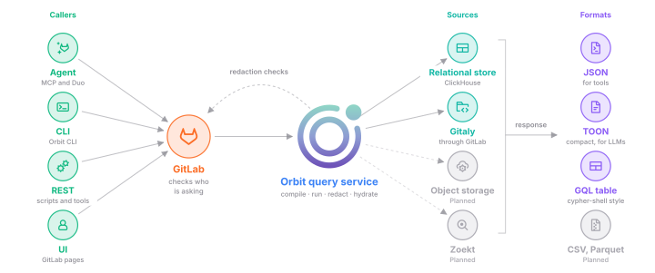
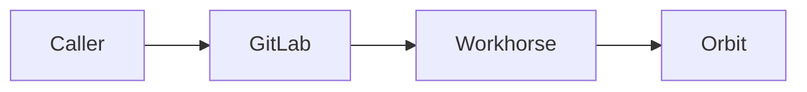
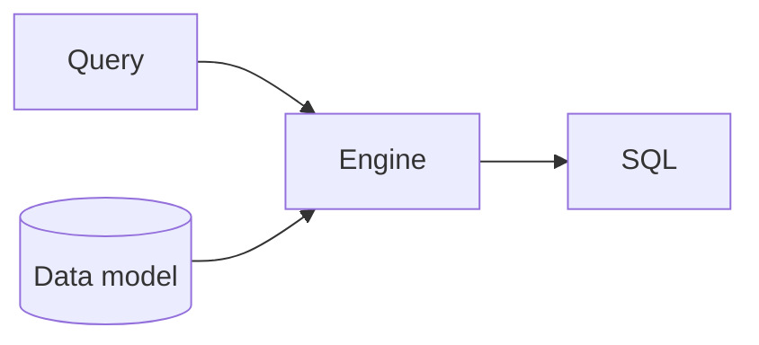
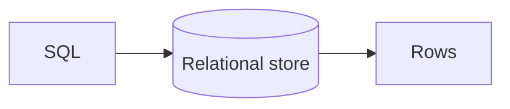
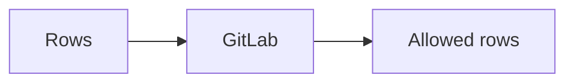
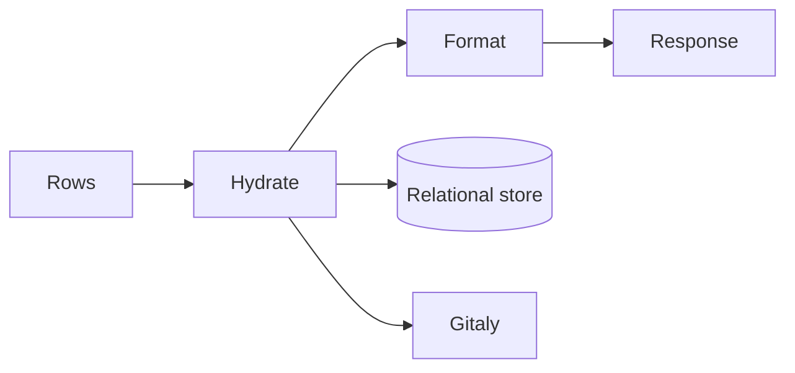

## What happens to a query

Orbit answers each graph query with one bounded SQL statement that reads only
what the caller may see. Agents and people send queries through MCP, the
GitLab Orbit CLI, the REST API, and GitLab Duo, and every query goes through
GitLab first. GitLab decides who can see what. Orbit compiles the query and
runs it on a relational store. Then it asks GitLab about the rows that SQL
alone can't decide, and fills in properties from other sources.

## How it works

The caller sends a query to GitLab, which checks who is asking and hands the
query to Orbit with the caller's namespaces. Orbit compiles the query into SQL
that can only read those namespaces, and runs it on the relational store. For
rows that need a per-resource check, Orbit asks GitLab, and drops every row
that GitLab denies. Last, Orbit fills in the properties that live in other
sources and returns one response. The [Security](../security.md) page covers
every access check along the way.

### 1. GitLab checks the caller

GitLab authenticates the caller and works out which namespaces they can read,
and with which role. It signs that list into a short-lived token and hands the
request to Workhorse. Workhorse streams the request to Orbit over gRPC, so a
long query never holds a GitLab web worker.
[How a request is checked](../security.md#how-a-request-is-checked) explains
the token, and [ADR 008](../../adr/008_workhorse_query_acceleration.md)
explains the stream.

### 2. Orbit compiles the query

Orbit compiles the query against the data model of the active schema version.
The compiler checks every name, plans the reads, and adds a namespace filter
to every read that the caller's roles allow. It rejects the query if any read
lacks its filter, which is the second of the
[three layers](../security.md#the-three-layers). The
[Orbit Query Engine](query-engine.md) page walks through each step.

### 3. The relational store runs it

The engine writes one SQL statement for one relational backend. Orbit Remote
runs it on ClickHouse, the Orbit CLI runs it on DuckDB, and a PostgreSQL
backend is a plan. On ClickHouse, Orbit runs the statement as a user that can
only read, with time and memory limits for each query type. Every read keeps
only the latest version of each row, so old and deleted versions never match.

### 4. GitLab redacts what SQL can't decide

Some rules exist only in GitLab, like who can see a confidential work item.
For those, Orbit sends the IDs of the returned resources back through the
stream. GitLab checks each one with its normal permission rules, and Orbit
drops every row that GitLab denies. This is the third layer on the
[Security](../security.md#the-three-layers) page, and aggregation counts skip
it.

### 5. Orbit hydrates the result and formats it

The main query returns IDs, plus the properties it already joined. Hydration
fills in the rest in two ways. Stored properties come from a second, small
query on the relational store, with the same namespace filters as the main
query.

Some properties don't live in the graph at all. The ontology marks them as
virtual, like the content of a file or the diff of a merge request. It also
names the service that holds them. After the main query, Orbit asks GitLab for
those properties, and GitLab reads them from Gitaly with its own permission
checks. A filter on a virtual property runs after Orbit fetches it.

Every query type returns the same shape: nodes, edges, optional aggregation
rows, and paging details. Callers get raw JSON, compact TOON text for LLMs, or
a GQL-style table. CSV and Parquet exports are a plan. Pages keep no state,
and each next page is a new query.

## When things go wrong

- **The caller can't see a namespace.** The namespace filter excludes its rows
  inside the relational store, so they never reach Orbit.
- **The caller lacks the role for an entity.** Orbit rejects the query, or
  reads of that entity match nothing.
- **The query is too big.** Orbit rejects it before it writes any SQL, with an
  error that names the limit.
- **The query is too slow or uses too much memory.** ClickHouse stops it, and
  the caller gets an error, never a partial result.
- **GitLab can't answer a redaction check.** The query fails, and Orbit never
  returns rows that GitLab didn't check.
- **The caller disconnects.** Orbit stops the query.
- **A new schema version is rolling out.** Orbit keeps serving the active
  graph until the new one is complete.

The [Security](../security.md#when-things-go-wrong) page covers what happens
when the token is missing or expired.

## Why we built it this way

ClickHouse already holds the replicated GitLab data, and it handles analytical
questions well. A separate graph database would add another store to run and
keep in sync. So we treat graph queries as a compiler problem, and
[ADR 000](../../adr/000_clickhouse_graph_storage.md) records that choice.

We check access in two places. Namespace filters in SQL cover almost every
row, at the speed of an index. GitLab redaction covers the rules that only
GitLab knows. Some results pay for one extra round trip, but no query depends
on filtering after the fact to keep tenants apart. The
[Security](../security.md#what-this-guarantees) page lists every guarantee
that follows.

Virtual properties stay where they live. Copying file content or diffs into
the graph would duplicate data that GitLab already stores and protects.
Fetching them at query time keeps the graph small, and GitLab checks every
read.

Callers never send SQL. A query language with a fixed shape lets Orbit check,
bound, and secure every query, and LLMs can write it reliably.

## Trade-offs and what's next

- **The relational store is one source among several.** The engine already
  writes SQL for ClickHouse and DuckDB. PostgreSQL is a plan, and it needs its
  own data model layout and its own way to read the latest row version.
- **Hydration can fan out further.** Virtual properties come only from Gitaly
  today. Object storage and Zoekt code search are plans, and each would add
  one resolver for its own virtual properties.
- **Virtual filters run late.** A filter on a virtual property runs after the
  main query, so a page can hold fewer rows than its limit.

## Decisions

- [ADR 000: ClickHouse as graph storage](../../adr/000_clickhouse_graph_storage.md)
- [ADR 004: Unified response schema](../../adr/004_unified_response_schema.md)
- [ADR 008: Workhorse query acceleration](../../adr/008_workhorse_query_acceleration.md)
- [ADR 011: Agent command surface](../../adr/011_agent_command_surface.md)
- [ADR 018: Gitaly proxy in Workhorse](../../adr/018_gitaly_proxy_in_workhorse.md)
- [ADR 019: GQL response format](../../adr/019_gql_response_format.md)
- [ADR 021: Entity context expansion](../../adr/021_entity_context_expansion.md)
