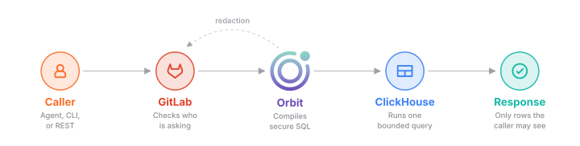
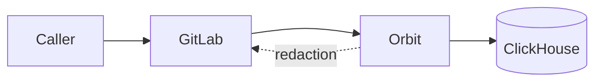
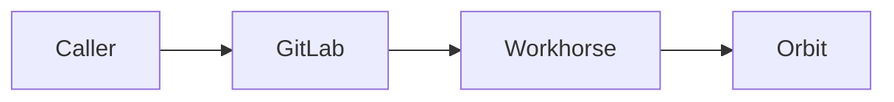
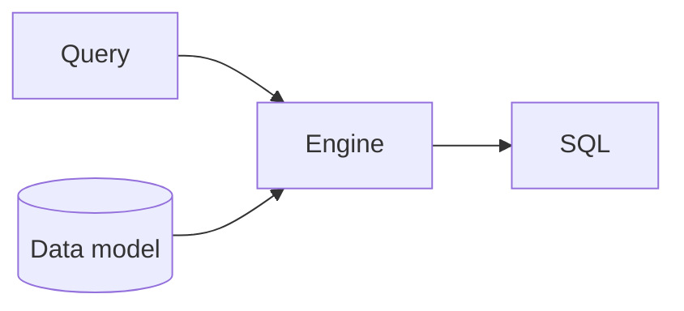
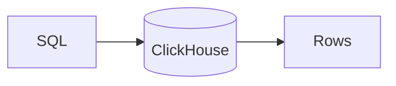
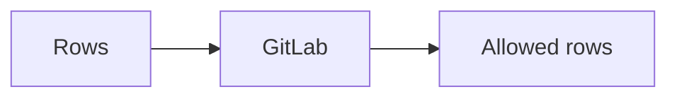
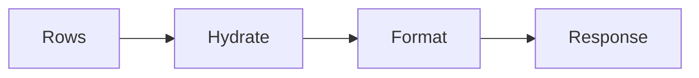

## What happens to a query

Orbit answers each graph query with one bounded SQL statement that reads only
what the caller may see. Agents and people send queries through MCP, the
GitLab Orbit CLI, the REST API, and GitLab Duo, and every query goes through
GitLab first. GitLab decides who can see what. Orbit compiles the query, runs
it on ClickHouse, and asks GitLab about the rows that SQL alone can't decide.

## How it works

The caller sends a query to GitLab, which checks who is asking and hands the
query to Orbit with the caller's namespaces. Orbit compiles the query into SQL
that can only read those namespaces, and runs it on ClickHouse. For rows that
need a per-resource check, Orbit asks GitLab, and drops every row that GitLab
denies. Last, Orbit fills in the remaining properties and returns one
response.

### 1. GitLab checks the caller

GitLab authenticates the caller and works out which namespaces they can read,
and with which role. It signs that list into a token and hands the request to
Workhorse. Workhorse streams the request to Orbit over gRPC, so a long query
never holds a GitLab web worker.
[ADR 008](../../adr/008_workhorse_query_acceleration.md) explains that choice.

### 2. Orbit compiles the query

Orbit compiles the query against the data model of the active schema version.
The compiler checks every name, plans the reads, and adds a namespace filter
to every read that the caller's roles allow. It rejects the query if any read
lacks its filter. The [Orbit Query Engine](query-engine.md) page walks through
each step.

### 3. ClickHouse runs it

Orbit runs the statement as a ClickHouse user that can only read. Each query
type has its own time and memory limits, so one expensive query can't starve
the others. Every read keeps only the latest version of each row, so old and
deleted versions never match.

### 4. GitLab redacts what SQL can't decide

Some rules exist only in GitLab, like who can see a confidential work item.
For those, Orbit sends the IDs of the returned resources back through the
stream. GitLab checks each one with its normal permission rules, and Orbit
drops every row that GitLab denies.

### 5. Orbit hydrates and formats the result

The main query returns IDs, plus the properties it already joined. A second,
small query fetches the rest, with the same authorization filters. Every query
type returns the same shape: nodes, edges, optional aggregation rows, and
paging details. Callers get raw JSON, compact text for LLMs, or a GQL-style
table. Pages keep no state, and each next page is a new query.

## When things go wrong

- **The caller can't see a namespace.** The namespace filter excludes its rows
  inside ClickHouse, so they never reach Orbit.
- **The caller lacks the role for an entity.** Orbit rejects the query, or
  reads of that entity match nothing.
- **The query is too big.** Orbit rejects it before it writes any SQL, with an
  error that names the limit.
- **The query is too slow or uses too much memory.** ClickHouse stops it, and
  the caller gets an error, never a partial result.
- **GitLab can't answer a redaction check.** The query fails, and Orbit never
  returns rows that GitLab didn't check.
- **The caller disconnects.** Orbit stops the query.
- **A new schema version is rolling out.** Orbit keeps serving the active
  graph until the new one is complete.

## Why we built it this way

ClickHouse already holds the replicated GitLab data, and it handles analytical
questions well. A separate graph database would add another store to run and
keep in sync. So we treat graph queries as a compiler problem, and
[ADR 000](../../adr/000_clickhouse_graph_storage.md) records that choice.

We check access in two places. Namespace filters in SQL cover almost every
row, at the speed of an index. GitLab redaction covers the rules that only
GitLab knows. Some results pay for one extra round trip, but no query depends
on filtering after the fact to keep tenants apart.

Callers never send SQL. A query language with a fixed shape lets Orbit check,
bound, and secure every query, and LLMs can write it reliably.

## Decisions

- [ADR 000: ClickHouse as graph storage](../../adr/000_clickhouse_graph_storage.md)
- [ADR 004: Unified response schema](../../adr/004_unified_response_schema.md)
- [ADR 008: Workhorse query acceleration](../../adr/008_workhorse_query_acceleration.md)
- [ADR 011: Agent command surface](../../adr/011_agent_command_surface.md)
- [ADR 019: GQL response format](../../adr/019_gql_response_format.md)
- [ADR 021: Entity context expansion](../../adr/021_entity_context_expansion.md)
