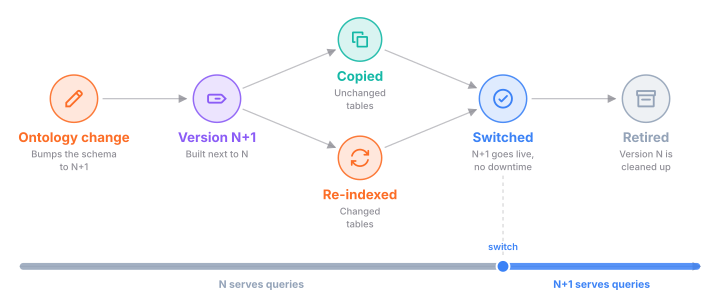
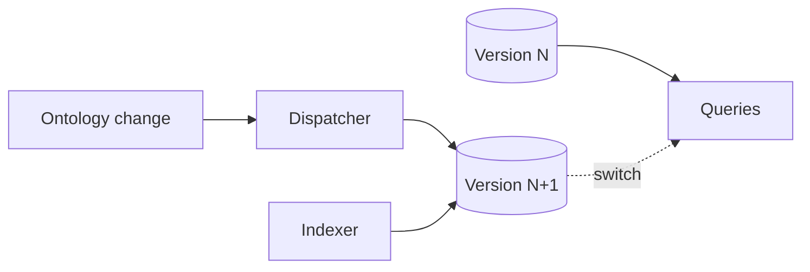
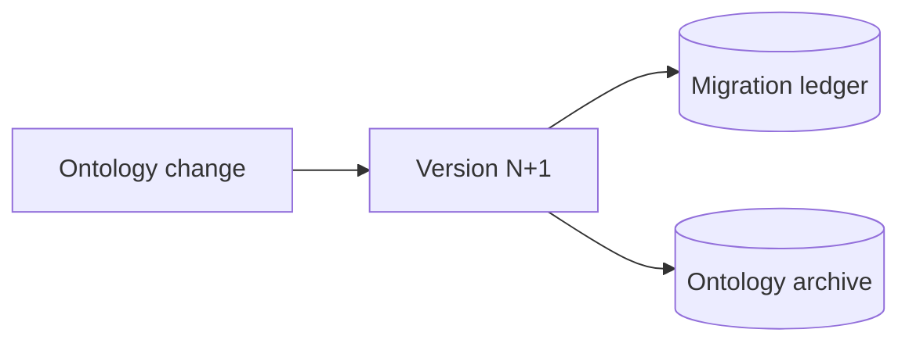
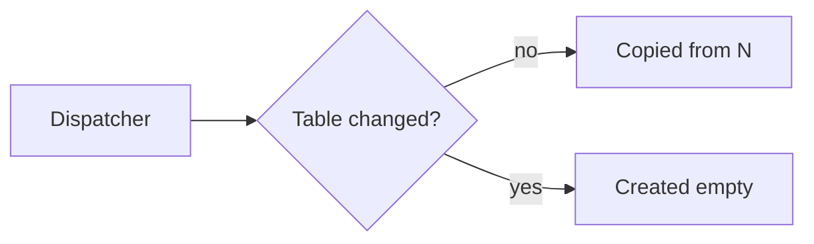
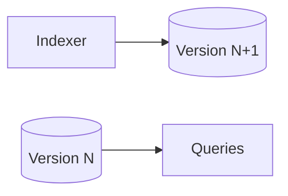
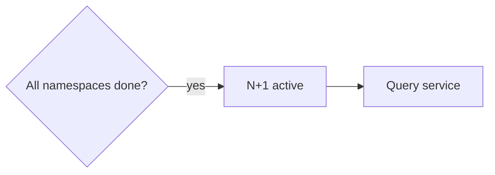
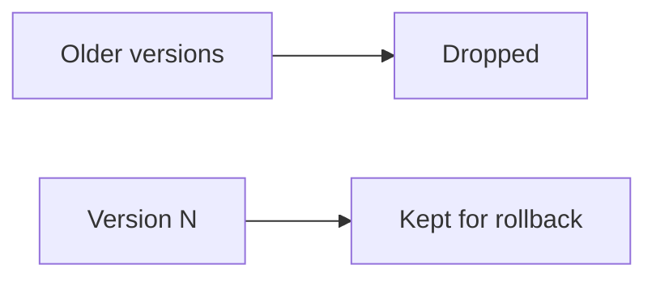

## What a schema change is

The ontology defines every node, edge, and property in the graph. When it
changes, the graph gets a new schema version, N+1. Orbit builds N+1 next to
version N, which keeps answering queries the whole time. Once N+1 is complete,
queries move to it with no downtime, and N is cleaned up. Here is a simplified
view of that path.

## How it works

Every table in the graph carries its schema version in its name, so two
versions can live side by side in the same database. A new version starts as a
change in the repository. When the new release deploys, the dispatcher builds
the tables for N+1 and the indexers fill them. Queries keep reading N until
N+1 is ready to take over.

### 1. A new version

The schema version is a single number in the repository. A change to the
ontology bumps it by one and adds an entry to a migration ledger. The entry
says what the change touches: everything, the SDLC graph or some of its
entities, the code graph, or nothing that changes the output.

CI keeps the ledger honest. It regenerates the table definitions from the
ontology and compares them with the ones in the repository. It also checks
that the version moved by exactly one and that the ledger entry covers
everything the change touches. The same change saves an archive of the
ontology for that version, so every running service can load it later.

### 2. Copy or re-index

When the new release starts, the dispatcher sees that its version is newer
than the active one. It takes a lock, so only one dispatcher migrates, and
reads the ledger to know what changed.

Tables that the change doesn't touch are copied from N. The copy attaches the
existing data instead of rewriting it, so it's cheap even for large tables.
Tables that the change does touch are created empty and filled again from
scratch. When a changed entity writes to a shared table, the dispatcher
rebuilds more, so a shared table never mixes old and new rows.

The dispatcher also copies the indexing progress of everything that didn't
change. Only the work that the change invalidated runs again.

### 3. Filling version N+1

Indexers never change tables themselves. A new indexer waits until its version
exists, then writes only to the tables of that version. The normal indexing
sweeps see the missing progress and fill the rebuilt tables, the same way they
would index a new namespace.

Version N keeps answering every query while this happens. It doesn't get new
data, though: once the new release is deployed, indexers only write to N+1. So
the longer a migration takes, the older the data that users see, until the
switch.

### 4. The switch

A scheduled check decides when N+1 is ready. It waits until every enabled
top-level group has finished the indexing that the change required, and until
the instance-wide data is done too. Groups that were turned off in the
meantime don't count, and code indexing doesn't hold back the switch.

Before switching, the check makes sure the archive of N+1 loads. Then it marks
N+1 as active and N as retired in a single write. The query service watches
the active version, loads the matching ontology, and starts serving N+1
without a restart. Requests that are already running finish on the version
they started with.

### 5. Cleanup

Old versions don't stay forever. By default, Orbit keeps the active version,
the most recently retired one, and any version that is still migrating.
Everything older is dropped, along with its tables and its queues.

Keeping the last retired version is what makes a rollback cheap. If an older
release comes back while its tables still exist, it becomes active again right
away.

## When things go wrong

- **The dispatcher crashes mid-migration.** It runs the migration again when
  it restarts. Every step can be repeated, and a table that was left half
  copied is copied again.
- **A namespace never finishes.** The switch waits for it, with no timeout.
  Version N keeps serving queries, and a metric shows how long the migration
  has been running.
- **The archive of N+1 doesn't load.** The switch doesn't happen, and the
  check tries again on its next run.
- **An older release comes back.** If its tables are still there, it becomes
  active again at once. If they were already cleaned up, it rebuilds them from
  scratch.
- **The query service can't load the active version.** It answers that it's
  unavailable and fails its readiness check, instead of serving the wrong
  schema.

## Why we built it this way

A schema change used to mean rebuilding the whole graph, even when only one
table changed. Copying what didn't change and rebuilding only what did turns
most migrations into a small re-index. Keeping both versions side by side
means a migration never breaks queries, and a rollback can be as simple as
switching back.

The ledger makes every change say what it touches, and CI checks it. That's
what lets the dispatcher trust it enough to copy everything else.

## Trade-offs and what's next

- **Avoiding migrations went too far.** Everything versioned is either copied
  or rebuilt, and that works for the graph itself. But some data lives outside
  the versioned tables and is only ever created once, so there's no way to
  change it. A column change on the indexing progress tables even forces a
  full rebuild today. Persistent data needs real migrations.
- **True background indexing.** Today, version N stops getting updates as soon
  as the new release deploys. The same workers that keep the graph fresh are
  busy filling N+1. We want N to stay live while extra workers fill N+1 in the
  background up to a rendez-vous point. Only then would indexing stall briefly
  to catch up and switch.
- **The ontology outside Orbit.** The ontology is built into Orbit today, so
  every new node or edge needs a change to the Orbit codebase. The query
  service can already load an ontology from an archive at run time, which is a
  first step. Next is letting other services publish their own ontology, so
  they can extend the graph without changing Orbit.

## Decisions

- [ADR 017: Clone-based non-blocking migrations](../adr/017_clone_based_non_blocking_migrations.md)
