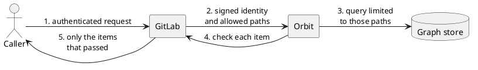

**TL;DR:** Orbit never decides who can see what. GitLab decides, and Orbit
enforces that decision at three layers. No caller can go around the GitLab
permission model, and a fault removes data from a response. It never adds
data.

## How a request is checked

1. The caller talks only to GitLab. No caller connects to Orbit directly.
2. GitLab authenticates the caller and finds the groups and projects that the
   caller can read. It sends Orbit a signed, short-lived statement of the
   caller's identity and those paths.
3. Orbit limits the query to those paths before the query runs.
4. GitLab checks each item in the result with its normal permission rules.
5. Orbit removes each item that GitLab denies.

## Paths: how Orbit knows where data belongs

Every group and project in GitLab has a
[traversal path](https://docs.gitlab.com/development/namespaces/#querying-namespaces):
the list of IDs from the top-level group down to itself. A project with ID 300
in subgroup 200 of group 100 has the path `100/200/300`.

Everything inside a group has a path that starts with the path of that group.
Access to `100/200` therefore covers `100/200/300`, but not `100/400`. This is
the same rule that GitLab uses for its group hierarchy.

A path that another allowed path already covers adds nothing, so Orbit drops
it before it builds the query. The
[namespaces guide](https://docs.gitlab.com/development/namespaces/#search-using-trie-data-structure)
explains this prefix search.

## The three layers

1. **Every row has a path.** Each row that belongs to a group or a project
   stores its traversal path. A few global entities, such as users and
   runners, have no path. Layer 3 protects them, and a relationship from a
   global entity to a group or project still carries a path.
2. **Every query has a scope.** Orbit adds the allowed paths to every read of
   data that has a path. A final check rejects a query if one of those reads
   has no scope.
3. **GitLab checks every item.** Some rules apply to one item, not to a
   group. Examples are confidential issues, SAML and IP restrictions, and
   custom roles. GitLab checks each returned item and Orbit removes the
   items that GitLab denies. This layer also catches a fault in layers 1
   and 2.

Each layer is a separate check, so one bug alone does not expose data.

## Guarantees

- GitLab is the only source of truth for permissions. Orbit does not copy
  GitLab policy, so a policy change in GitLab applies to Orbit at once.
- Every allowed path needs at least the Reporter role. Some entities need a
  higher role, for example Security Manager for security findings. Orbit
  removes the paths below that role before it builds the query, so counts
  and groupings cannot expose the entity.
- The paths are the security boundary. The organization is not, and one
  caller's scope can span more than one organization.
- The scope comes from group membership. Access to one project without access
  to its group is not part of the scope.
- A filter from the caller can only make the scope smaller.
- An empty scope is an error, not an empty result.
- Token scopes control which Orbit routes a token can call. The caller's own
  access controls which data comes back.
- Caller input never becomes query text. Names must match the graph schema,
  and every value goes to the store as a separate parameter.
- Every query has limits on depth, size, and time.
- Logs keep customer data out unless the deployment turns on expanded fields.

## Service trust

- The signed identity proves who the caller is. TLS, which the deployment
  turns on, proves that each side talks to the right service.
- The server uses only a FIPS-validated cryptographic module. It does not
  start without that module.
- Each Orbit role connects to the graph store with the least privilege it
  needs. The query service can only read.
- The project signs each release image, and a release with a fixable high
  or critical vulnerability does not ship. Images do not run as root.

## Failure behavior

- If the signed identity is missing, invalid, or expired, Orbit rejects the
  request before it does any work.
- If GitLab does not answer an item check, the query fails. Orbit never
  returns items that GitLab did not check.

## Further reading

- [GitLab namespaces and traversal IDs](https://docs.gitlab.com/development/namespaces/)
- [Orbit design document](https://handbook.gitlab.com/handbook/engineering/architecture/design-documents/orbit/)
- [ADR 001: gRPC communication](../adr/001_grpc_communication.md)
- [ADR 008: Workhorse query acceleration](../adr/008_workhorse_query_acceleration.md)
- [FIPS and TLS runbook](../runbooks/fips_and_tls.md) and
  [image signing runbook](../runbooks/image_signing.md)
