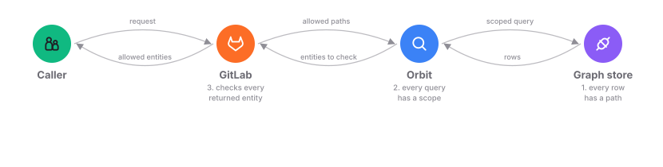
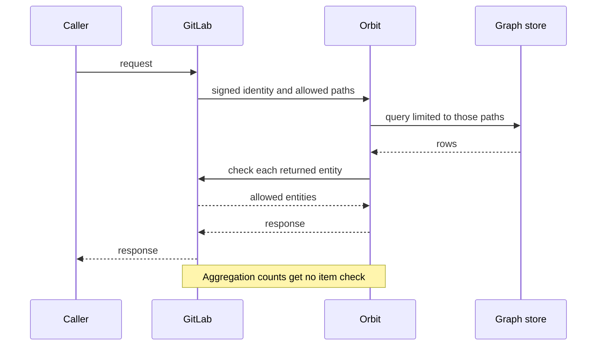

## Who sees what

GitLab decides who can see what, and Orbit enforces it. Here is a simplified
view of the three checks.

Customers already trust the GitLab permission model, so we enforce it instead
of copying it. Three separate layers do that, and each one fails closed: a
fault returns less data or an error, never more.

## How a request is checked

Nobody talks to Orbit directly. GitLab authenticates the caller and finds the
groups where they have at least the Reporter role. It sends Orbit a
short-lived signed token with that list. Orbit limits the query to those
groups, then asks GitLab to check every returned entity before the result goes
back.

## Paths: where each row belongs

Every group and project in GitLab has a
[traversal path](https://docs.gitlab.com/development/namespaces/#querying-namespaces):
the organization ID, then the namespace IDs from the top-level group down to
itself. Take organization 1, group 100, subgroup 200, and a project whose
project namespace has ID 300. That project has the path `1/100/200/300/`.

Everything inside a group has a path that starts with the group's path. So
access to `1/100/200/` covers `1/100/200/300/` but not `1/100/400/`. It's the
same rule GitLab uses for its group hierarchy, and the
[namespaces guide](https://docs.gitlab.com/development/namespaces/#search-using-trie-data-structure)
explains the prefix search behind it. We drop any allowed path that another
allowed path already covers, which keeps the query small.

## The three layers

**1. Every row has a path.** Rows that belong to a group or project store
their traversal path. A few global entities, like users and runners, have no
path. A relationship from one of them into a group still carries one.

**2. Every query has a scope.** Orbit adds the allowed paths to every read of
data that has a path. A final check rejects the query if any read is missing
its scope.

**3. GitLab checks every returned entity.** Some rules apply to one item, not
to a whole group: confidential issues, SAML and IP restrictions, custom roles.
GitLab checks each returned entity and Orbit drops the ones it denies. This
also catches anything a bug in the first two layers lets through. Aggregation
counts rely on the first two layers only.

Each layer is a separate check, so for returned entities a single bug can't
expose data on its own.

## What this guarantees

- GitLab stays the only source of truth for permissions, so a policy change in
  GitLab applies to the next Orbit request.
- Every allowed path needs at least the Reporter role. Some entities need
  more, like Security Manager for vulnerabilities.
- We remove paths below that role before building the query, so counts and
  groupings can't leak the entity either.
- The paths are the boundary, not the organization, so one caller's scope can
  span more than one organization.
- Scope comes from group membership, so access to one project without access
  to its group isn't part of it.
- A caller's own filter can only make the scope smaller. A query with no
  allowed paths is an error, not an empty result.
- Token scopes decide which Orbit routes a token can call. The caller's own
  access decides which data comes back.
- Caller input never becomes query text. Names must match the graph schema,
  and every value goes to the store as a separate parameter.
- Every query has limits on depth, size, and time.
- Customer data goes only into expanded log fields, and the deployment decides
  when Orbit writes them.

## Between the services

The signed token proves that GitLab sent the request and names the caller.
TLS, when the deployment turns it on, proves to GitLab that it talks to the
real Orbit server. The server uses only a FIPS 140-3 cryptographic module and
won't start unless it runs in FIPS mode.

Setup creates a separate read-only user for the graph store, so a deployment
can give the query service read access only.

We sign every release image, block a release that has a fixable high or
critical vulnerability, and don't run images as root.

## When things go wrong

If the token is missing, invalid, or expired, Orbit rejects the request before
doing any work. If GitLab doesn't answer an item check, the query fails. Orbit
never returns entities that GitLab didn't check.

## Further reading

- [GitLab namespaces and traversal IDs](https://docs.gitlab.com/development/namespaces/)
- [Orbit design document](https://handbook.gitlab.com/handbook/engineering/architecture/design-documents/orbit/)
- [ADR 001: gRPC communication](../adr/001_grpc_communication.md)
- [ADR 008: Workhorse query acceleration](../adr/008_workhorse_query_acceleration.md)
- The [FIPS and TLS](../runbooks/fips_and_tls.md) and
  [image signing](../runbooks/image_signing.md) runbooks
