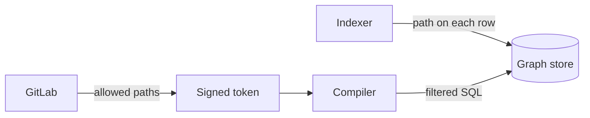

## Row ownership and query scope

Almost every row in the graph records the group or project that owns it.
Every query reads only the rows that belong to the groups of the caller.
These two rules are tiers 1 and 2, and together they keep the data of one customer away from another.



## Traversal paths

Orbit uses traversal paths as the primary way to keep tenants apart on GitLab.com.

A [traversal path](https://docs.gitlab.com/development/namespaces/#querying-namespaces) is the list of IDs from the top of the namespace tree down to one group or project.
The first segment is always the organization ID.
With that segment, the same paths work for both Cells and organizations.

For example, take a project in subgroup 200 of group 100, in organization 1.
The project has this path:

```plaintext
1/100/200/300/
│ │   │   └── project namespace
│ │   └────── subgroup
│ └────────── top-level group
└──────────── organization
```

A group path is a prefix of the path of each item inside the group.
Access to `1/100/200/` covers `1/100/200/300/`, but not `1/100/400/`.
GitLab applies the same prefix rule to its group hierarchy.

The indexer writes the traversal path on each row that belongs to a group or project.
These tables are namespaced tables.
Users and runners are global, so their rows have no path.
An edge from a user into a group carries the path of the group.
Each namespaced table sorts its rows by traversal path first.
**This is the key point for performance.**
The scope filter is a prefix match on the sort key.
The graph store reads only the data of the allowed groups and skips the rest.

## Caller scope

GitLab builds the scope of the caller before the request reaches Orbit:

1. GitLab finds the groups where the caller has at least the Reporter role, through membership or a group share.
1. GitLab keeps only the groups under top-level groups where Orbit is turned on. A caller with no such group gets an error.
1. GitLab records the access levels of the caller on each of those paths, as GitLab access numbers such as 20 for Reporter.
1. GitLab removes each path that a shorter path with the same role already covers.
1. GitLab signs the other paths into a token with a short lifetime, and sends the token with the request.

The token carries claims like this example:

```json
{
  "user_id": 42,
  "username": "sidney.jones",
  "admin": false,
  "organization_id": 1,
  "group_traversal_ids": [
    { "path": "1/100/", "access_levels": [20] },
    { "path": "1/500/600/", "access_levels": [40] }
  ]
}
```

The token also carries the standard JSON Web Token (JWT) claims and the source of the request.
Orbit rejects a token without a source or an organization.

Orbit turns the claims into a security context.
The `admin` claim is true for a caller who can read all resources in GitLab: an administrator in Admin Mode, or an auditor.
For that caller, the context holds one path, the root of the organization.
For any other caller, the context holds the paths from the token.
A token with no paths is an error, so a misconfigured caller fails and does not get an empty result.

## Query restrictions

The compiler checks the query against the security context before it plans any reads.
The compiler applies these rules:

- An entity can declare a minimum role. The compiler rejects a query on that entity when the caller has the role on no path.
- A property can be admin-only. For a caller without the `admin` claim, the compiler removes the property from the output. The compiler also rejects a filter, sort, or group on the property.
- The traversal path is a hidden property, so a caller cannot filter on the path. Any other path condition that the compiler adds only narrows the scope filter.

[Schema and identity](schema-and-ids.md#entity-access-settings) shows where the ontology declares these rules.

## Scope filters

The compiler adds the scope filters last, after it builds the full SQL syntax tree.
The filters see every read in the final statement and its subqueries.

```plaintext
for each read of a table in the statement:
    if the table has no traversal path column:
        skip                                   # global entity
    minimum = highest minimum role among the entities in the table
    paths = allowed paths with an access level at or above minimum
    if paths is empty:
        add  WHERE false
    else:
        add  WHERE startsWith(traversal_path, path_1)
                OR startsWith(traversal_path, path_2) ...
```

The minimum role uses the GitLab access numbers in the token.
Reporter is 20, Security Manager is 25, Developer is 30, and Maintainer is 40.
The [default roles](https://docs.gitlab.com/user/permissions/#default-roles) page lists the permissions of each role.

Take the caller from the token example, with Reporter on `1/100/` and Maintainer on `1/500/600/`.
A vulnerability query keeps only `1/500/600/`, because the `Vulnerability` entity needs Security Manager:

```sql
SELECT ...
FROM gl_vulnerability AS v
WHERE startsWith(v.traversal_path, {p1:String})
  AND ...
```

The parameter `p1` holds `1/500/600/`.
Each path is a bound parameter, never text in the SQL.
A final check rejects a statement with an unfiltered read of a namespaced table, or with a filter outside the eligible paths of the caller.
A rejected statement never reaches the graph store.

## Aggregations

Redaction runs after the query, so redaction cannot remove an entity from a count.
A count can still leak data.
The Reporter role covers the minimum role for most project resources, such as [merge requests](https://docs.gitlab.com/user/permissions/#project-merge-requests), [code](https://docs.gitlab.com/user/permissions/#projects), and [CI/CD](https://docs.gitlab.com/user/permissions/#project-cicd).
Security resources need the [Security Manager role](https://docs.gitlab.com/user/permissions/#project-application-security).
Without an extra rule, a caller with only the Reporter role could count vulnerabilities by severity in each project.

Orbit closes that gap with role-scoped traversal paths:

1. GitLab tags each path in the token with the role of the caller on that path.
1. The ontology declares the minimum role of each entity. The default is Reporter, and the security entities need Security Manager.
1. The compiler keeps only the paths that meet the minimum role when it adds the scope filter to the table of each entity.

**The filter is over-restrictive by design.**
A count never includes a row outside the paths that allow the role.
To keep each gated entity under its filter, the compiler applies these rules:

- An entity with a minimum role above Reporter keeps its own table in the statement.
- A group on a property keeps the table of that property in the statement.
- The compiler rejects an aggregation that no namespaced entity can reach.

Orbit does not support custom roles or item-level permissions, such as confidential issues, in counts.
Custom roles only add permissions, so Orbit shows less data than GitLab and never more.

## Design rationale

We made the traversal path the boundary, not the organization.
One caller can hold paths in more than one organization, and the scope covers each of those paths.

We do not create separate permission settings for Orbit.
A second set of rules would drift from GitLab, so Orbit reads the same memberships that GitLab uses.

We over-redact by design.
A caller can see less data in Orbit than in GitLab, but never more.
The first iteration supports most of the GitLab permission model.
We left custom roles out to keep the scope and the complexity small.

The prefix match uses the sort key of each namespaced table, so the scope filter costs little.
GitLab compacts the paths before it signs the token, so the filter stays small for callers in many groups.
GitLab also caps the number of paths in one token after compaction.
The compiler adds the scope filters after all other steps, so no later step can add a read that the final check does not see.
