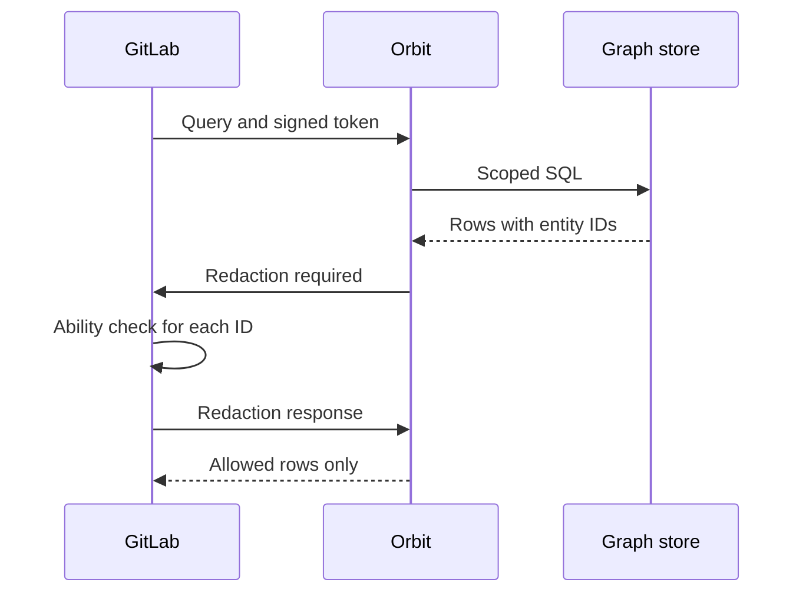

## Redaction tier

Redaction is tier 3 of the access control model.
After the graph store returns rows, Orbit asks GitLab about each entity in those rows.
GitLab answers with its standard permission rules, and Orbit drops each row that holds a denied entity.

Rules for one item exist only in GitLab and cannot become a path filter.
Examples are confidential issues, Security Assertion Markup Language (SAML) group links, Internet Protocol (IP) restrictions, and custom roles.
Redaction applies those rules.

## Redaction exchange

The exchange runs inside the bidirectional gRPC stream that carries the query.
GitLab opens the stream in the same request that the caller sent, so the redaction check runs for that caller.



### 1. Collect the checks

Each returned row carries an ID and a type for each entity in the row.
[Internal columns](schema-and-ids.md#internal-columns) explains how the compiler adds them.
Orbit reads the redaction settings of each type from the ontology and groups the IDs:

```plaintext
checks = {}
for each row:
    for each entity in the row:
        settings = ontology.redaction_settings(entity.type)
        key = (settings.resource_type, settings.ability)
        checks[key].add(entity.redaction_id)
```

Each ID appears once in each group, so a merge request in 10 rows costs one check.
A query with no entities to check skips the exchange.
An aggregation grouped by an entity checks that entity.
Redaction does not check the counted entities, and an aggregation with no entity group skips the exchange.

### 2. Ask GitLab

Orbit sends one message with all groups, and a unique result ID for the exchange:

```json
{
  "result_id": "<uuid>",
  "resources": [
    { "resource_type": "merge_request", "resource_ids": [11, 12], "abilities": ["read_merge_request"] },
    { "resource_type": "user", "resource_ids": [42], "abilities": ["read_user"] }
  ]
}
```

GitLab receives the message in the request that holds the stream, and checks the IDs for the caller of that request.
GitLab loads the resources of each type in one batch and runs the ability check for the caller:

```ruby
resources.each do |resource|
  allowed[resource.id] = Ability.allowed?(user, ability, resource)
end
```

GitLab denies each ID of a resource type that has no ability in the request.
GitLab sends a map from each ID to true or false back on the stream.
Orbit rejects a response whose result ID does not match the request.
The query fails when GitLab returns an error, does not answer, or closes the stream during the exchange.

### 3. Drop the denied rows

Orbit checks each entity of each row against the map.
One denied entity removes the whole row:

```plaintext
for each row:
    for each entity in the row:
        if not allowed(entity):
            mark the row unauthorized
            stop
```

An entity counts as denied when any of these conditions is true:

- GitLab returned false for the ID.
- GitLab returned no decision for the ID.
- The ontology has no redaction settings for the type.
- The row has no ID for the entity. A path or neighbor column with no ID fails the whole query.

Orbit removes the row.
Orbit never returns a row with empty values in place of a denied entity.
An edge belongs to its row, so the edge goes with the row.
A path row holds every node on the path, so one denied node removes the whole path.

### 4. Finish the result

This step is hydration.
Orbit fills in the other properties only for allowed rows.
Content that lives outside the graph, such as file content and merge request diffs, comes from GitLab only after redaction.
Orbit never reads content for a row that the caller cannot see.
**This order is a security control.** The query service fetches content with a service token, not a token of the caller.
Redaction must run first.
The formatter then removes the internal columns, so the response holds no redaction IDs.

## Design rationale

We reuse the standard GitLab ability checks, so a new permission rule in GitLab applies to Orbit with no change to Orbit.

If Orbit cannot look up the authorization of a row, Orbit does not return the row.
We chose to fail closed here, because a missing answer can hide a bug in tiers 1 and 2.

Orbit sends one batch for each query, not one request for each row.
GitLab can then load each resource type in one database query.
Orbit checks the entity that GitLab can load, which can be the owner of a row and not the row itself.
[Owner checks](schema-and-ids.md#owner-checks) explains that rule.

## Trade-offs

- One request holds one ability for each resource type. GitLab rejects two entries with the same resource type, so two entities with the same resource type must share an ability.
- A page can hold fewer rows than its limit, because redaction removes rows after the graph store applies the limit.
