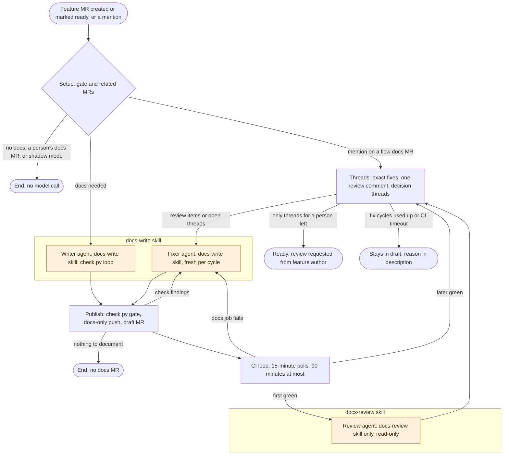

The docs-write flow is a GitLab Duo custom flow. When a feature MR in this project is
created or marked ready, it decides whether users need a docs change. If they do, it writes
the change and gets CI green. A fresh agent reviews it, and the flow fixes the review threads.
Then it marks the docs MR ready and requests review from the feature MR author. It never merges anything.

Status: design v2, built and tested in a private sandbox fork. Not enabled in this project
yet. Plan, decisions, and every result are in
[#1494](https://gitlab.com/gitlab-org/orbit/knowledge-graph/-/work_items/1494).

## The flow at a glance

The steps inside the skill boxes are model calls. Every other step is a script. Most feature
MRs end at the gate. Each agent loads one skill: the writer and the fixers `docs-write`, the
reviewer only `docs-review`. The reviewer's prompt tells it not to read the writer's notes, so
it reviews what a person would.

## Stages

| Stage | What runs | Model call | Goes to |
|---|---|---|---|
| Setup | `needs_docs.py` scores the diff at threshold 6, `related_mrs.py` groups related MRs, and the docs branch is checked out | No | Write, or end. A mention on a same-project docs MR that the flow's identity opened goes to threads. |
| Write | One agent follows `write.md` and runs `check.py`, the docs linters and the rules a script can check, until it is clean | Yes | Publish |
| Publish | Checks the writer report and runs `check.py`. Pushes only user docs and only when `check.py` reports no errors, opens the draft docs MR, and posts thread replies. | No | CI, a fixer, or end |
| CI loop | `ci_loop.py` waits for the docs MR pipeline | No | Review on the first green, threads later, a fixer on a docs failure |
| Review | One fresh agent with only the `docs-review` skill. It reads the changed pages, the docs diff, and the feature MR diff and code. It checks claims, missing steps, brevity, the word list, topic type, and links. | Yes | Threads |
| Threads | Applies the exact fixes, then posts the review as one comment, "For agent: docs review", with every finding numbered. Each `decision` finding also gets a thread titled **Needs reviewer decision**. | No | A fixer, CI, or handoff |
| Fix | A fresh agent per cycle, four at most. It fixes check or CI findings, or the numbered review items and the open threads it was given in one pass. | Yes | Publish, which posts one reply on the review comment and one per thread |
| Handoff | When CI is green on the head and the only open threads are decisions or threads the flow does not take: removes `Draft:`, adds the feature MR author as reviewer, and posts one note. The note lists the decision threads, threads the flow did not take, and review items it did not fix. | No | End. Otherwise the MR stays in draft, with the reason in its description. |

The gate ends the run with no model call on a draft feature MR or one that scores below 6.
It also skips an MR with the `documentation` or `docs-factory::skip` label, or one that
already changes user docs.
A mention on a feature MR runs the same gate.

Any step that fails to write its route file ends the flow. When in doubt, the flow does
nothing. The flow file ships with `MODE=shadow`, which stops after setup and logs one line per MR.

## What a person does

| Role | What to do |
|---|---|
| Feature MR author | Review the docs MR when the flow requests your review. Settle the **Needs reviewer decision** threads. To skip the flow, add `docs-factory::skip`. |
| Docs MR reviewer | Read the "For agent: docs review" comment and the flow's reply to it. Check the "What to check" lines in the description, and each claim against the feature code. Add the feature MR as a dependency, then merge after it. |
| Anyone | Mention the flow's service account on a feature MR to run the gate again. Mention it on a docs MR it opened to fix the open threads. It fixes only threads from the people and bots listed in [Guardrails](#guardrails). |

## Guardrails

Script steps enforce these rules:

- The scripts open docs MRs as drafts and never merge or approve.
- A push happens only when `check.py` reports no errors and the branch changes nothing but
  user docs. Warnings left after the fix cycles are listed on the MR.
- Agents see only threads from the feature MR author, its reviewers, Developer+ members of
  this project, and Duo Code Review. Other threads stay open for the person who merges, and
  the handoff note lists them.
- The flow resolves only the threads it gave the fixer, and only after the fix is pushed and
  `check.py` is clean. It never resolves a **Needs reviewer decision** thread.
- The threads path runs only on a docs MR that the flow's identity opened in this project.
  Flow markers count only on notes from the flow's identity or GitLab Duo.
- The flow discards any commit the review agent makes, and any edit outside `.docs-write/`.

Prompts set these rules, and the script steps check the result where they can:

- No agent gets a GitLab write tool, but each has a shell with the run's token. The prompts
  forbid pushes and API writes. A prompt is the only barrier between thread text and that
  shell, so the intake filter limits who can write the text an agent reads.
- The reviewer is told not to read the writer's notes in `.docs-write/`. Nothing blocks the read.

Other rules:

- The docs change gets its own MR, as this project's `AGENTS.md` requires.
- A run acts as the flow's service account together with the person who triggered it. When
  that person cannot read the private skills project, the run ends with no docs MR.
- The docs MRs it opens start the flow again, and the gate ends those runs before any model call.

## Where things live

| What | Where |
|---|---|
| Flow definition | [`.gitlab/duo/catalog/flows/docs-write.yml`](https://gitlab.com/gitlab-org/orbit/knowledge-graph/-/tree/main/.gitlab/duo/catalog/flows) in this project, with setup steps in its README. The file is the reviewable copy. The AI Catalog item is what runs, so after a change to the file, update the item from it. |
| Skills and scripts | `docs-write` (writer and fixers) and `docs-review` (reviewer) in [`gitlab-org/orbit/team/skills`](https://gitlab.com/gitlab-org/orbit/team/skills) (team members only). `docs-review` also works by hand on any docs MR. |
| Evaluations and benchmarks | [`gitlab-org/orbit/team/product/orbit-docs-evals`](https://gitlab.com/gitlab-org/orbit/team/product/orbit-docs-evals) (team members only) |
| Test sandbox | A private fork, [`knowledge-graph-docs-sandbox`](https://gitlab.com/gitlab-org/orbit/team/knowledge-graph-docs-sandbox) |

## Why design v2

Round 2 is tasks R1 to R4 on [#1494](https://gitlab.com/gitlab-org/orbit/knowledge-graph/-/work_items/1494).
It benchmarked each choice before the build
([decision](https://gitlab.com/gitlab-org/orbit/knowledge-graph/-/work_items/1494#note_4229149663)).
R4 then reversed two points of that decision. It kept two skills, one per agent, and posts
one review comment instead of a thread per finding
([R4 results](https://gitlab.com/gitlab-org/orbit/knowledge-graph/-/work_items/1494#note_4231244021)).
The benchmarks found:

- **Writer** ([results](https://gitlab.com/gitlab-org/orbit/knowledge-graph/-/work_items/1494#note_4229141228)):
  short instructions with the `check.py` loop matched the old writer on facts, within noise.
  It wrote 48% fewer words, left no check findings, and cost 22% less.
- **Review** ([results](https://gitlab.com/gitlab-org/orbit/knowledge-graph/-/work_items/1494#note_4229040208)):
  one fresh agent in one context tied the old review as Duo can run it, at half the cost.
- **No review depth classifier** ([results](https://gitlab.com/gitlab-org/orbit/knowledge-graph/-/work_items/1494#note_4228292674)):
  at threshold 6, it routed 34 of 35 changes to the full review. Its reasons became the
  "What to check" lines instead.

## How it was tested

**Live, in the sandbox fork** ([results](https://gitlab.com/gitlab-org/orbit/knowledge-graph/-/work_items/1494#note_4231244021)). Each case re-created a past feature MR on
the commit it merged into:

| Case | Trigger | What happened |
|---|---|---|
| Shadow mode | MR created | The gate scored the change `small` and the flow logged one line. No model call, no write. |
| Small CLI change | MR created | The review found 6 items and the script applied 1. One fixer fixed the other 5 and the flow replied once. CI went green, the MR was marked ready, and the flow requested review from the feature author. |
| Large setup change | MR created | The review found 2 items. One fixer fixed both in one pass. CI went green, the MR was marked ready, and the flow requested review from the feature author. |
| CI docs failure | MR marked ready | An injected sandbox docs rule failed the pipeline. A fixer fixed it, CI went green, and the flow handed off. |
| Decision finding | MR created | An injected code comment left a product question open. The review raised it as a **Needs reviewer decision** thread. The flow fixed the 2 other items and handed off with the thread open and listed. |
| Threads from others | A mention on the docs MR | Duo Code Review posted 5 threads and a person posted 1. A fixer fixed the 5, and Duo posted 1 more after the push. A second fixer fixed it. The person's product question stayed open as a decision. |

The first build posted a thread per finding. It also tested the no-docs exit: the writer
found nothing a user needs and ended the run with no docs MR.

Every flow-made docs MR started the flow again, on **Created** and on **Marked ready**. Each
of those runs ended at the gate with no model call. Each event started one session.
The flow's service account could post comments, resolve threads, mark MRs ready, and add
reviewers.

**Ready-to-merge grading**: blind Opus graders judged the v2 docs MRs, the v1 docs MRs, and
the human docs for two features. They did not know which was which.

| Docs change | Verdicts | Blocking scores | Side by side |
|---|---|---|---|
| v2, CLI change | needs changes, twice | 0 | Lost to v1. Lost to the human change. |
| v2, setup change | needs changes, twice | 0 | Lost to v1. Beat the human change. |
| v1, CLI change | needs changes, twice | 0 | Beat the human change, slightly |
| v1, setup change | needs changes, twice | 0 | Beat the human change |
| Human, CLI change | needs changes | 0 | |
| Human, setup change | needs changes | 2 | |

- The graders ask for edits on every item, human ones included, so the verdict alone does not
  separate them. No v2 item has a blocking score.
- v2 is shorter and covers less than v1. The graders preferred v1 for coverage, such as
  first-use indexing for the MCP tools, not for wrong claims.
- The v2 test branches start where each feature merged, so the code matches the docs tree.
  The v1 branches started from a newer default branch.

## Known limits

- The writer covers fewer details than the v1 writer. Next: point the review at missing coverage.
- The review rarely raises a decision on its own. In 10 reviews of real changes, it raised none.
- One review context finds less than separate reviewer contexts: recall is 0.12 to 0.14 lower,
  mostly on brevity and steps
  ([results](https://gitlab.com/gitlab-org/orbit/knowledge-graph/-/work_items/1494#note_4229040208)).
  Duo flows cannot run subagents.
- The gate misses changes whose user impact is not in a CLI, MCP, or query surface.
- The flow cannot set MR dependencies.

## Rollout

1. Shadow mode: the gate and related steps run and log their decision. No model call, no writes.
1. Advisory: a note on the feature MR with the pages and the size.
1. Draft docs MRs, with review requested from the feature MR author.

Each stage starts only after the previous one holds up against what technical writers decide.
