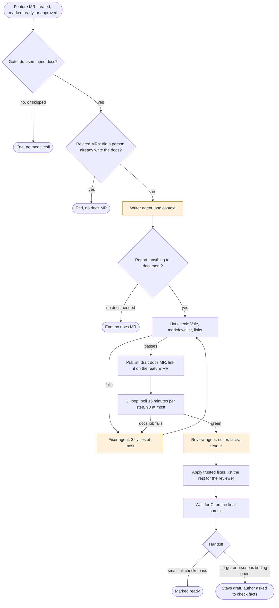

The docs-write flow is a GitLab Duo custom flow. When a feature MR in this project is
created, marked ready, or approved, it decides whether users need a docs change. If they do,
it writes the change, gets CI green, reviews it, and opens a draft docs MR for a person to
finish. It never merges anything.

Status: built and tested in a private sandbox fork. Not enabled in this project yet. Plan,
decisions, and every result are in [#1494](https://gitlab.com/gitlab-org/orbit/knowledge-graph/-/work_items/1494).

## The flow at a glance

Shaded steps are model calls. Every other step is a script, with no model call. Most feature
MRs end at the gate.

## Stages

| Stage | What runs | Model call | Ends the flow when |
|---|---|---|---|
| Gate | `needs_docs.py` scores the diff: CLI commands and flags, MCP tools, the query language, settings, user-facing errors | No | The MR is a draft, has ~documentation or ~"docs-factory::skip", is the flow's own docs MR, already changes user docs, or scores below 6 |
| Related | `related_mrs.py` finds stacked MRs, MRs on the same issue, and an existing docs MR to update | No | A person already has an open docs MR for the group |
| Write | One agent with the `docs-write` skill: it lists the user-facing facts by kind, searches the docs for every name the change touches, and edits up to about 8 pages | Yes | It reports `no_docs` (nothing a user needs) or `blocked` |
| Lint check | The project's docs linters on the changed pages | No | Three fix cycles fail |
| Publish | `publish.py` opens or updates the draft docs MR on branch `docs-write/mr-<iid>` and posts a link note on the feature MR | No | Never, except on an error |
| CI loop | `ci_loop.py` waits for the docs MR pipeline and hands docs failures to the fixer | No | A non-docs job fails, or 90 minutes pass |
| Review | One agent with the `docs-review` skill runs three reviewers (editor, facts, reader) | Yes | Never |
| Apply and handoff | Exact lint, word list, and link fixes are applied. Everything else goes to a "For the final human pass" list in the docs MR description. After CI passes on the final commit, a small change is marked ready when the three reviewers finished and no serious finding is open. A large change stays in draft. | No | Not applicable |

Any step that fails to write its route file ends the flow. When in doubt, the flow does
nothing.

## What a person does

| Role | What to do |
|---|---|
| Feature MR author | Nothing. To skip the flow, add ~"docs-factory::skip". For a large change, answer the fact-check note on the docs MR. |
| Docs MR reviewer | Read the "For the final human pass" list first. Check each claim against the feature code; wrong claims are the most common problem. Add the feature MR as a dependency (the flow cannot), then merge after the feature MR. |
| Anyone | Mention the flow's service account on a feature MR to run it again. |

## Guardrails

- It opens docs MRs as drafts and never merges or approves.
- No agent has a GitLab write tool. Only script steps push, and only after a check that the
  branch changes nothing but user docs.
- The docs change gets its own MR, as this project's `AGENTS.md` requires.
- A run acts as the flow's service account together with the person who triggered it. When
  that person cannot read the private skills project, the run ends with no docs MR.
- The docs MRs it opens start the flow again, and the gate ends those runs before any model call.

## Where things live

| What | Where |
|---|---|
| Flow definitions | [`.gitlab/duo/catalog/flows/`](https://gitlab.com/gitlab-org/orbit/knowledge-graph/-/tree/main/.gitlab/duo/catalog/flows) in this project, with setup steps in its README |
| Skills and scripts | `docs-write` and `docs-review` in [`gitlab-org/orbit/team/skills`](https://gitlab.com/gitlab-org/orbit/team/skills) (team members only) |
| Evaluations and benchmarks | [`gitlab-org/orbit/team/product/orbit-docs-evals`](https://gitlab.com/gitlab-org/orbit/team/product/orbit-docs-evals) (team members only) |
| Test sandbox | A private fork, [`knowledge-graph-docs-sandbox`](https://gitlab.com/gitlab-org/orbit/team/knowledge-graph-docs-sandbox) |

## How it was tested

**Live, in the sandbox fork** ([results](https://gitlab.com/gitlab-org/orbit/knowledge-graph/-/work_items/1494#note_4224327300)):

- A small CLI change ran end to end: writer, lint check, publish, green CI, three reviewers, marked ready.
- A large setup change: the lint check caught a Vale error, the fixer corrected it, CI went green, and the
  author got the fact-check note.
- A change with no user impact and an opted-out MR both ended at the gate, with no model call.
- The flow's own docs MRs started it again, and each of those runs ended at the gate.

**Writing benchmark**, on 10 past feature MRs no part of the flow was tuned on, two runs each
([results](https://gitlab.com/gitlab-org/orbit/knowledge-graph/-/work_items/1494#note_4224118145)):

| Arm | Facts the human docs covered | Wrong claims | Cost per MR |
|---|---|---|---|
| Plain single writer (baseline) | 82-84% | 0-1 | $0.19 |
| `docs-write` writer | 79-89% | 0-4 | $0.21 |
| `docs-write` plus checks and review | 82-89% | 0-4 | $0.40 |

The writer ties the baseline. The checks and the review changed the output in 3 of 20 runs and
caught none of the wrong claims. The review's main value is the list it gives the human reviewer.

**Ready-to-merge grading**: blind graders judged 37 docs changes, the flow's and the human ones
for the same features, without knowing which was which
([results](https://gitlab.com/gitlab-org/orbit/knowledge-graph/-/work_items/1494#note_4224533164)).

- Side by side, they preferred the flow's docs over the human docs 17 times to 7.
- They wanted edits on almost every item, human docs included.
- Blocking problems were twice as common in the flow's docs (50% against 25%): mostly claims that
  contradict the code, and missing steps.

**Gate** ([results](https://gitlab.com/gitlab-org/orbit/knowledge-graph/-/work_items/1494#note_4224136767)):
at threshold 6, 86% of the MRs it lets through needed docs. It catches only about a third of the
MRs that do. The flow would write docs about 4 times a week.

## Known limits

- The gate misses changes whose user impact is not in a CLI, MCP, or query surface, such as
  skills, install scripts, and telemetry.
- The writer can state facts the code contradicts, and the review does not catch them. Next: a
  step that checks each claim against the target branch.
- The flow cannot set MR dependencies, and the **Approved** trigger is not tested yet.

## Rollout

1. Shadow mode: the gate and related steps run and log their decision. No model call, no writes.
1. Advisory: a note on the feature MR with the pages and the size.
1. Draft docs MRs for small changes.
1. Draft docs MRs for large changes, with related MRs grouped into one.

Each stage starts only after the previous one holds up against what technical writers decide.
