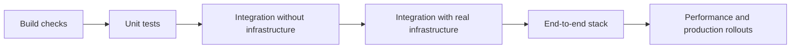
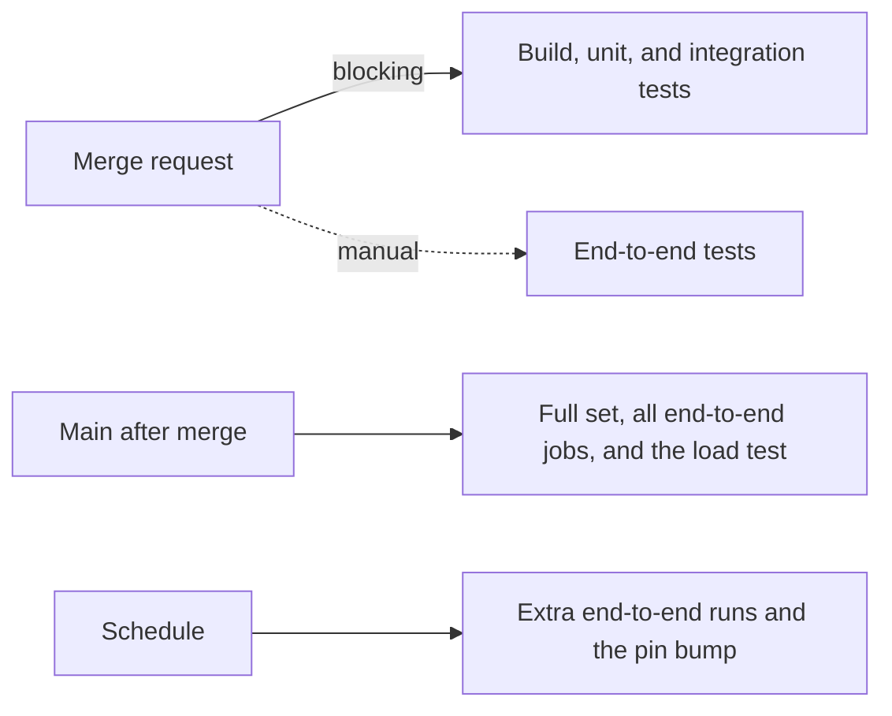

Orbit tests the system from the outside, as a black box.
A test states an input and the behavior that a caller must see, never how the code produces it.
**Most tests are data files, not code**, so a test stays valid when the code behind it changes.
Mocks replace only the systems that Orbit does not own, and the GitLab side of Orbit has its own tests in the GitLab project.

## Where the approach comes from

We took this approach from database testing, where a test is a file of input and expected output that reads the same in any language:

- PostgreSQL runs regression tests: SQL input files and their expected output.
- SQLite and DuckDB use `sqllogictest`: SQL statements and the rows each one must return.
- CockroachDB and Pebble use `datadriven` files: a list of commands, each with its expected output.

Orbit needs more than SQL in, rows out. A query test also sets the caller permissions and checks redaction, and an indexer test runs handlers and checks the graph.
So each Orbit harness defines its own steps in the `datadriven` style.
The end-to-end suites use plain-language Robot Framework keywords, such as `Create User`.
Each test reads as a specification of what a user does and sees.

## Principles

- **Prefer integration, scenario, and end-to-end tests over unit tests.** Use a unit test only for pure logic that a higher layer cannot reach.
- Write new correctness tests as data-driven scenarios. If a case does not fit, extend the harness. Do not write a one-off test.
- **Every bug fix gets a test that fails before the fix.** Write it at the layer where a user can see the bug.
- Test the behavior that Orbit owns against real infrastructure. Mock only the systems that Orbit does not own, such as GitLab authorization and repository storage.
- Keep tests deterministic. A test that gates a merge checks results and query plans, never wall-clock time.
- A test never depends on the state that another test leaves.
- Do not delete a test until a scenario checks every one of its assertions.
- Every marked query example in the user docs, the design documents, and the Orbit skill runs as a test.
- A new test goes in a target that CI runs. A test that no job selects proves nothing.

## Layers

Each layer adds more of the real system. A failure at a low layer is fast to find, and a pass at a high layer proves more.

| Layer | What it proves | What it catches |
| ----- | -------------- | --------------- |
| [Build checks](build-checks.md) | Inputs that the compiler cannot type-check are valid | A bad schema, query limit, prompt, or skill file |
| [Unit tests](unit-tests.md) | Pure logic and repository consistency | A wrong parser branch or a stale generated file |
| [Integration without infrastructure](integration/README.md) | The query compiler, the code-graph engine, and the command-line tool work on real inputs | Wrong SQL, a wrong code-graph edge, a broken command |
| [Integration with real infrastructure](integration/scenarios.md) | Query and indexer scenarios give the right rows in a real graph store and message broker | Wrong results, a missing scope filter, a lost message |
| [End-to-end tests](end-to-end/README.md) | The full GitLab and Orbit stack works the way a user sees it | A break between GitLab, Siphon, the indexer, and the query API |
| [Performance](performance/README.md) | How fast Orbit answers, and how it behaves at scale | A slower query, more rows read, more memory |
| [Fuzzing](fuzzing.md) | The parsers and decoders survive random input | A crash or a hang on unexpected input |

## How a change is tested

A merge request that changes code must pass the build checks, the unit tests, and both integration layers.
[Merge gates](merge-gates.md) lists every check and review, and [Testing commands](../development/testing-commands.md) lists the command for each layer.
