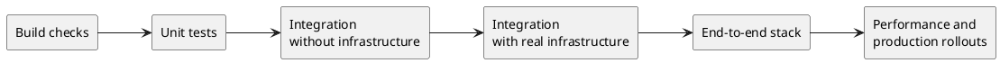

**TL;DR:** Orbit tests behavior at the highest layer that can see it. New
correctness tests are data files that run real Orbit code, most of them
against real infrastructure.
Mocks replace only the systems that Orbit does not own. The GitLab side of
Orbit has its own tests in the GitLab project.

## Principles

- Prefer integration, scenario, and end-to-end tests over unit tests. Use a
  unit test only for pure logic that a higher layer cannot reach.
- Write new correctness tests as data-driven scenarios. If a case does not
  fit, extend the harness. Do not write a one-off test.
- Every bug fix gets a test that fails before the fix. Write it at the layer
  where a user can see the bug.
- Test the behavior that Orbit owns against real infrastructure. Mock only
  the systems that Orbit does not own, such as GitLab authorization and
  repository storage.
- Keep tests deterministic. A test that gates a merge measures cost in rows or
  bytes read, never in wall-clock time.
- A test never depends on the state that another test leaves.
- Do not delete a test until a scenario checks every one of its assertions.
- Every marked query example in the user docs, the design documents, and
  the Orbit skill runs as a test.
- A new test goes in a target that CI runs. A test that no job selects
  proves nothing.

## Terms

- A **test layer** is one level of the stack in the diagram.
- A **scenario** is a data file that a harness turns into one or more tests.
- The **end-to-end stack** is one full deployment of GitLab and every Orbit
  component.

## Layers

| Page | What it covers |
| --- | --- |
| [Build checks](build-checks.md) | Inputs that the compiler cannot type-check |
| [Unit tests](unit-tests.md) | Pure logic and repository consistency |
| [Integration without infrastructure](integration.md) | The query compiler, the code-graph engine, and the command-line tool |
| [Integration with real infrastructure](infrastructure.md) | Query and indexer scenarios against a real graph store and message broker |
| [End-to-end tests](end-to-end.md) | The full GitLab and Orbit stack, used the way a user does |
| [Performance](performance.md) | Load tests, benchmarks, and production rollouts |
| [Fuzzing](fuzzing.md) | Random input to the parsers and decoders |
| [Merge gates](merge-gates.md) | The checks and reviews around the tests |
| [Testing commands](../development/testing-commands.md) | The command and the harness for each layer |
