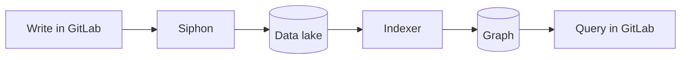
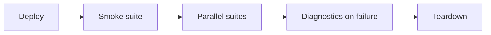
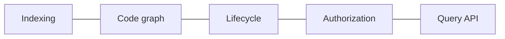
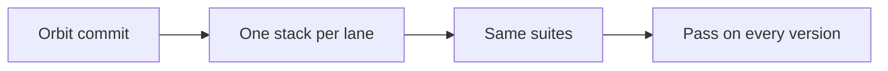
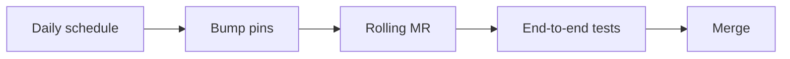
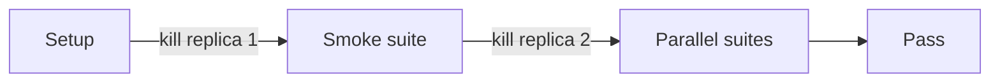

## What an end-to-end test proves

An end-to-end test uses Orbit the way a customer does. It creates data
through the GitLab API. Then it asks Orbit for that data with a query.

Nothing in between is mocked. The data travels from the GitLab database,
through Siphon and the data lake, into the graph. The answer comes back
through GitLab. A test passes only when every piece on that path works.

This is the only layer that sees all the pieces at once. The lower layers
test each piece on its own.

## One stack per run

Each run deploys its own copy of GitLab and Orbit on a shared Kubernetes
cluster. The copy lives in its own namespaces, named after the commit. Two
runs never share a database or a queue.

The run removes its stack when it ends. A run can die before it cleans up.
The next run removes any stack that is older than two hours.

Every component runs a pinned version. One file in the repository holds all
the pins. The GitLab pins go down to the image digest. A moving tag could
let two GitLab pods run different code.

The Orbit image depends on where the run starts. On a merge request, the run
builds Orbit from the branch. After a merge, it uses the image that the main
pipeline already built.

## How a run works

Setup deploys every component in one pass. Slow steps overlap. Orbit starts
while GitLab is still booting.

The tests are Robot Framework suites. They run in a pod inside the cluster.

The smoke suite runs alone first. It creates the admin credentials. It turns
on Orbit queries for the instance. It creates a namespace with Orbit enabled.
Then it waits until a test issue and a test note show up in the graph. That
proves the pipeline is live before any other suite starts.

Every other suite then runs in parallel. Each suite gets its own bot user.
GitLab limits Orbit queries per user. One shared user would make the suites
throttle each other.

A suite never depends on data from another suite. A new suite joins the
parallel pool on its own, with no registration.

Indexing is [eventually consistent](../architecture/indexing/resiliency.md).
A test can't check the graph right after it writes to GitLab. It polls Orbit
until the expected node or edge appears. Each wait has a time budget. Slower
stacks get a bigger budget.

When a run fails, it collects the pod logs, the ClickHouse state, and the NATS
state. Then it removes the stack. A green run skips that step. CI keeps the
diagnostics for three days.

## What the suites cover

The indexing suites create projects, work items, notes, epics, and
vulnerabilities. They check that the nodes and the edges reach the graph. They
also check memberships and project creators.

The code suites push small repositories in a few languages. They check that
files, definitions, and imports reach the graph. One suite pushes the code
first and enables Orbit after. That tests the backfill of existing projects.

The lifecycle suites change data after it's indexed. A note deleted in GitLab
must disappear from the graph. A disabled namespace keeps its data. A
re-enabled namespace indexes new data again.

The authorization suites give users different roles. Each role runs the same
queries. A private project must stay hidden from a user who can't read it.
An aggregation must count only what the role can see.

The query suites cover the API surface. They run neighbors, path finding,
pagination, and each response format. They also check that a scoped query
still finds data in another top-level group.

## Testing multiple GitLab versions

Orbit runs with more than one GitLab version. GitLab.com runs the latest
GitLab code. Self-managed and Dedicated instances run a released version. The
same Orbit release must work with all of them.

The main job runs the suites against GitLab master. A second job runs the same
suites against each released version we support. We call each version a lane.

A lane has its own pins: the GitLab chart, the GitLab commit, and the image
digests. Siphon reads its table list from that commit. Each lane replicates
the tables that its own GitLab version defines. To support a new version, we
add a lane.

The lanes run in parallel, one stack each. They run after each merge to main
and on a daily schedule. On a merge request, someone starts them by hand.

An older GitLab can lack an Orbit endpoint that came later. The tests treat a
missing endpoint as absent, not as a failure. A server error still fails the
test. That way an older lane only fails on a real Orbit problem.

## Keeping the pins current

Pins go stale. A daily job moves each pin to its newest build. That includes
GitLab master, each GitLab lane, Siphon, and the Orbit release.

The job pushes the new pins to one rolling merge request. If that request is
already open, the job updates it. On that request, the main end-to-end job
runs on its own and blocks the merge. The lanes run too, but they don't block.

A lane can be pinned by hand. The release images for a GitLab version come
from its last release tag. An Orbit backport can land on the stable branch
before the next patch release. Then the lane uses images built from that
branch instead. The daily job leaves a hand-pinned lane alone.

## The high availability variant

Production ClickHouse runs with replicas. A variant runs the same suites on
three ClickHouse replicas. It kills one replica at the end of setup. It kills a
second one a minute after the parallel suites start. Every test must still
pass.

Writes to a replicated cluster are slower. This variant gives each wait five
times the usual budget. It runs after each merge to main and on a daily
schedule.

The commands to run a stack yourself are in the
[end-to-end testing harness](../development/e2e-testing.md).
