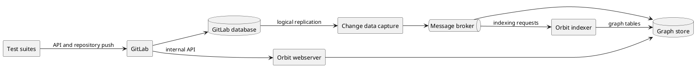

End-to-end tests deploy GitLab and every Orbit component. Then they
create data through the GitLab API and query until the expected graph appears.
A pass proves the full chain, from a database row to a query response.

## Contracts

- The end-to-end job runs after each merge to the main branch. On a merge
  request a person starts it, and it does not block the merge.
- Each run gets its own isolated stack and removes it at the end.
- A run on a merge request builds the Orbit image from its branch.
- The suites cover indexing, code indexing and backfill, role-based
  authorization, redaction, incremental updates, the namespace lifecycle,
  the API, query shapes, and cross-namespace traversal.
- Each suite uses its own user, because the query rate limit applies to each
  user.
- A variant runs the same suites on a replicated graph store and stops
  replicas during the run.
- A second variant runs the same suites on the supported stable GitLab
  versions.
- A daily job moves the pinned GitLab, change-data-capture, and Orbit image
  versions to their latest versions. That change merges only when the
  end-to-end tests pass.
- Setup and debugging are in the
  [end-to-end testing harness](../development/e2e-testing.md).
