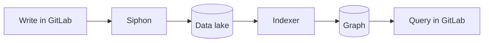

## What an end-to-end test proves

An end-to-end test uses Orbit the way a customer does.
It writes data through the GitLab API, then queries Orbit through GitLab.

Nothing on that path is mocked, and the answer passes through the same authorization and redaction as in production.
**A test passes only when every piece on that path works.**
No other layer sees all the pieces at once.

Each run deploys its own copy of GitLab and Orbit, in namespaces named after the commit, on a [shared Kubernetes cluster](cluster.md).
Two runs never share a database or a queue.
A run removes its stack at the end, and each new run first removes stacks that are a few hours old.

## When the tests run

| Pipeline | Main job | Version lanes and the ClickHouse HA variant |
| -------- | -------- | ------------------------------------------- |
| After each merge to main | Runs, and a failure turns main red | Run, and a failure also turns main red |
| A merge request | Manual, and does not block | Manual, and do not block |
| The rolling pin-bump merge request | Runs, and **blocks the merge** | The lanes run and do not block. The HA variant is manual. |
| A schedule | Has no schedule of its own | Run on their own schedules |

On a merge request, the run builds Orbit from the branch.
After a merge, it uses the image that the main pipeline built.

## Pages

- [The test cluster](cluster.md) covers the shared cluster, the harness repository, and how runs stay apart.
- [How a run works](how-a-run-works.md) follows one run from the trigger to the result.
- [Suites](suites.md) covers what the suites check and the rules for a new suite.
- [Versions and pins](versions-and-pins.md) covers the GitLab version lanes, the pins, and the ClickHouse HA variant.

The commands to run a stack yourself are in the [end-to-end testing harness](../../development/e2e-testing.md).

## Design rationale

We test through GitLab, because customers reach Orbit only through GitLab.
We deploy a fresh stack for each run, because a shared environment keeps state from earlier runs.
A failure then depends on what ran before.
