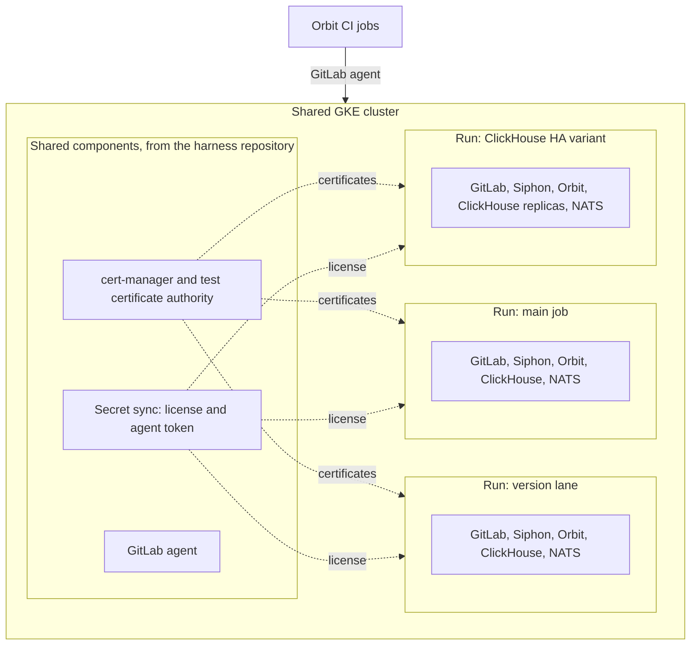

## One cluster, many stacks

Every end-to-end run deploys into one shared Google Kubernetes Engine (GKE) cluster.
The cluster holds a few shared components, and each run adds its own full stack next to the others:

## The harness repository

The [orbit-e2e-harness](https://gitlab.com/gitlab-org/orbit/orbit-e2e-harness) repository installs the shared components.
Its CI shows a diff of the changes on a merge request and applies them after the merge.
So the cluster setup is reviewed like code.

| Component | Purpose |
| --------- | ------- |
| GitLab agent for Kubernetes | Lets the CI jobs of the Orbit and harness projects deploy to the cluster, with no cluster credentials in CI |
| cert-manager and the test certificate authority | Issues the certificate for the Orbit gRPC endpoint in each run, so GitLab talks to Orbit over TLS as in production |
| Secret sync from Google Secret Manager | Keeps the GitLab license and the agent token in the cluster, so no run stores a secret |

A run reads only these shared parts.
Everything else that a run needs, it deploys itself and removes at the end.

## How runs stay apart

**Each run lives in its own namespaces, named after the commit and the job.**

The main job, each version lane, and the ClickHouse HA variant add their own suffix.
So one merge to main can run several stacks at the same time.

- **No shared data.** Each run makes its own passwords and keys, and the run removes its databases and their storage at the end.
- **Its own endpoints.** The test runner reaches GitLab and Orbit through service names inside its own namespaces.
- **Cluster-wide leftovers.** The GitLab chart also creates a few cluster-wide objects. Setup removes the ones that a removed run left behind, so a new install does not fail on them.
- **Cleanup in two places.** Each job removes its namespaces at the end. A job can stop before that, so each new run also removes the namespaces that are a few hours old.

## Capacity

Each pod states its own CPU and memory requests, and the cluster has no quota for each run.
When the runs need more than the cluster has, pods wait, and the cluster autoscaler adds nodes.
The cluster has a main node pool with fast local SSD storage and a fallback pool.
The autoscaler removes extra nodes when the runs end.

On a merge request, a new commit cancels the running job, so an old run does not hold capacity that a new run needs.

## Inside one run

One test runner pod runs the suites.
The smoke suite runs alone, and then the other suites run in a pool of parallel workers in the same pod.
So there are two levels of parallel work: several stacks in the cluster, and several suites in each stack.
