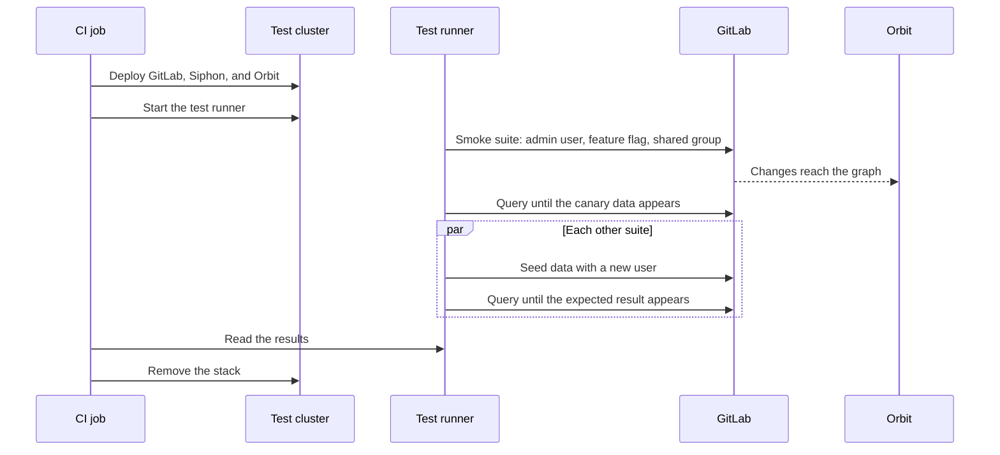
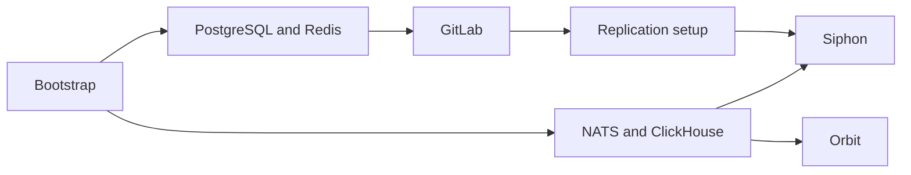

## The run at a glance

One run deploys a stack, proves that data reaches the graph, runs every suite, and removes the stack.



## 1. Deploy the stack

On a merge request, the job builds a debug image of Orbit from the branch, in the background while the stack deploys.
Setup removes old stacks, makes new secrets, and reads the list of replicated tables from the pinned GitLab commit.
Then the deploy runs in waves, and each component waits only for what it needs:



Orbit starts while GitLab is still booting, and a background step activates the license and creates the first administrator token.

## 2. Prove the pipeline with the smoke suite

The suites are Robot Framework files that run in a pod inside the cluster.
The smoke suite runs alone first. It creates an administrator user and token, turns on the GQL query language, and creates a shared group with Orbit turned on.
Then it creates a canary project, issue, and note, and queries Orbit until they appear in the graph.

**When the smoke suite passes, the whole data path works.**

A failure in a later suite then points to the feature under test, not to the stack.

## 3. Run the other suites in parallel

Every other suite starts at the same time, and each creates its own administrator user, because GitLab limits Orbit queries for each user.
Indexing is [eventually consistent](../../architecture/indexing/resiliency.md), so a test polls Orbit until the expected result appears:

```plaintext
create the data in GitLab
deadline = now + budget × multiplier
repeat:
    if a query through GitLab returns the expected node or edge:
        pass
    if now > deadline:
        fail with the last result
    wait a short time
```

A slower stack, such as the ClickHouse HA variant, gets a larger multiplier.
A test reads like the steps that a user takes:

```robotframework
Group Membership Produces A MEMBER_OF Edge
    ${suffix}=    Random Suffix
    ${user}=    Create User    e2e-member-${suffix}
    Add Group Member    ${SHARED_NAMESPACE_ID}    ${user["id"]}    20
    Start Indexing Budget    180
    Wait For Edge Indexed Within Budget    User    ${user["id"]}
    ...    MEMBER_OF    Group    ${SHARED_NAMESPACE_ID}
```

## 4. Collect the results and remove the stack

Every run saves the test report and the Orbit logs.
A failed run also saves the pods, events, and logs of every component.
It also saves the ClickHouse tables, errors, and insert and merge logs, and the NATS streams and consumers.
CI keeps these files for a few days. Start with the test report, then the Orbit logs, then the ClickHouse state.

The job always removes the stack. If the job stops first, the next run removes it.

## Design rationale

We prove the data path once, in the smoke suite.
Otherwise a broken stack fails every suite at once and hides the first error.
We poll with a budget, because a fixed wait is too short on a slow stack and wastes time on a fast one.
