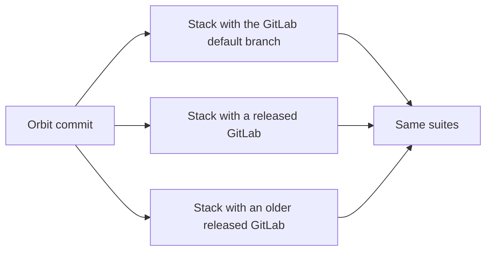
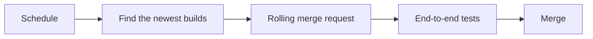
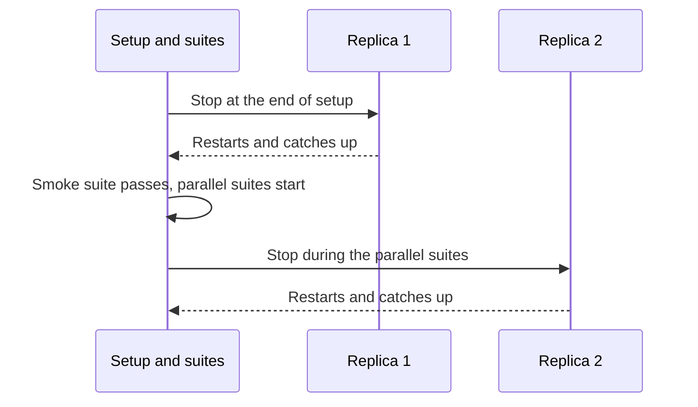

## GitLab version lanes

GitLab.com runs the latest GitLab code, and GitLab Self-Managed and GitLab Dedicated run released versions.
**The same Orbit release must work with all of them.**

The main job tests against the GitLab default branch, which matches GitLab.com.
A second job runs the same suites against each supported released version, which we call a lane.
Each lane has its own GitLab chart, commit, and image digests, and Siphon replicates the tables that its GitLab version defines.
To support a new GitLab version, we add a lane.

## Pins

The stack pins each component that Orbit does not build: GitLab, Siphon, ClickHouse, the message broker, and the databases.
Then a failure cannot come from a change that nobody made in Orbit.
GitLab images are pinned to a digest, because a moving tag can let two GitLab pods run different code.
No run deploys a pinned Orbit image. A CI run tests the Orbit image of its own commit.

A scheduled job moves the pins forward.
It finds the newest GitLab, Siphon, and Orbit builds, and publishes the replicated tables for the new GitLab commit.
Then it pushes the pins to one rolling merge request.
The main end-to-end job **blocks that merge request until it passes**, so a GitLab change that breaks Orbit shows up before a release.

A lane can be pinned by hand, for example to images from a GitLab stable branch that holds an Orbit backport.
The scheduled job skips a hand-pinned lane. Today every lane is hand-pinned, so the job moves only the default-branch pins.

A CI check compares the redaction settings in the ontology with the GitLab permission policies of the pinned commit.
A pin that renames or removes an ability fails the check before it merges.

## ClickHouse HA variant

Production ClickHouse runs with replicas.
The ClickHouse HA variant runs the same suites on a replicated ClickHouse cluster and stops replicas during the run:

**Every test must still pass, and each replica must catch up in a time limit.**

Replicated writes are slower, so this variant multiplies each wait budget.
