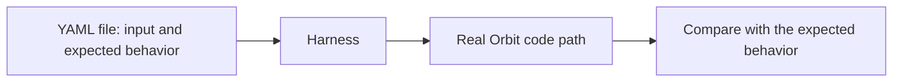

## The test pattern

Integration tests run real Orbit code on real inputs, and most of them follow one pattern:

- **A YAML file declares the test:** the input, such as seed rows, source files, or a query, and the behavior to expect.
- **The harness runs the real code path,** the way production compiles, indexes, or queries.
- **The harness checks only what a caller can observe:** result rows, the graph, messages, or the query plan. It never calls an internal function.

To add a test, add a file. The harness finds it with no registration and no Rust code.
**Similar tests share a folder, one for each behavior**, so a reader finds every test of one behavior in one place.

## Harnesses

| Harness | Checks | Infrastructure |
| ------- | ------ | -------------- |
| [Plan tests](compiler-and-code-graph.md#plan-tests) | The query plan and the generated SQL | None |
| [Code-graph suites](compiler-and-code-graph.md#code-graph-suites) | The code graph, with graph queries | None |
| Command-line tests | The output and the local graph of the real binary | None |
| [Query and indexer scenarios](scenarios.md) | The query response, and the graph that the indexer writes | ClickHouse |
| [Container tests](containers.md) | The message broker, code indexing, and analytics events | ClickHouse, NATS, and an event collector |

The command-line and container tests are Rust tests, but they also check only observable behavior.
The command-line tests run the real binary against temporary repositories.
They cover concurrent readers and writers, repeated indexing, worktrees, nested repositories, unreadable files, and the bundled skills.

## When they run

Every harness runs on each merge request that changes code and on each commit to main, and **a failure blocks the merge**.
In CI, a run continues after a failure, retries a failed test, and reports each test.
A check fails if a container test is in no CI lane or in two lanes, so no test drops out of CI.

## Design rationale

We write tests as data, because a data file states what Orbit must do, not how the code does it.
So the test stays valid through a refactor.
We test the real code path, because a mock of an Orbit part repeats the assumptions of the code under test.
We mock only the systems that Orbit does not own: GitLab authorization and repository storage.
