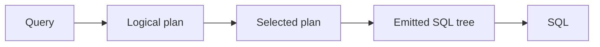

## Plan tests

The query compiler turns a graph query into SQL for ClickHouse.
A small compiler change can make a query return wrong rows, or scan a table that it did not scan before.
**Plan tests catch both kinds of regression without a database.**



A plan test gives a query and states what the plan must look like, as in this trimmed example:

```yaml
name: Covered center filters retain fused neighbor scans
query:
  gql: |
    MATCH (mr:MergeRequest {state: 'merged'})-[:IN_PROJECT|AUTHORED]-(neighbor) RETURN mr, neighbor
physical:
  clickhouse:
    planned:
      expect: ["(Neighbors center=mr direction=both fused table=gl_edge ... (_))"]
    emitted:
      occurrences:
        - pattern: (Scan Table(gl_edge) AS e)
          count: 1
      reject: ["(Scan Table(gl_merge_request) ...)", "(Union ... (...))"]
```

The patterns are trees, and `...` and `_` match any part, so a test pins only the part of the plan that matters.

| Check | Catches |
| ----- | ------- |
| `expect` | A filter in the wrong step, which can return wrong rows or read more data |
| `occurrences` | A table that the plan now scans more than once |
| `reject` | A costly shape, such as a union or an extra table scan |

In the example, the neighbors query must scan the edge table once and never scan the merge request table.
Plan tests never measure time, so they give the same result on any machine.
Other compiler tests check the SQL for each database dialect, ontology loading, virtual columns, and named queries.

## Code-graph suites

A code-graph suite declares source files inline, indexes them with the real engine into an in-process database, and checks the graph with graph queries:

```yaml
name: "Python: simple function call"

fixtures:
  - path: main.py
    content: |
      def foo():
          pass

      foo()

tests:
  - name: File has edge to foo (structural + call)
    query: |
      MATCH (f:File)-[:DEFINES|CALLS]->(d:Definition)
      WHERE d.name = 'foo'
      RETURN f.path AS file, d.fqn AS target
    assert:
      - { row_count: 2 }
      - { row: { file: "main.py", target: "main.foo" } }
```

The file defines `foo` and calls it, so the graph must hold one definition edge and one call edge to `main.foo`.
Each language and framework has its own folder of suites, and incremental suites add, change, and remove files in steps.

**A suite fails if the engine writes a relationship that the graph schema does not declare.**

The build turns each suite file into its own test, so a new file runs with no registration.
