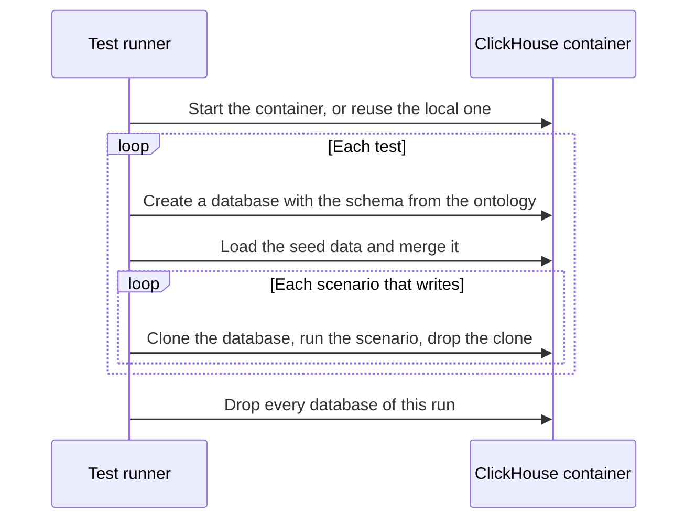

## One ClickHouse for the whole run

The scenarios and the other container tests share one ClickHouse container, and each test gets its own database in it.

1. **Start the container.** On a laptop, the container stays up between runs. In CI, each job starts its own container in Docker and removes it at the end.
1. **Create the schema from the ontology.** The tests read the same tables that the indexer writes in production. A schema change reaches the tests with no extra step.
1. **Give each test its own data.** A scenario that only reads shares the database. A scenario that writes gets a clone, which copies the tables without copying data on disk.
1. **Make reads deterministic.** ClickHouse merges duplicate rows in the background, so the harness merges the seed data before the test reads it.

Each run gives its databases a unique prefix, and the runner drops them all at the end.

## Mocks for the systems that Orbit does not own

| System | What the mock does |
| ------ | ------------------ |
| GitLab authorization | Answers each redaction request from the list of readable resources in the scenario |
| GitLab repository archives | A local HTTP server returns a repository archive, or a slow answer, an empty archive, an error, or a new archive between two runs |
| GitLab file content and diffs | A local HTTP server returns file content and merge request diffs in the GitLab format |

With the archive mock, the code indexing tests run the real download, extraction, and indexing path.
They check reindexing, stale-row cleanup, disk cleanup, and writer failures.

## Message broker and analytics events

The broker tests start a NATS container with JetStream and check what the indexer depends on:

- acknowledgements, redelivery, and keep-alives
- stream updates during a rolling update
- delivery limits, the dead-letter queue, and stuck-message cleanup
- locks and storage slots across pods
- the cleanup of old releases and schema versions

A suite makes a certificate authority at run time and proves that the broker rejects a client with no certificate or the wrong one.

The analytics test sends a query event to a local event collector, which validates it against the published event schemas.
An event that the analytics pipeline would reject fails the test.
