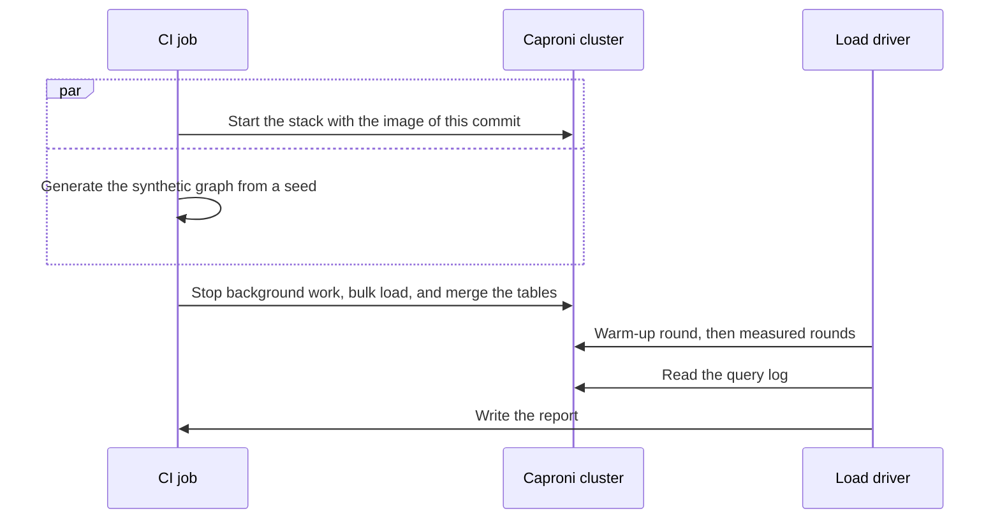

## What the load test measures

The load test shows how fast each query shape answers under concurrent load, and how much work ClickHouse does for each query.
It measures the query path only. The graph arrives through a bulk load, not through the indexer.

The test runs in one CI job, on a local [Caproni](https://gitlab.com/gitlab-org/caproni) cluster with ClickHouse, NATS, PostgreSQL, and the Orbit query service.
There is no GitLab and no Siphon: the load driver signs the token and answers the redaction requests itself.

1. **Prepare.** The job starts the stack and generates a synthetic graph from the ontology, a size profile, and a fixed seed. Each run gets the same graph.
1. **Quiet the cluster.** It stops the dispatcher and the scheduled view refreshes, and gives ClickHouse and the query service fixed CPU and memory.
1. **Load.** It loads the graph, merges every table, and checks that each node ID that a scenario pins exists.
1. **Query.** The driver sends each performance scenario many times at once, in a shuffled order each round, and discards the warm-up round.
1. **Report.** Each request carries a correlation ID that appears in the ClickHouse query log. The report joins the time that the caller waits with the work that ClickHouse did.

For each scenario, the report shows the request and error counts, the median, p90, and max latency, and the spread between rounds.
It also shows the ClickHouse time, the rows read, and the peak memory, and names the commit, the image digest, and the runner CPU.

## When it runs

It runs after each merge to main, one run at a time, and on merge requests that change the query path. Other merge requests can start it by hand.
**It never blocks a merge.**
The job fails only when the setup fails, a pinned ID is missing, or a request fails. No latency fails the job.
On a merge request, the job posts the report as a comment and updates the same comment on each run.

## How to read a report

Compare the report with the last report from main:

- **Rows read is the stable signal.** It does not depend on the machine, so a change means that the query plan changed.
- **Latency is the noisy signal.** Check the spread first, and run the job again before you trust a change.
- **Memory shows the risk of failure.** A query whose peak memory grows toward the limit can fail at production scale.
