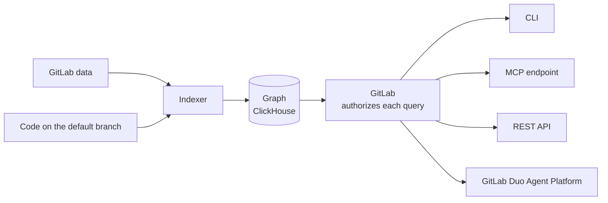



- Tier: Premium, Ultimate
- Offering: GitLab.com, GitLab Self-Managed, GitLab Dedicated





- [Introduced](https://gitlab.com/gitlab-org/gitlab/-/work_items/583676) in GitLab 18.10 [with a feature flag](https://docs.gitlab.com/administration/feature_flags/) named `knowledge_graph`. Disabled by default. This feature is an [experiment](https://docs.gitlab.com/policy/development_stages_support/#experiment).
- [Changed](https://gitlab.com/gitlab-org/gitlab/-/work_items/583676) to [beta](https://docs.gitlab.com/policy/development_stages_support/#beta) in GitLab 19.1.
- [Enabled on GitLab.com, GitLab Self-Managed, and GitLab Dedicated](https://gitlab.com/gitlab-org/gitlab/-/merge_requests/245620) in GitLab 19.3.
- [Generally available](https://gitlab.com/gitlab-org/gitlab/-/merge_requests/259054) in GitLab 19.5. Feature flag `knowledge_graph` removed.



GitLab Orbit is a read-only property graph of your GitLab data and code.
GitLab builds it for each top-level group where GitLab Orbit is turned on, keeps it current,
and checks your permissions on every query.

## What the graph contains

Each entity, such as a project, a user, or a function, is a node.
Each relationship, such as a user who authored a merge request, is a directed edge. The graph has two connected layers:

- The software development lifecycle (SDLC) layer holds GitLab objects, such as groups, projects, merge requests, pipelines, and work items.
- The code layer holds files, directories, definitions, and imports.
  A project contains branches, and a branch contains the files of the code layer.

For the full list of node types and relationships, see [What GitLab Orbit indexes](schema.md).

## How GitLab Orbit indexes your data

After you [turn on GitLab Orbit](quickstart.md#step-1-turn-on-gitlab-orbit-for-your-group) for a group,
the indexer builds the graph from two sources:

- SDLC data. GitLab streams changes through a change data capture (CDC) pipeline to the
  [GitLab Data Insights Platform](https://handbook.gitlab.com/handbook/engineering/architecture/design-documents/data_insights_platform/),
  which writes them to ClickHouse. A new merge request, work item, or pipeline is in the graph in minutes.
- Source code. The indexer fetches the files of the default branch through the GitLab internal API,
  parses them, and indexes again when the default branch changes. You cannot select another branch.

Results show your data as of the last index cycle.
The first index can take up to a few hours. Later updates take seconds to minutes.
To check the progress, run `glab orbit graph-status --full-path <my-group>`.

## How a query runs

Queries use the [Cypher query language](queries/cypher.md).
Every query follows the same path:

1. GitLab receives the query from the CLI, the REST API, the MCP endpoint, or GitLab Duo Agent Platform.
1. The query engine validates the query against the schema and compiles it to ClickHouse SQL.
1. ClickHouse runs the SQL against the graph.
1. GitLab removes each result that you cannot access. For more information, see [Security](security.md).

## Where the graph runs

On GitLab.com, the graph is stored in ClickHouse, and the GitLab Orbit services run in a separate Kubernetes cluster.
They do not share compute or memory with GitLab.com.
On GitLab Dedicated, GitLab runs GitLab Orbit for your instance.
On GitLab Self-Managed, you run GitLab Orbit yourself. See [GitLab Orbit on GitLab Self-Managed](self-managed/_index.md).

## Data retention and deletion

When you turn off GitLab Orbit for a group, GitLab keeps the indexed data for 30 days.
If you turn it on again in that time, indexing continues from where it stopped.
After 30 days, GitLab deletes all graph data of the group.

## The local graph

The GitLab Orbit CLI also indexes repositories on your machine into a local graph of code only, with no authorization layer.
For more information, see [GitLab Orbit Local](local/_index.md).

## Billing

<!-- TODO(GA): confirm with Pricing what the add-on includes, and how GitLab Self-Managed and GitLab Dedicated are billed. -->
The GitLab Orbit add-on includes GitLab Credits for GitLab Orbit queries.
On GitLab.com, queries consume GitLab Credits with every access method, including Agent Platform.
For the rates, see [GitLab Credits and usage billing](https://docs.gitlab.com/subscriptions/gitlab_credits/).
For billing on GitLab Self-Managed and GitLab Dedicated, contact your GitLab account team.

| Access method | Calls that consume GitLab Credits | Calls that do not consume GitLab Credits |
|---------------|-----------------------------------|------------------------------------------|
| CLI | `query` | `status`, `ontology`, `dsl`, `tools`, `graph-status` |
| REST API | `POST /api/v4/orbit/query`, `POST /api/v4/orbit/query/:name`, `POST /api/v4/orbit/agent/commands/query_graph` | All other endpoints |
| MCP endpoint | `invoke_command` calls that run `query_graph` | `list_commands`, `get_graph_schema`, `get_query_dsl`, `get_response_format` |
| GitLab Duo Agent Platform | Queries that the agent makes for you | None |

- A query that succeeds consumes GitLab Credits, even when it returns no rows. A failed query and `CALL db.schema()` do not.
- GitLab Orbit bills each query to one top-level group.
- When the group has no GitLab Credits left, or its [free trial](trial.md) ends, queries fail.
  See [troubleshooting](troubleshooting.md#error-gitlab-credits-exhausted).
- The local graph never consumes GitLab Credits.

## Known issues

- GitLab Orbit indexes code on the default branch only.
  An answer about code on another branch reflects the default branch.
  For code that you have not merged, use the [local graph](local/_index.md).
- GitLab Orbit resolves imports and calls in one repository.
  It matches dependencies between repositories by name only.
- GitLab Orbit does not run on a GitLab Geo secondary site.
  After a failover, GitLab Orbit indexes the data again.
- GitLab Orbit is not available on GitLab Dedicated for Government.

## Related topics

- [What GitLab Orbit indexes](schema.md)
- [Security](security.md)
- [Cypher query language](queries/cypher.md)
- [GitLab Orbit Local](local/_index.md)
- [Troubleshooting](troubleshooting.md)
