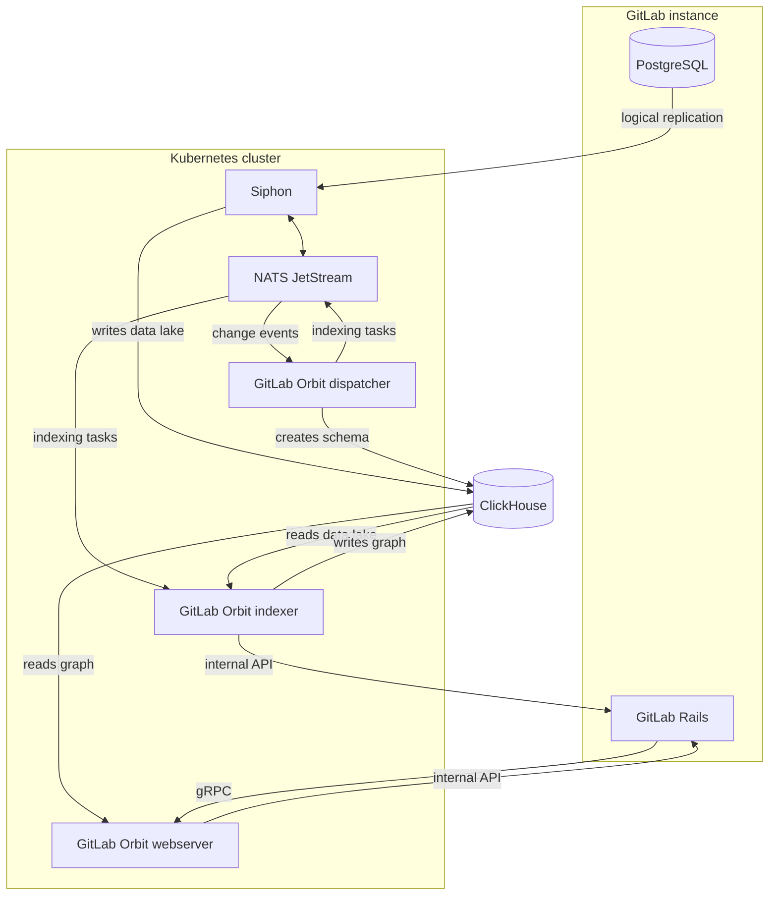



- Tier: Premium, Ultimate
- Offering: GitLab Self-Managed





- [Introduced](https://gitlab.com/groups/gitlab-org/-/epics/22739) in GitLab 19.2.2.
- Generally available in GitLab 19.5.



On GitLab Self-Managed, you run GitLab Orbit next to your instance. A deployment has two parts:

- A data pipeline, Siphon and NATS, that copies the GitLab database into ClickHouse.
- GitLab Orbit, which turns that copy into a queryable graph.

GitLab Orbit is distributed only as a Helm chart for Kubernetes. The Linux package does not include it.
Some component names use the earlier product name, GitLab Knowledge Graph, for example the `gkg` chart and the `gkg_*` ClickHouse users.
Install the chart on the cluster that runs GitLab, or on a separate cluster next to your instance.

| Page | Description |
|------|-------------|
| [Get started](getting-started.md) | Prerequisites, installation order, and shared configuration values |
| [Set up data replication](data-replication.md) | PostgreSQL logical replication and Siphon |
| [Set up GitLab Orbit](orbit-setup.md) | The ClickHouse database and identities, the GitLab connection, the GitLab Orbit chart, and group indexing |

## Architecture

| Component | Function |
|-----------|----------|
| Siphon | Copies rows from PostgreSQL into the ClickHouse data lake, through NATS. |
| Dispatcher | Watches the same NATS stream, owns the graph schema, and publishes indexing tasks back to NATS. |
| Indexer | Takes indexing tasks from NATS, reads the data lake, fetches source code over the GitLab internal API, and writes the property graph. |
| Webserver | Answers queries from the graph that GitLab sends over gRPC, and fetches file content over the internal API when a query needs it. |

## Geo and recovery

GitLab Orbit does not run on a GitLab Geo secondary site. GitLab Orbit holds no data of its own. If you lose the graph database, or after a failover to another site,
rebuild the graph by indexing again. For ClickHouse redundancy, see [high availability](getting-started.md#high-availability).

## Cryptographic module

The GitLab Orbit server image links the
[AWS-LC-FIPS 4](https://github.com/aws/aws-lc/blob/main/crypto/fipsmodule/FIPS.md) cryptographic module,
which is in process at the NIST Cryptographic Module Validation Program.
All TLS connections (gRPC from GitLab, ClickHouse, and NATS) and JWT verification run inside it.
The server does not start when the module is not in FIPS mode.
Every published image tag carries the module, so there is no separate FIPS image.
The `orbit` command line tool for local indexing does not link the module.

For support, see the [Statement of Support](https://about.gitlab.com/support/statement-of-support/).
