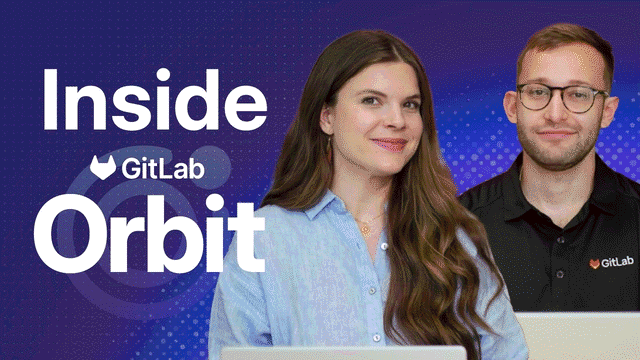
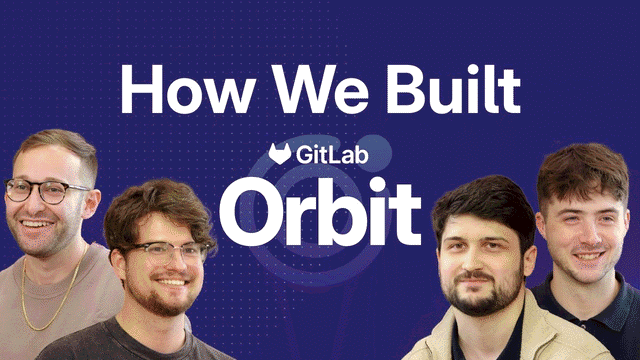

Software lifecycle context graph for AI agents
{.product-hero-title}



- Tier: Premium, Ultimate
- Offering: GitLab.com, GitLab Self-Managed, GitLab Dedicated





- [Introduced](https://gitlab.com/gitlab-org/gitlab/-/work_items/583676) as an [experiment](https://docs.gitlab.com/policy/development_stages_support/#experiment) in GitLab 18.10.
- [Changed](https://gitlab.com/gitlab-org/gitlab/-/work_items/583676) from experiment to beta in GitLab 19.1.
- [Introduced](https://gitlab.com/groups/gitlab-org/-/epics/22739) for GitLab Self-Managed in GitLab 19.2.2.
- [Generally available](https://gitlab.com/gitlab-org/gitlab/-/merge_requests/259054) in GitLab 19.5.



<section class="product-landing product-hero">

GitLab Orbit indexes your GitLab data and code into a graph your agent can query.
Ask which of your projects a CVE affects, which changes reached production before an incident,
or what a merge request affects outside its diff.
Your agent answers with a few graph queries in place of many file reads and API calls.
{.product-hero-lead}

[Quickstart](quickstart.md) [ Watch GitLab Orbit in two minutes](https://www.youtube.com/watch?v=dKaPp-TWd_o)
{.product-hero-actions}

<!-- Video published on 2026-09-03 -->

</section>

- [Ask across code and lifecycle](prompt-examples.md) One graph connects your GitLab data and code, so one question can cross both.
- [Run one query in place of many API calls](how-it-works.md) Your agent sends one graph query and gets back rows, not pages of JSON to filter.
- [Get only the data you can access](security.md#how-gitlab-orbit-enforces-access) GitLab Orbit filters every answer by your GitLab permissions.
{.product-cards .product-cards-icons}

## About GitLab Orbit

- [How GitLab Orbit works](https://www.youtube.com/watch?v=YtPc8kOmyi0) The architecture of GitLab Orbit, from indexing to queries.
- [How we built GitLab Orbit](https://www.youtube.com/watch?v=wddpf0rDGnA) A technical deep dive into the context graph.
{.product-cards .product-cards-2 .product-video-cards}

<!-- Videos published on 2026-07-06 and 2026-06-26 -->

- [Read the launch blog post](https://about.gitlab.com/blog/introducing-gitlab-orbit/) Introducing GitLab Orbit, from the GitLab blog.
- [See the roadmap](https://gitlab-org.gitlab.io/orbit/roadmap/) The work the GitLab Orbit team plans next, on the public GitLab Orbit roadmap.
{.product-cards .product-cards-2}

## Questions GitLab Orbit can answer

- [Review a merge request with proof](prompt-examples.md#review-a-merge-request-with-proof) Which code and projects does this merge request affect? Each finding comes with the graph result that shows it.
- [Fix a vulnerability across every affected project](prompt-examples.md#fix-a-vulnerability-across-every-affected-project) Which projects in my group does this CVE affect, and which fixes reached production?
- [Respond to a production incident](prompt-examples.md#respond-to-a-production-incident) Which changes to the failing component, and to the code that it calls, reached production this week?
- [Change shared code safely](prompt-examples.md#change-shared-code-safely) Which classes inherit from this base class, and what calls the method that I change?
{.product-cards .product-cards-2 .product-cards-icons}

For more examples, see [prompt examples](prompt-examples.md).

## Reference



- [Connect your agent](agents/_index.md)
- [Indexed data](schema.md)
- [Queries](queries/_index.md)
- [Security](security.md)
- [GitLab Self-Managed setup](https://docs.gitlab.com/orbit/self-managed/orbit-setup/ "Install GitLab Orbit on Kubernetes and connect it to GitLab.")
- [Troubleshooting](troubleshooting.md)



