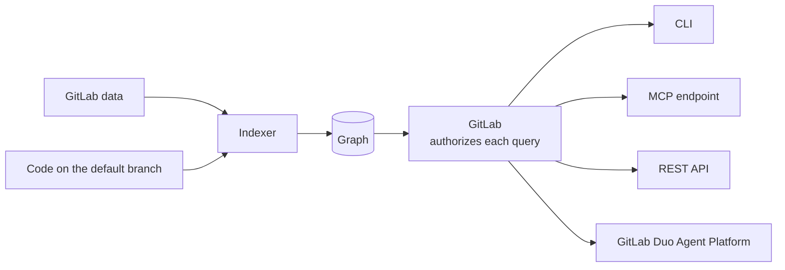



- Tier: Premium, Ultimate
- Offering: GitLab.com, GitLab Self-Managed, GitLab Dedicated





- [Introduced](https://gitlab.com/gitlab-org/gitlab/-/work_items/583676) as an [experiment](https://docs.gitlab.com/policy/development_stages_support/#experiment) in GitLab 18.10.
- [Changed](https://gitlab.com/gitlab-org/gitlab/-/work_items/583676) from experiment to beta in GitLab 19.1.
- [Generally available](https://gitlab.com/gitlab-org/gitlab/-/merge_requests/259054) in GitLab 19.5.



GitLab Orbit is a read-only property graph of your GitLab data and code.
GitLab builds it for each top-level group where GitLab Orbit is turned on, keeps it current,
and checks your permissions on every query.

## Graph layers

Each entity, such as a project, a user, or a function, is a node.
Each relationship, such as `AUTHORED` from a user to a merge request, is a directed edge.
The graph has two connected layers:

- The software development lifecycle (SDLC) layer holds GitLab objects, such as groups, projects, merge requests, pipelines, and work items.
- The code layer holds files, directories, definitions, and imports.
  A project contains branches, and a branch contains the files of the code layer.

For the full list of node types and relationships, see [indexed data](schema.md).

## Indexing

After you [turn on GitLab Orbit](quickstart.md#step-1-turn-on-gitlab-orbit-for-your-group) for a group,
the indexer builds the graph from two sources:

- SDLC data. GitLab streams changes through a change data capture (CDC) pipeline to the
  [GitLab Data Insights Platform](https://handbook.gitlab.com/handbook/engineering/architecture/design-documents/data_insights_platform/),
  and the indexer reads them from there. A new merge request, work item, or pipeline is in the graph in minutes.
- Source code. The indexer fetches the files of the default branch through the GitLab internal API and
  [Gitaly](https://docs.gitlab.com/administration/gitaly/), parses them, and indexes again when the default branch changes.
  You cannot select another branch. An answer about code on another branch reflects the default branch.
  For code you have not merged, use the [local graph](cli.md#local-graph).

Results show your data as of the last index cycle.
The first index can take up to a few hours.
Later updates take seconds to minutes.
To check the progress, see [check indexing progress with the GitLab Orbit CLI](cli.md#check-indexing-progress).

## Query execution

Queries use [GQL](queries/query-language.md), the GitLab Orbit query language.
Every query follows the same path:

1. GitLab receives the query from the CLI, the REST API, the MCP endpoint, or GitLab Duo Agent Platform.
1. The query engine validates the query against the schema and compiles it to SQL.
1. The graph database runs the SQL.
1. GitLab removes each result you cannot access. For more information, see [Security](security.md).

## Hosting

On GitLab.com, a separate graph database stores the graph, and the GitLab Orbit services run in a separate Kubernetes cluster.
They do not share compute or memory with GitLab.com.
On GitLab Dedicated, GitLab runs GitLab Orbit for your instance.
On GitLab Self-Managed, you run GitLab Orbit yourself.
For more information, see [GitLab Orbit on GitLab Self-Managed](https://docs.gitlab.com/orbit/self-managed/).

## Data retention and deletion

When you turn off GitLab Orbit for a group, GitLab keeps the indexed data for 30 days.
If you turn GitLab Orbit on again in that time, indexing continues from where it stopped.
After 30 days, GitLab deletes all graph data of the group.

## Related topics

- [GitLab Orbit roadmap](https://gitlab-org.gitlab.io/orbit/roadmap/)
- [Troubleshooting](troubleshooting.md)
