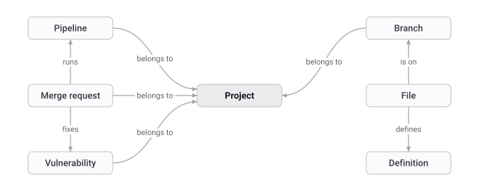
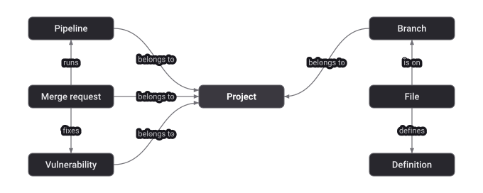



- Tier: Premium, Ultimate
- Offering: GitLab.com, GitLab Self-Managed, GitLab Dedicated





- [Introduced](https://gitlab.com/gitlab-org/gitlab/-/work_items/583676) in GitLab 18.10 [with a feature flag](https://docs.gitlab.com/administration/feature_flags/) named `knowledge_graph`. Disabled by default. This feature is an [experiment](https://docs.gitlab.com/policy/development_stages_support/#experiment).
- [Changed](https://gitlab.com/gitlab-org/gitlab/-/work_items/583676) to [beta](https://docs.gitlab.com/policy/development_stages_support/#beta) in GitLab 19.1.
- [Enabled on GitLab.com, GitLab Self-Managed, and GitLab Dedicated](https://gitlab.com/gitlab-org/gitlab/-/merge_requests/245620) in GitLab 19.3.
- [Generally available](https://gitlab.com/gitlab-org/gitlab/-/merge_requests/259054) in GitLab 19.5. Feature flag `knowledge_graph` removed.



GitLab Orbit indexes two kinds of data into one graph:

- Software development lifecycle (SDLC) objects from GitLab, such as groups, projects, users,
  merge requests, pipelines, work items, and security findings.
- Source code on the default branch of each project, such as files, directories, definitions, imports, and calls.
  Binary files get only a `File` node, with no definitions. GitLab Orbit does not index other branches.

The [local graph](cli.md#local-tables) on your machine holds only code.

The graph links these objects. For example, a merge request belongs to a project, runs a pipeline,
and fixes a vulnerability. A file is on a branch of the project and defines a definition.

{.orbit-graph-figure .orbit-graph-light}

{.orbit-graph-figure .orbit-graph-dark}

## Get the live schema

The node types, properties, and relationships change between releases.
To see the current schema, use one of these methods:

- In GitLab, in the top bar, select **Search or go to** > **Your work** > **GitLab Orbit**, then select the **Schema** tab.
  On GitLab.com, go to [`https://gitlab.com/dashboard/orbit/schema`](https://gitlab.com/dashboard/orbit/schema).
  For more information, see [GitLab Orbit dashboard](dashboard.md).
- In a terminal, run `glab orbit ontology`. To show the properties and relationships of node types,
  add their names, for example `glab orbit ontology MergeRequest Project`.
- Over HTTP, send a request to the [schema endpoint](queries/api.md#schema-endpoint), `GET /api/v4/orbit/schema`.
- In a query, run `CALL db.schema()`.

## Supported languages

The remote graph and the local graph use the same parser. Each language gets files, directories, and definitions.
Most languages also get imports and cross-file calls.

| Language | File extensions |
|----------|-----------------|
| Bash/Shell | `.sh`, `.bash`, `.zsh` |
| C | `.c`, `.h` |
| C++ | `.cpp`, `.cc`, `.cxx`, `.hpp`, `.hh`, `.hxx` |
| C# | `.cs` |
| Elixir | `.ex`, `.exs` |
| Go | `.go` |
| HCL (Terraform) | `.tf`, `.tfvars` |
| Java | `.java` |
| JavaScript | `.js`, `.jsx`, `.mjs`, `.cjs`, `.vue`, `.graphql`, `.gql`, `.json` |
| Kotlin | `.kt`, `.kts` |
| Lua | `.lua` |
| PHP | `.php`, `.phtml`, `.php3`, `.php4`, `.php5`, `.php7`, `.phps` |
| Python | `.py` |
| Ruby | `.rb`, `.rbw`, `.rake`, `.gemspec` |
| Rust | `.rs` |
| Scala | `.scala`, `.sc` |
| Swift | `.swift` |
| TypeScript | `.ts`, `.tsx`, `.mts`, `.cts` |
| YAML | `.yml`, `.yaml` |
| Zig | `.zig` |

Some languages have limits:

- Bash/Shell: function definitions and `source` or `.` imports only. No cross-file calls.
- Rust: cross-file `CALLS` and `EXTENDS` edges. No other reference edges.
- YAML: anchors and aliases. Mapping keys become definitions only in GitLab CI, ArgoCD,
  Helm, and Docker Compose files. No cross-file references.

Files in other languages still get a `File` node, with no definitions.

## Properties resolved at query time

Some properties are not stored in the graph.
The server fetches them from the repository when your query asks for them.

| Node type | Property | Value |
|-----------|----------|-------|
| `File` | `content` | Full source text of the file |
| `Definition` | `content` | Source text of the definition |
| `MergeRequest` | `diff` | Full unified diff of the merge request |
| `MergeRequestDiff` | `patch` | Full unified patch of the diff version |
| `MergeRequestDiffFile` | `diff` | Patch of one changed file |

Use these properties to read code without a separate call to the GitLab API.

## Identifiers and authorization

- Query responses return all entity IDs as strings, even when the stored value is an integer.
  This prevents precision loss in JavaScript clients for values above `Number.MAX_SAFE_INTEGER`.
- On the server, a `Definition` ID is a content hash scoped to the project and branch.
  The same function in two projects has two different IDs.
- GitLab checks your access to each entity before it returns a result.
  For more information, see [Security](security.md).

## Related topics

- [GitLab Orbit architecture](how-it-works.md)
- [Query language](queries/query-language.md)
- [Local graph](cli.md#local-graph)
- [CLI](cli.md)
- [Prompt examples](prompt-examples.md)
