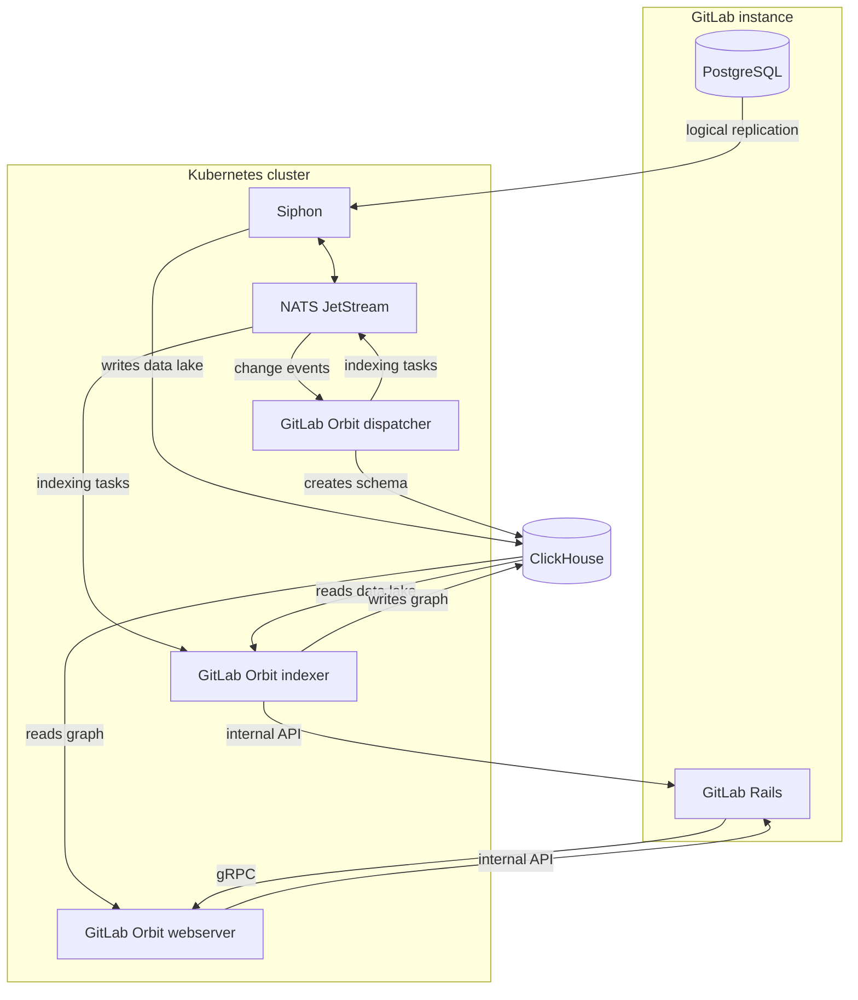



- Tier: Premium, Ultimate
- Offering: GitLab Self-Managed





- [Introduced](https://gitlab.com/groups/gitlab-org/-/epics/22739) in GitLab 19.2.2.
- [Generally available](https://gitlab.com/gitlab-org/gitlab/-/merge_requests/259054) in GitLab 19.5.



On GitLab Self-Managed, you run GitLab Orbit next to your instance.
A deployment has two parts:

- A data pipeline, Siphon and NATS, that copies the GitLab database into ClickHouse.
- GitLab Orbit, which turns that copy into a queryable graph.

GitLab distributes GitLab Orbit only as a Helm chart for Kubernetes.
The Linux package does not include GitLab Orbit.
Some component names use the earlier product name, GitLab Knowledge Graph.
For example, the image is named `gkg`, and the ClickHouse user names start with `gkg_`.

GitLab Orbit supports two deployment models:

- If GitLab runs from the Linux package, install GitLab Orbit on a Kubernetes cluster next to your instance.
- If GitLab runs from the GitLab Helm chart, install GitLab Orbit on the same cluster.

In both models, GitLab Orbit runs in Kubernetes and reaches GitLab over the network.

To set up GitLab Orbit, complete these pages in order:

| Page | Description |
|------|-------------|
| [Get started](getting-started.md) | Prerequisites, installation order, and shared configuration values |
| [Set up data replication](data-replication.md) | PostgreSQL logical replication and Siphon |
| [Set up GitLab Orbit](orbit-setup.md) | The ClickHouse database and identities, the GitLab connection, the GitLab Orbit chart, and group indexing |

## Architecture

The following diagram shows how GitLab data moves through the GitLab Orbit components:

| Component | Description |
|-----------|-------------|
| Siphon | Copies rows from PostgreSQL into the ClickHouse data lake, through NATS. |
| Dispatcher | Watches the NATS stream that Siphon publishes to, owns the graph schema, and publishes indexing tasks back to NATS. |
| Indexer | Takes indexing tasks from NATS, reads the data lake, fetches source code over the GitLab internal API, and writes the property graph. |
| Webserver | Answers the queries that GitLab sends over gRPC with data from the graph, and fetches file content over the internal API when a query needs it. |

## Geo and recovery

GitLab Orbit does not run on a GitLab Geo secondary site.
GitLab Orbit holds no data of its own.
If you lose the graph database, or after a failover to another site, index the groups again to rebuild the graph.
For ClickHouse redundancy, see [high availability](getting-started.md#high-availability).

## Cryptographic module

The GitLab Orbit server image links the
[AWS-LC-FIPS 4](https://github.com/aws/aws-lc/blob/main/crypto/fipsmodule/FIPS.md) cryptographic module,
which is in process at the National Institute of Standards and Technology (NIST)
Cryptographic Module Validation Program.
All TLS connections (gRPC from GitLab, ClickHouse, and NATS) and JSON Web Token (JWT) verification
run inside the module.
The server starts only when the module is in Federal Information Processing Standards (FIPS) mode.
Every published image tag carries the module, so GitLab publishes no separate FIPS image.
The GitLab Orbit CLI (`orbit`) does not link the module.

For support, see the [Statement of Support](https://about.gitlab.com/support/statement-of-support/).
